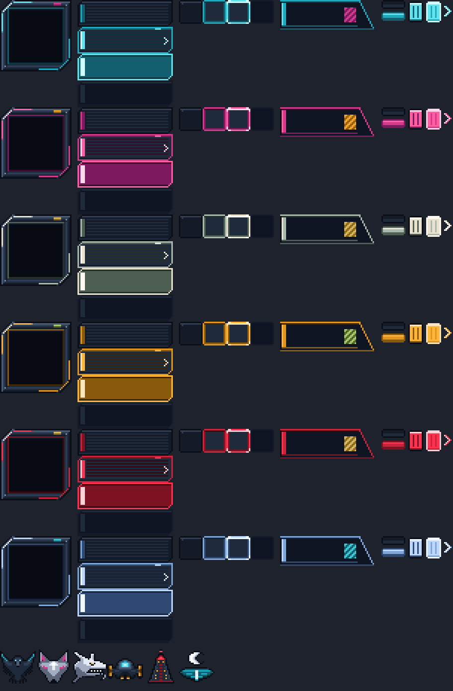
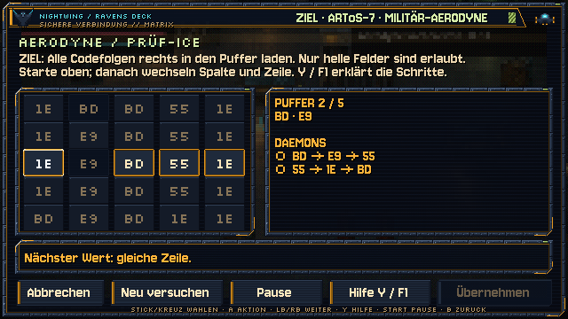
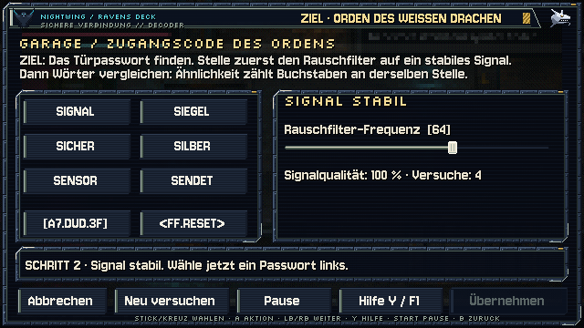
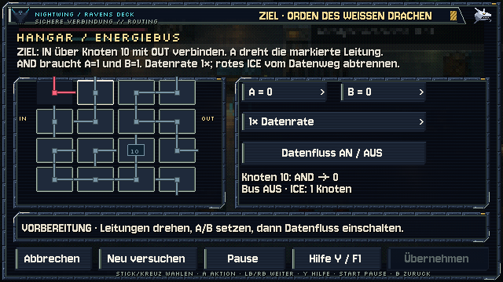
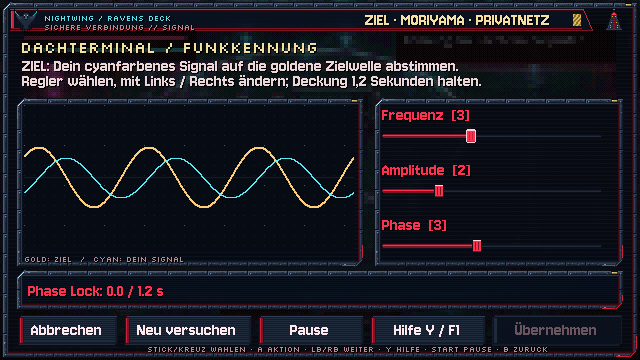
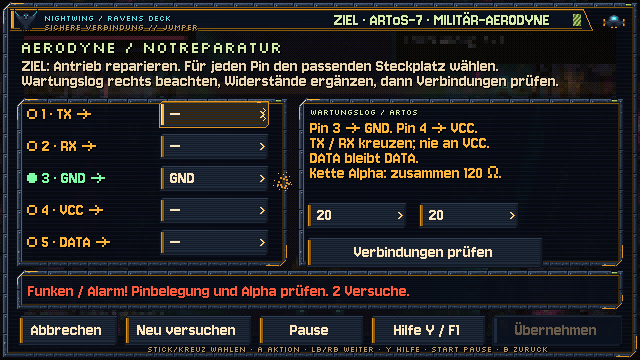
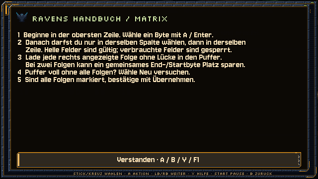
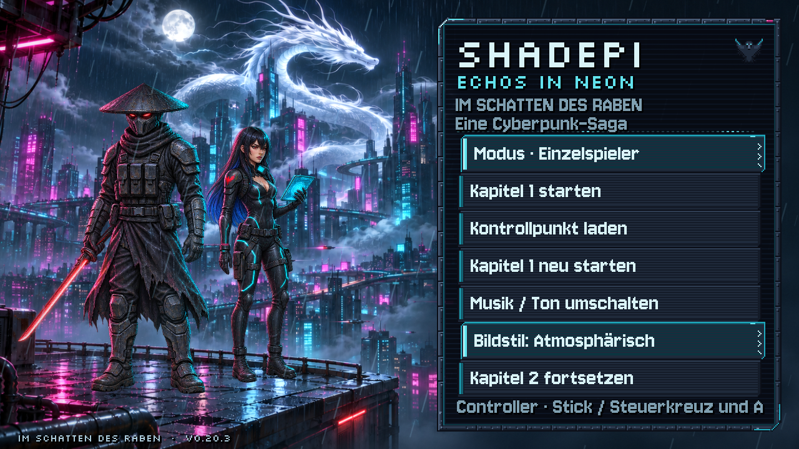

# Pixelart-Menüs und Hack-Oberflächen · v0.20.5 · ClaudeHelper

Haupt- und Pausenmenü sowie Ravens Hack-Decks verwenden Pixelart im 640×360-Spielraster. Rahmen, Knöpfe, Codezellen, Regler und Embleme wurden im Pixelwright-Studio gezeichnet (Projekt „Shadepi UI“). Vektorgrafik wird dafür nicht mehr verwendet.

## Themen

| Thema | Wo | Farben | Emblem |
|---|---|---|---|
| `raven` | Hauptmenü, Kapitel 2–3, Ravens eigenes Netz | Cyan / Magenta | Rabe |
| `jackal` | Kapitel 1, Chrome-Jackal-Schleuse | Pink / Amber | Schakal |
| `order` | Garage, Energiebus, Heiligtum | Elfenbein / Gold | Weißer Drache |
| `artos` | Hangar, Aerodyne, Notreparatur | Amber / Oliv | ARToS-7 |
| `tower` | Dach, Penthouse, Aufzug, Flucht | Rot / Gold | Moriyama-Tower |
| `lake` | Abschluss am See | Eisblau / Cyan | Mond über dem See |

Die Zuordnung steht in `scripts/ui_skin.gd` (`TERMINALS`, `CHAPTERS`) sowie in `menu_theme()` der Kapitel-HUDs.

## Bilder

| Terminal | Vorschau |
|---|---|
| Matrix (ARToS-Transponder) |  |
| Decoder (Garage des Ordens) |  |
| Routing (Hangar-Energiebus) |  |
| Signal (Moriyama-Dach) |  |
| Jumper (Aerodyne-Notreparatur) |  |
| Ravens Handbuch |  |

## Dateien und Neuaufbau

- `assets/ui/<thema>/frame.png`: 64×64-Nine-Slice mit 22 px Rand. Die Kanten kacheln alle 20 px, dadurch wiederholen sich Plattennähte und Nieten, statt zu verschmieren.
- `button.png` (normal, Fokus, gedrückt, gesperrt), `cells.png` (frei, erlaubt, Cursor, verbraucht), `header.png`, `parts.png` (Regler, Griffe, Listenpfeil) und `assets/ui/emblems.png`.
- Neu erzeugen: `python3 tools/ui_pixel/build_ui_pixel.py`. Das Skript enthält dieselben Pixelraster wie das Studio. Pro Thema tauscht es nur die Neon- und Akzentrampen.
- Schriften: `assets/fonts/ShadepiPixel.ttf` und `assets/fonts/Silkscreen-Regular.ttf`, beide unter SIL OFL 1.1.
  - „Shadepi Pixel“ basiert auf Jersey 10. Das Em ist so skaliert, dass bei Schriftgröße 20 ein Schriftpixel genau einem Bildpixel entspricht.
  - Pfeile, Haken, Kreise und Ω wurden als Pixelglyphen ergänzt.
  - Neu erzeugen mit `tools/ui_pixel/build_pixel_font.py`.
  - Größen im Spiel: Shadepi Pixel 20, Silkscreen 8 / 16 / 32.
- Alle UI-Texturen nutzen Nearest-Filterung. Ravens Decks bleiben im Spielraster. Das Hauptmenü wird in Fensterauflösung gerendert; die Pixelgrafik ist dabei ganzzahlig skaliert.
