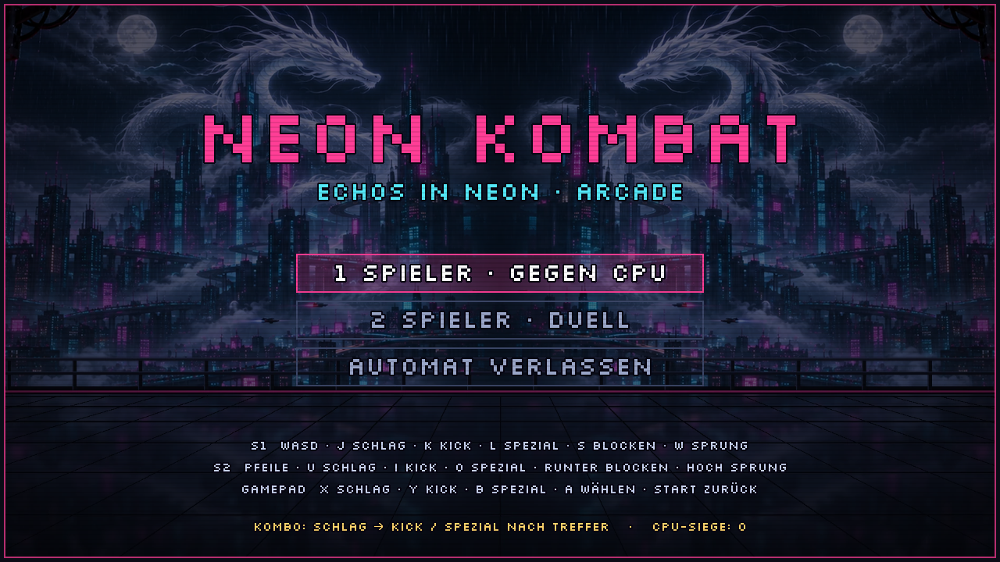
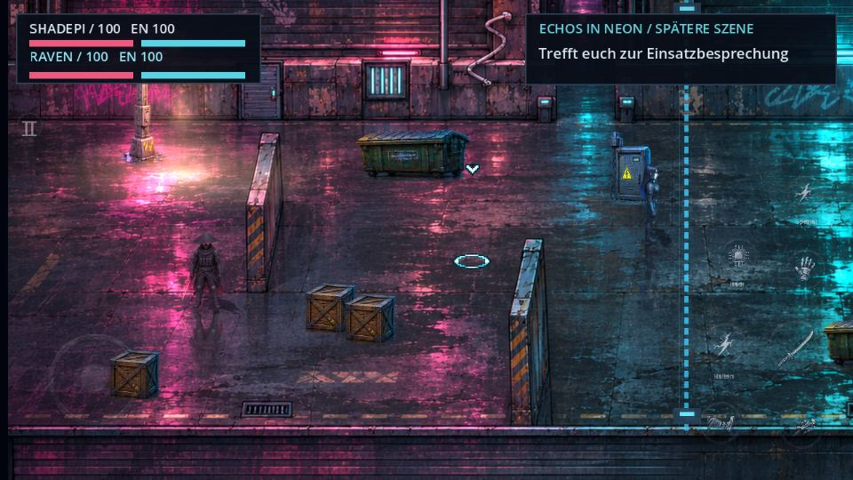

# Gesamtprojektanalyse · v0.63.0 · CodexAI

**15. November 2026. Analysierter Spielstand: [`7fb7625`](https://github.com/Inrouder/ShadepiRPG/commit/7fb76252878843e4f79c5ebb79b51c9a3a874b63).** Alle Remote-Branches abgerufen und verglichen; Main war aktuell, Arbeitskopie sauber. Auftrag ist Analyse: **Spielcode, Assets, Importkonfiguration und Versionsnummer bleiben unverändert.** Dieser Bericht samt Belegen ergänzt die Dokumentation, keine neue Spielveröffentlichung.

Das Projekt besitzt eine umfangreiche funktionierende Basis: sieben Kapitel, Erinnerungen, Tower-Ablauf, Fahrzeuge, Arcade, Koop, eigenes Grafikmaterial und viele Prüfungen. Die dringendsten Verbesserungen betreffen jetzt **WLAN-Lebenszyklus, Eingabekontexte und Plattformwechsel**. Die grünen Einzelprüfungen decken diese Kombinationen noch nicht ausreichend ab.

## Prüfumfang und Aussagegrenzen

| Bereich | Aktuelles Ergebnis |
| --- | --- |
| Bestehende CI-Prüfreihen | **50 Reihen, 4.858 Checks, 0 gemeldete Fehler**, getrennte temporäre Spielstände; keine Warnungen in diesen Reihen. |
| Repository, Verweise, Versionen, Exportgrenzen | **5.452 Checks, 0 Fehler** vor den neuen Analyseverweisen. |
| Registrierte Grafikausschnitte | **49 Atlanten, 3.272 Ausschnitte, 0 erkannte sichtbare Schnitt-/Nachbarfehler**. Das bewertet nicht automatisch Figurenästhetik oder alle Anker in jeder Szene. |
| Zusätzliche Integration | WLAN-Hostende, Zielstick, Arcade-Touch, Arcade-Abbruch/Pause, Ton-Einstellungen und mobile Host-Oberfläche separat untersucht. Mehrere bestätigte Fehler trotz grüner Basistests. |
| Native Darstellung | Hauptmenü, Arcade, Gasse, ICE-Arena, Hangar, Kenzō-Raum und See mit echtem Godot-Renderer betrachtet. Zusätzlicher Zwei-Prozess-Stream mit Touch auf beiden Instanzen: 5 bestehende native Checks bestanden, 16 Streambilder angekommen. |
| Bestand | 108 Laufzeit-GDScripts mit 20.094 Zeilen; Inventur und gezielte Prüfung von Spiellogik, Kamera/Kollision, Szenenwechsel, Darstellung, Eingaben, Speicherwegen, Audio, Netzwerk, Assets und CI. |

Vollständige [Messdaten und Prüfergebnisse](analysen/v063/ergebnisse.json), [50 Prüfläufe](analysen/v063/pruefreihen.txt), [Atlasaudit](analysen/v063/atlas-pruefung.txt). Native Aufnahmen und Messungen stammen von Linux/Mesa **llvmpipe**, also Software-Rendering. Sie sind **kein FPS-, Temperatur- oder Akkutest eines Handys**. Der Nutzer bestätigt den Android-Start und rudimentären WLAN-Koop von v0.62.0. Ein manueller vollständiger Durchgang aller sieben Kapitel auf Windows und Android wurde hier nicht ersetzt oder behauptet.

## Priorisierte Befunde

**P1** bedeutet: vor weiteren größeren Erweiterungen beheben. **P2**: nächster Stabilitäts-/Optimierungsschritt. **P3**: Ausbau und Feinschliff. „Reproduziert“ beschreibt einen gezielten tatsächlichen Ablauf; „Codebefund“ eine nachvollziehbare Implementierungseigenschaft, deren Wirkung auf Hardware noch zu prüfen ist.

| ID | Priorität | Befund | Absicherung |
| --- | --- | --- | --- |
| A1 | P1 | Clientabsturz, wenn der WLAN-Host zuerst beendet | **3 von 3 Zwei-Prozess-Versuchen**; verzögerter Callback als Kontrolle **2 von 2 ohne Absturz** |
| A2 | P1 | Arcade aus dem Hauptmenü hat auf Touch keinen nutzbaren Spielcontroller | Reproduziert, native Aufnahme |
| A3 | P1 | Touch-Belegung entspricht im Arcade-Spiel anderen Aktionen | Reproduziert: Kick bleibt wirkungslos, „Spezial“ löst schweren Angriff aus |
| A4 | P1 | Arcade-Kampf läuft nach WLAN-Trennung unter dem Pausenmenü weiter | Reproduziert: Timer 60,0 → 59,59 s bei offenem Host-Menü |
| A5 | P1 | Rechter Zielstick erreicht den WLAN-Host nicht | Reproduziert: Client rechts 0,75; Host rechts 0,0; linke Achse kommt mit 0,75 an |
| B1 | P2 | Mobile Host-Tasten werden ins Streambild eingebrannt | Rohes empfangenes JPEG mit Host-HUD gespeichert |
| B2 | P2 | Hohe Texturbelegung und frühzeitiges Laden vieler Quellen | Native Renderer-Messung: ungefähr 481–892 MiB im untersuchten Ablauf |
| B3 | P2 | WLAN-Bildaufbereitung hängt stark von der Host-Fenstergröße ab | Messung 720p/4K, synchrone CPU-Aufbereitung im Renderpfad |
| B4 | P2 | Kapitel-Speicherwege haben keine vergleichbare Austausch-/Backupstrategie wie die Demo | Codebefund; kein absichtlich beschädigter echter Nutzerstand |
| B5 | P2 | Ton-Aus bleibt beim Kapitelwechsel nicht erhalten; Stream berücksichtigt lokale Tonoption nicht | Einstellungs-/Playerzustände reproduziert; kein Hörtest |
| B6 | P2 | Android-CI benötigt einen dauerhaften Signierschlüssel für verlässliche Updates | Konfigurationsbefund; keine Installationsmessung mit zwei CI-APKs |
| C1 | P2/P3 | Zusätzliche Kombinationstests und veralteten Walk-Audit aktualisieren | Basistests grün; alter Walk-Audit wirft Indexfehler |
| C2 | P3 | Build-/Repositorykosten, Optionskomfort und Spielvariation gezielt verbessern | Bestands-/Codeanalyse und Vorschläge, keine bestätigten Spielblockaden |

## A1 · WLAN-Hostende kann den Client beenden

**Nachstellen:** zwei echte ENet-Prozesse verbinden, Client verbunden lassen, Host zuerst `close()` ausführen lassen. Unter Godot 4.7.2/Linux meldete der Client in allen drei Versuchen **Signal 11** und endete im Crashhandler mit Prozesscode `-6`. Der GDScript-Stack zeigt auf [`peer.poll()`](../scripts/network_session.gd#L113).

Der Client behandelt das Peer-Ende in [`_disconnected`](../scripts/network_session.gd#L328) und ruft dort unmittelbar `close()` auf. Der Signalaufruf geschieht während des Pollens; `close()` schließt und verwirft das Peer-Objekt. **Kontrolle:** ausschließlich im isolierten Prüfprozess wurde derselbe Disconnect-Callback mit `CONNECT_DEFERRED` angemeldet. Beide Kontrollläufe endeten normal. Der Produktionscode wurde nicht geändert.

**Empfehlung:** Verbindung erst nach Rückkehr aus dem Poll-Zyklus abbauen, etwa über ein vorgemerktes Ende oder verzögerte Callback-Ausführung. Danach Hostende, Clientende, Verbindungsverlust, Hintergrund/Rückkehr und Wiederbeitritt in die Regression aufnehmen. Die bisherigen LAN-Tests beenden überwiegend den Client zuerst und finden diesen Gegenfall deshalb nicht. Der Kontrollversuch grenzt die Ursache ein, ersetzt aber noch keinen vollständigen Produktionsfix.

## A2/A3 · Mobile Eingabe braucht einen Kontext

[`open_arcade(true)`](../scripts/main.gd#L119) lässt das darunterliegende Hauptmenü offen. [`MobileControls`](../scripts/mobile_controls.gd#L71) blendet bei `world.menu_open` seine Tasten aus. Der Automat zeichnet seine Auswahl selbst und verarbeitet Tastatur/Gamepad, keine tappbaren Auswahlbuttons. **Ergebnis:** Arcade-Titel sichtbar, Touch-HUD unsichtbar; ohne zusätzliches Eingabegerät ist dieser Einstieg nicht bedienbar.

Auch beim Einstieg aus der laufenden Welt ist die Belegung nicht deckungsgleich:

| Bildtaste im Story-HUD | Gesendetes Signal | Arcade-Verwendung |
| --- | --- | --- |
| Stiefel / Kick | LT-Achse | Vom Arcade-PAD-Schema nicht ausgewertet; im Versuch blieb der Kämpfer `idle` |
| „Spezial“ | Y | Schwerer Angriff/Kick; Versuch erzeugte `heavy` |
| Ausweichen | B | Spezialangriff |
| „Halten“ | RT-Achse | Keine entsprechende Arcade-Ladeaktion |

Quellen: [Touch-Belegung](../scripts/mobile_controls.gd#L37), [Arcade-PAD und Eingabepolling](../scripts/arcade/neon_kombat.gd#L50), [gezielte Zustandsproben](analysen/v063/arcade-faelle.txt). Bei Raven erscheint zusätzlich eine Kick-Taste, obwohl ihre Spielerklasse den Kick derzeit ausdrücklich auslässt ([Player](../scripts/player.gd#L80)).

**Empfehlung:** eine gemeinsame Eingabebeschreibung für **Story, Arcade, Fahrt/Flug, Hack und Film**. Sie bestimmt verfügbare Aktionen, Bilder, Beschriftung und Belegung. Im Arcade-Menü Navigation/Bestätigung zeigen; im Kampf Faust/Kick/Spezial/Block/Sprung. Während Filmen Weiter und bewusstes Überspringen anbieten. Nicht verfügbare Aktionen ausblenden oder eindeutig sperren. Vorhandene Tastenbelegungen und Speicherstände dabei erhalten.

Ergänzender Codebefund: [`_pad_for()`](../scripts/arcade/neon_kombat.gd#L129) sortiert die zentral zugewiesenen Geräte erneut. Aus einer bevorzugten Touch-Reihenfolge `[100, physisches Gerät 0]` wird `[0,100]`; die Touch-Eingabe wird im CPU-Modus damit nicht mehr für Spieler 1 gelesen. Auch direkte rechte-Stick-Abfragen über Gerät 100 berücksichtigen den zusätzlich zugeordneten Bluetooth-Controller nicht automatisch. Diese Hardwarekombination noch auf einem Telefon prüfen und die bereits vorhandene Gerätezuordnung konsequent benutzen.

## A4 · Gemeinsame Pause muss auch Minispiele erfassen

Bei Trennung setzt [`NetworkSession`](../scripts/network_session.gd#L328) `world.menu_open=true`. Das Hauptspiel pausiert über seine Busy-Prüfungen. Der unabhängige [`Arcade._process()`](../scripts/arcade/neon_kombat.gd#L214) wertet diesen Zustand nicht aus und aktualisiert den Kampf weiter. Im Versuch sank der Rundentimer trotz Host-Pause innerhalb von 0,4 s von 60 auf 59,59 s. Die Touch-Steuerung wurde gleichzeitig unsichtbar; das Arcade-Bild verdeckt das darunterliegende Pausenmenü.

**Empfehlung:** Sitzungspause und modale Eingabezustände zentral an die aktive Spielart weitergeben. Bei Netzverlust dürfen weder Timer noch CPU-Gegner oder Schaden weiterlaufen. Wiederaufnahme und bewusstes Verlassen getrennt behandeln; nicht versehentlich zur Titelauswahl zurücksetzen.

## A5 · Ravens Zielstick wird nicht übertragen

Die lokale Spielerklasse liest [`JOY_AXIS_RIGHT_X/Y`](../scripts/player.gd#L68). Das Netzwerkpaket und seine Verarbeitung enthalten jedoch nur linken Stick und Trigger ([Senden/Empfangen](../scripts/network_session.gd#L197)). Ein echter Client sandte Eingabeereignisse für beide Sticks: links kam am Host mit 0,75 an, rechts blieb 0,0, obwohl der Client rechts 0,75 meldete.

**Empfehlung:** beide Zielachsen in zulässige Zustände, Übertragung, Freigabe und Fokus-/Abbruchbehandlung aufnehmen. Richtungsanzeige und tatsächliche Projektilrichtung mit Controller und Touch getrennt prüfen. Ein zweiter Touch-Zielbereich oder Zielhilfe wäre anschließend eine Produktentscheidung, keine Voraussetzung für die Behebung der verlorenen Controllerachsen.

## B1/B3 · Streamdarstellung und Bildaufbereitung gemeinsam optimieren

Die Aufnahme liest das **gesamte physische Root-Fenster** ([Capture](../scripts/network_session.gd#L276)). Dadurch gelangen die lokalen Touch-Tasten eines mobilen Hosts in die JPEGs. Der Client zeichnet sein eigenes Touch-HUD darüber. Im Rohbild des Empfängers ist bereits das Host-Katana zu sehen, obwohl der Client anschließend sein Pistolensymbol auf dieselbe Stelle zeichnet.

Für die Aufbereitung wurde bei unverändertem 960×540-Ziel gemessen:

| Warmmedian, Software-Renderer | Hostfenster 1280×720 | Hostfenster 3840×2160 |
| --- | ---: | ---: |
| Bild vom Renderer lesen | 3,9 ms | 42,3 ms |
| CPU-Verkleinerung | 10,3 ms | 11,2 ms |
| JPEG erzeugen | 8,0 ms | 9,0 ms |
| Summe dieser Stufen | ca. 22 ms | ca. 62 ms |
| Komprimiertes Bild | ca. 106 kB | ca. 108 kB |

Jeweils vier Stichproben, erste Probe als Kaltlauf nicht für die Zeitmediane verwendet. Diese Werte sind kein Smartphone-Benchmark; sie zeigen hier den großen unnötigen Aufwand beim Auslesen eines 4K-Fensters für fast dieselbe Ausgabedatei. Aufbereitung erfolgt synchron im Renderablauf. Das 15-FPS-Profil allein bedeutet außerdem bereits bis zu 66,7 ms Abstand zwischen Bildern; Bildbestätigung, WLAN, Decodierung und Darstellung kommen hinzu. Die Ein-Bild-Warteschlange begrenzt Rückstau sinnvoll, begrenzt die erreichbare Bildrate aber zusätzlich durch die vollständige Bestätigungsrunde.

**Empfehlung:** begrenztes Stream-Renderziel mit Spiel und benötigtem gemeinsamem HUD; lokale Touch-/Verbindungsflächen separat zeichnen. **Eingebettete Popups müssen weiterhin übertragen werden** – ein bloßer Wechsel auf das bisherige HQ-Ziel würde diese Grenze nicht automatisch erfüllen. Encode-Zeit, empfangene FPS, Eingabelatenz und Audiopuffer sichtbar vermessen. Danach adaptive Profile beziehungsweise einen hardwaregestützten Videoencoder prüfen. Für schnelle Arcade-Duelle bleibt die heutige JPEG-Remoteplay-Grenze besonders relevant.

Tonpakete haben ebenfalls noch keine gemeinsame Bild-/Ton-Zeitbasis oder gezielte Jitterregelung. Hörbare Aussetzer wurden hier nicht gemessen; dafür ist ein Test mit realen Audiotreibern und gestörtem WLAN erforderlich.

## B2 · Texturspeicher und Startlast senken

Native Renderer-Zähler im selben untersuchten Ablauf:

| Zustand | Gemeldeter Texturspeicher |
| --- | ---: |
| Hauptmenü | 481 MiB |
| Nach Öffnen des Automaten | 619 MiB |
| Gasse, HQ | 490 MiB |
| Gasse, klassischer Modus | 468 MiB |
| ICE-Arena | 522 MiB |
| Späterer Kampagnen-/Hangarabschnitt | 892 MiB |

Das ist **kein gemessener Android-RAM-Verbrauch und kein bewiesenes Speicherleck**. Die Werte umfassen Renderer-Texturen und Renderziele; gecachte Ressourcen unterscheiden sich über den Ablauf. Der klassische Modus spart hier nur einen kleinen Teil des Texturvolumens.

Der [Painted-Weltrenderer](../scripts/painted_world.gd#L16) lädt bereits 22 Bildquellen direkt vor; deren rohe RGBA-Größen summieren sich auf etwa 128 MiB. Die normalen 1024×5120-Helden-/Gegneratlanten entsprechen jeweils 20 MiB RGBA. Viele aktive Imports stehen auf **Lossless / `vram_texture=false`**, beispielsweise [Raven](../assets/sprites/heroes/raven.png.import) und [Industrie](../assets/world/painted/industry.png.import). Die globale ETC2/ASTC-Importfreigabe stellt diese Texturen nicht selbst auf VRAM-Kompression um.

**Empfehlung:** Assets nach Abschnitt laden und nachvollziehbar freigeben, lange Szenenwechsel vorladen, Textur-/Spitzenlastbudgets auf den tatsächlichen Zielgeräten festlegen. Geeignete große Kulissen mit passenden Desktop-/Android-Importprofilen vergleichen. Transparenz, Pixelcluster und Bildqualität der Figuren separat abnehmen. Die HQ-Originale bleiben die Quellen; weitere reine Vergrößerungen liefern keine zusätzlichen gezeichneten Details. Maximale Atlasgrößen und Speicher auch auf schwächeren vorgesehenen GPUs prüfen.

## B4 · Kapiteldateien gegen unterbrochenes Schreiben absichern

Die Demo verwendet bereits einen sorgfältigen [JSON-Speicherdienst](../scripts/save_service.gd#L41) mit temporärer Datei, Backup und Wiederherstellung. Die tatsächlichen Kapitel verwenden dagegen direkte `ConfigFile.save()`-Aufrufe: [Kapitel 1](../scripts/chapter_one.gd#L764), [Kapitel 2](../scripts/chapter_two.gd#L766), [Kampagne](../scripts/campaign.gd#L1100). Ein entsprechender Backup-Lesepfad fehlt dort.

Das ist ein **Ausfallrisiko**, kein Nachweis eines verlorenen Nutzerstands. Gerade App-Beenden, Speicherknappheit und unterbrochene Autosaves sollen den letzten gültigen Fortschritt erhalten.

**Empfehlung:** gemeinsame transaktionale Speicherung auch für CFG-Kapitelstände, letzte gültige Sicherung, klare Formatversion und geprüfte Migration. Bestehende Enum-Werte, gemeinsame Kapitel-2–7-Dateien und getrennte Solo-/Koop-Felder in Kapitel 1 erhalten. Neuesten Kontrollpunkt nicht ausschließlich gegenüber Uhrzeitänderungen ungeschützt auswählen.

## B5 · Audioeinstellungen gelten bislang nicht für die ganze Sitzung

Zusätzliche Zustandsprobe: Kapitel 1 auf Ton-Aus geschaltet, dann Kapitel 2 erzeugt. Ergebnis **`false → true`**. [`audio_on`](../scripts/main.gd#L42) startet je Welt neu; [`toggle_audio`](../scripts/main.gd#L1289) speichert diese Wahl nicht zentral. Außerdem spielt der [Netzwerk-Audioplayer](../scripts/network_session.gd#L309) bei lokalem `audio_on=false` weiter (`playing=true`, `stream_paused=false`). Das bestätigt die Zustandslücke, ist kein akustischer Test auf einem Telefon.

**Empfehlung:** sitzungs-/geräteübergreifend eindeutige Audioeinstellung mit separaten lokalen Lautstärken für Musik, Effekte und Remote-Ton. Kapitelwechsel behalten die Wahl. Unterschiedliche Musikstücke vor einer pauschalen Pegeländerung tatsächlich hören beziehungsweise messen. Ein isolierter Dummy-Audiotest meldete beim Abbau eine Objektwarnung; daraus wurde kein allgemeines Laufzeitleck abgeleitet.

## B6 · Android-Updates und Auslieferung vereinheitlichen

Die [CI](../.github/workflows/build.yml#L333) baut auf frischen Runnern eine Debug-APK. Das [Buildskript](../tools/android/build.sh) konfiguriert SDK/Java, aber keinen dauerhaften Signierschlüssel; ein Keystore-Cache oder gesicherter Release-Schlüssel ist im Workflow nicht eingerichtet. Bei neu erzeugtem Schlüssel stimmt das Android-Zertifikat nicht mehr mit einer älteren Installation überein. Versionscode 6300 allein reicht dann für ein Update nicht aus. Die lokale wiederverwendete Entwicklungsumgebung kann dagegen denselben Schlüssel behalten.

**Empfehlung:** feste Test-/Release-Signatur außerhalb des Git verwalten und ein Update **über einer vorhandenen Installation mit erhaltenem Fortschritt** prüfen. Für öffentliche Android-Verteilung anschließend ARM64-Paket/AAB und einen ausdrücklich getrennten Emulator-Build anbieten. Die bisherige universelle Test-APK enthält rund 52 MiB komprimierte Bibliotheken beider Architekturen; Texturdateien dominieren mit rund 146 MiB weiterhin die Größe. Der bestehende Release-Job veröffentlicht Android noch nicht, nur Windows/Linux und Projekt-ZIP. Das ist bislang als Test-Artefakt dokumentiert und sollte vor einer regulären Android-Veröffentlichung angepasst werden.

## C1/C2 · Absicherung, Wartung und Spielfluss

- **Testkombinationen erweitern:** Hauptmenü → Arcade auf Touch, Arcade + WLAN-Abbruch, Host beendet zuerst, rechter Zielstick, mobile Hosts, Bluetooth plus Touch, Hintergrund/Rückkehr und Kapitelwechsel mit Ton-Aus. Die 50 vorhandenen Prüfreihen sind wertvoll; ihre grünen Ergebnisse sagen bisher wenig über diese Kombinationen aus.
- **Älteren Walk-Audit aktualisieren:** [`tools/story/walk_audit.gd`](../tools/story/walk_audit.gd) passt nicht mehr zu allen aktuellen Punktfolgen; er erzeugte Indexfehler in `campaign._complete_point()` und sechs Kollisionshinweise. [Protokoll](analysen/v063/alter-walk-audit.txt). **Diese Hinweise wurden nicht als sechs bestätigte Clippingfehler gewertet**, weil das Werkzeug Szenenpunkte erzwingt und nach den Fehlern keine verlässliche aktuelle Abnahme liefert. Neue Durchgänge/Überblendungen korrekt mitspielen lassen und sichtbare Kollisionen nachstellen.
- **Daten-/Zustandsgrenzen bündeln:** `campaign.gd` hat 1.677 Zeilen, `main.gd` 1.334, `hud.gd` 860. Eingabekontext, Sitzungspause, Einstellungen und Speicherdienst sind sinnvolle gemeinsame Schnittstellen. In kleinen geprüften Schritten auslagern, bestehenden Fortschritt erhalten.
- **CI-Aufwand reduzieren:** Die versionierten Dateien enthalten rund 245,5 MiB Dokumentation, 212,3 MiB Assets und 41,8 MiB Tools. Der Workflow lädt Exporttemplates und baut alle Plattformen auch bei reinen Doku-Pushes neu. Doc-/Linkprüfung getrennt vom Spielbuild, Template-/Importcache mit Versionsschlüssel und klar benannte Artefakte verbessern den Arbeitsablauf. Historische Belege behalten und große Medien bewusst verwalten; keine Quellen ungeprüft löschen.
- **Mobile Optionen ausbauen:** Position/Größe/Deckkraft des HUDs, Linkshänder-Preset, Belegungsübersicht und pro Kontext verständliche Hinweise. Das sind Komfortvorschläge, keine nachgewiesenen Ausfälle jedes Telefons. Lokale Rolle und aktive Spielart auch an den Client melden, damit Bilder und verfügbare Aktionen stimmen.
- **Spielvariation und Balance testen:** Zehn Arcade-Figuren verwenden derzeit vier Spezialfamilien und gemeinsame Grundfenster. Charaktereigene Signaturen, besser lesbare gegnerische Ankündigungen und ergänzende Aufgaben zwischen verlängerten Wellen können die zusätzliche Spielzeit abwechslungsreicher machen. Kampfdauer, nötige Wiederholungen, Pausen und Gegnerpfade in tatsächlichen Spielversuchen erfassen; hier wurde keine neue Balance behauptet.
- **Grafikpflege gezielt halten:** Der Atlasaudit fand keine sichtbaren Schnittfehler. Die verbindlichen Originalhelden, registrierten Kontaktposen und bestehenden Pixelquellen bleiben die Referenz. Weitere Arbeit gilt konkreten Anker-/Übergangsproblemen aus Sichtprüfungen und den gemessenen Ressourcenlasten. Die bestehende [Stilbibel](stilbibel/README.md) und die [Touch-Aufnahmen](touch-hud-v063.md) sind gute Grundlagen.

## Empfohlene Umsetzungsreihenfolge

| Block | Inhalt | Fertig, wenn … |
| --- | --- | --- |
| **1 · Betriebsfehler** | A1–A5: Disconnect-Lebenszyklus, Touch-Arcade-Einstieg, gemeinsame Pause, korrekte Aktionskontexte und Zielachsen | beide Endrichtungen ohne Absturz, Arcade vollständig per Touch, Pause stoppt Runde/Schaden, Raven kann über WLAN zielen |
| **2 · Verlässlichkeit** | B4–B6: Speicherdateien, Audioeinstellung, dauerhafte Android-Signatur; passende Regressionstests | gültiger Stand überlebt Schreibfehler, Tonwahl bleibt erhalten, APK aktualisiert bestehende Installation mit Fortschritt |
| **3 · Leistung** | B1–B3: getrennte lokale Overlays, begrenzte Streamaufnahme, Asset-/Texturbudgets, reale Geräteprofile | passende Bilder pro Gerät, gemessene Latenz/FPS, begrenzte Start-/Spitzenlast auf vereinbarten Zielgeräten |
| **4 · Spielgefühl und Feinschliff** | individuelle Moves/Begegnungen, HUD-Anpassbarkeit, geprüfte Szenenpfade und kleinere Dienste | spürbarer Mehrwert aus Spieltests und stabile bestehende Story-/Grafikverträge |

Der erste Block schafft eine stabile Grundlage für die nächsten Erweiterungen. Danach lässt sich Leistungsarbeit mit den neuen Messpunkten überprüfbar bewerten. **Die gefundenen Spielprobleme sind in diesem Analyseauftrag noch nicht behoben.**
