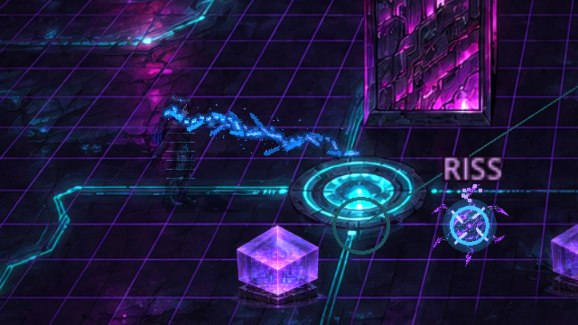
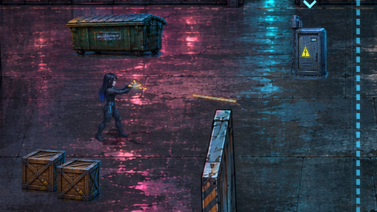
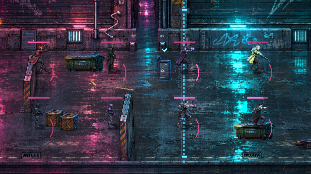
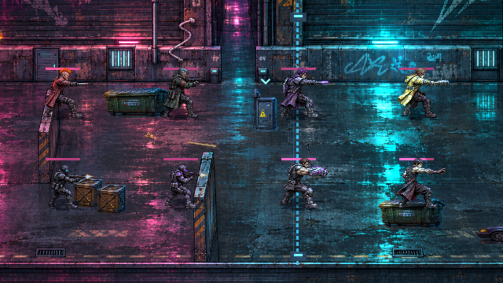
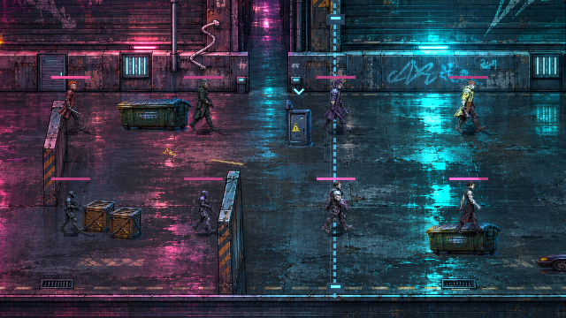

# Ravens Angriffe und Gegnerkampf · v0.21.0 · CodexAI

## Handblitze und Pistole

Im **Deep Dive** nutzt Raven eine eigene offene Handpose. Der Blitz startet am vermessenen Leuchtpunkt der Handfläche, nicht am Boden oder am Figurenmittelpunkt. Ausholen, Freigabe und Nachbewegung besitzen eigene HQ-Pixelposen für alle acht Blickrichtungen. Der normale Impuls und der aufgeladene Angriff verwenden dieselbe Handzuordnung. Verzweigte, animierte Pixelpakete und ein elektrisches Geräusch unterscheiden sie vom Schuss.

Außerhalb des Netzes feuert Raven aus der **Pistole**. Der Austritt folgt den Mündungskoordinaten der acht vorhandenen Schussposen und der tatsächlichen Sprite-Transformation. Kurzes warmes Mündungsfeuer, ein schneller Geschossstreifen und ein eigenes Schussgeräusch ersetzen den bisherigen Technikstrahl. Der aufgeladene Pistolenschuss startet ebenfalls an der Mündung. Ausgetretene Geschosse bleiben in Weltkoordinaten; sie kleben nicht nachträglich an der laufenden Figur.

Die vorhandenen Tasten und Controllerbelegungen bleiben erhalten: normaler Angriff J/X bzw. Maus, aufgeladener Angriff K/RT bzw. die Koop-Belegung. Schaden, Energiekosten, Kollisionsprüfung gegen Wände/Requisiten, Verwundbarkeitsfenster und ICE-Wellen bleiben wirksam. Die sichtbaren Effekte besitzen eigene Renderkoordinaten; die Kampfregeln arbeiten weiter mit den Bodenkoordinaten.

## Gegneranimationen

[Animierte Gegner-Vorschau öffnen](previews/gegner-kampf.webp)

Alle vier Punktypen, beide Schützen, Chrome Jackal und Kenzō besitzen neue Kontaktposen in acht Richtungen. Das vorhandene Ausholbild wird nun vor dem Treffer gezeigt. Zur Trefferphase wechselt die Grafik auf die ausgestreckte Schlag-/Schusspose; anschließend sinken Arm bzw. Waffe sichtbar zurück. Während dieses Ablaufs bleibt die Blickrichtung gebunden, die Erholungsphase gleitet nicht als Laufanimation weiter. Schützen haben weiterhin ihre Fernkampfmechanik, Nahkämpfer ihren bestehenden Ausfallschritt.

Treffer und Hacks unterbrechen die Sequenz. Reset und Kontrollpunkt-Wiederherstellung setzen Atlas, Schatten und Pose zurück. Beim Sterben bleibt die vorhandene Fallbewegung erhalten, ergänzt um den Sterbelaut; der Trefferblitz wird beendet, damit der Körper nicht weiß eingefroren bleibt. Eigene NPC-Ersatzgrafiken werden nicht durch die neuen Kontaktbilder ersetzt.

## Sounds

[Hörprobe: Pistole, Elektrizität, Anstrengung, Schmerz und Sterben](previews/combat-sounds.wav)

Die WAV-Dateien sind eigene Synthesen ohne fremde Aufnahmen oder imitierte Personen. Es gibt zwei Anstrengungslaute, drei kurze Schmerzvarianten und drei längere, ausatmende Sterbelaute. Die Stimmen verwenden einen eigenen Vier-Kanal-Pool, leichte Tonhöhenvariation und tiefere Boss-Stimmen. Schnelle Folgetreffer stapeln nicht bei jedem Treffer ein neues Stöhnen; ein tödlicher Treffer darf den Schutz übergehen. Tote Gegner wiederholen ihren Laut nicht. Der globale Ton-Schalter stoppt auch diese Stimmen. Allgemeine Explosionstöne werden nicht mehr über jeden menschlichen Tod gelegt; zerstörte Requisiten behalten ihre eigenen Geräusche.

Die Klangcharakteristik ist bewusst synthetisch/cybernetisch. Hörprobe und Dateien erlauben eine klangliche Beurteilung im Browser; die automatisierte Prüfung kontrolliert Ladefähigkeit, Dauer, Pegel und Auslöselogik.

## Quellen und Prüfung

- `assets/sprites/npcs/contact-poses.png`: neue 8×8-Kontakttafel anhand der vorhandenen NPC-Galerie und Original-Keyframes, mit konsistenten Haarfarben, Rüstung und Ausrüstung.
- `assets/sprites/heroes/raven-hand-cast.png`: neue 8×4-Handzaubertafel nach Ravens vorhandener Figur und archivierten Merkmalen: schwarz-blaue Haare, rote Augen, Cyan-Anzuglinien, rote Schulterembleme und 160 cm Körpergröße.
- Die Originalatlanten bleiben erhalten. HQ-Pixel-Texturen für Blitze, Geschosse und Mündungsfeuer stehen in `assets/fx/`; sie werden verlustfrei und ohne Weichzeichner verwendet.
- `tools/measure_combat_anchors.py` liest Alpha- und Farbwerte und schreibt Regionen, Fuß- und Handanker in JSON; es verändert keine Bilddatei. Die Exportprofile schließen beide JSON-Dateien ausdrücklich ein.
- `tools/generate_combat_fx.gd` erstellt die Pixel-FX aus gestuften Kernen, Verzweigungen und Palettenfarben. `tools/generate_combat_audio.py` erzeugt die eigenen WAVs reproduzierbar.
- `tests/raven_enemy_combat.gd` prüft die acht Richtungen, getrennte Hand-/Mündungsanker, Kontakt-/Erholungsposen aller NPC-Typen, Unterbrechung, Reset, Stimmen und wiederholte Todesereignisse.
- `tools/raven_enemy_gallery.gd -- --animate` rendert die oben verlinkten tatsächlichen Engine-Ansichten und Animationsbilder. Die GitHub-Prüfung führt die neuen Kampfprüfungen zusätzlich aus.

Geprüfter Stand: **1.517 Prüfungen in neun Prüfreihen**, darunter 292 gezielte Kampfprüfungen. Zusätzlich wurde ein Godot-Exportpaket erstellt und daraus Ankerdaten, Grafiken, Sounds und eine Gegnerszene erfolgreich geladen.
