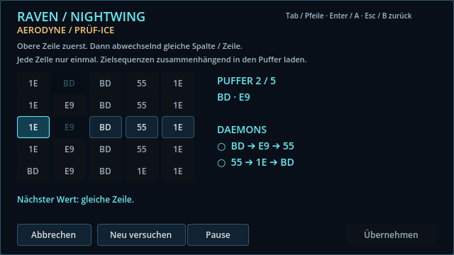
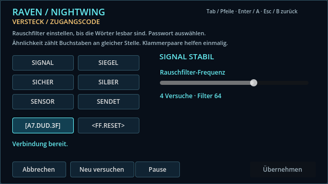
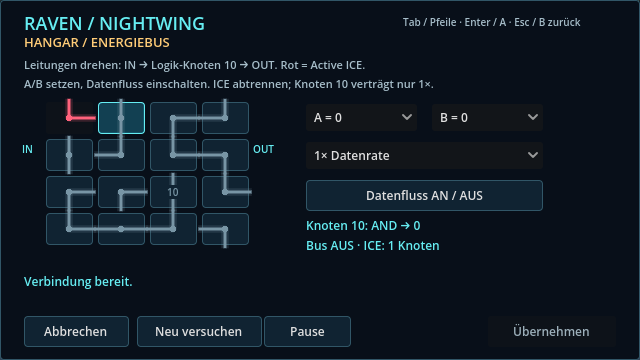
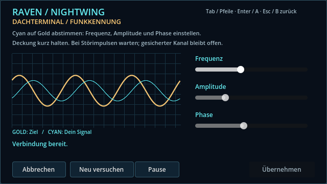
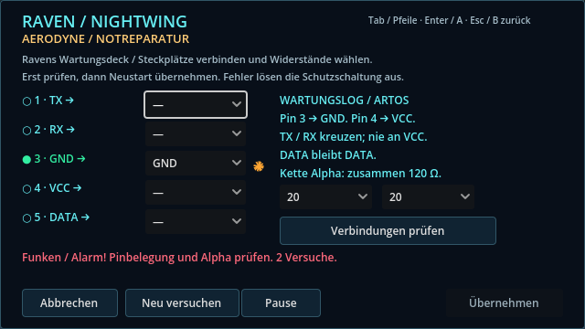

# Ravens Terminal-Mechaniken

Raven löst Technikaufgaben über ihr Nightwing-Deck. Das Betreten eines Markers öffnet keine Tür mehr automatisch: am Ziel **E / A** drücken, Aufgabe lösen und **Übernehmen** wählen. Im Anflug öffnet sich die Reparaturkonsole beim Triebwerksausfall automatisch; nach einem Abbruch öffnet **J / X** sie erneut.

| Ort | Aufgabe | Ergebnis |
|---|---|---|
| Kapitel 1, Chrome Jackals Schleuse | Hex-Matrix nach allen Wellen und der Spurensuche | Tor zum ersten Duell öffnen |
| Kapitel 4, Garagenzugang | Rauschfilter und Passwort-Decoder | Zugang zum Hangar freigeben |
| Kapitel 4, Hangar-Stromversorgung | Leitungsnetz mit AND-Knoten und Active ICE | Energieversorgung herstellen |
| Kapitel 4, Transponderprüfung | Zwei überlappende Matrix-Sequenzen | Prüf-ICE umgehen |
| Kapitel 6, Aerodyne-Notfall | Jumper und Widerstandskette | Triebwerk neu starten |
| Kapitel 6, Dachterminal | Wellen-Synchronisation | Funkkennung bestätigen |
| Kapitel 6, Penthouse-Tür | Passwort-Decoder | Zugang öffnen |
| Kapitel 6, Aufzug während der Flucht | Wellen-Synchronisation mit Phasendrift | Fiktive Sperrladung scharf stellen und Aufzug blockieren |

## Steuerung und Kontrollpunkte

- **Maus**, **Tab / Umschalt+Tab** oder **Pfeile / Steuerkreuz / Stick** wählen Bedienelemente. **Enter / A** bestätigt; **Links/Rechts** verändert einen fokussierten Regler.
- **Esc / B** oder **Abbrechen** schließt ohne Fortschritt. **P / Start** oder **Pause** friert auch die Terminal-Timer ein.
- **Neu versuchen** setzt nur das aktuelle Rätsel zurück. **Übernehmen** wird erst nach Erfolg aktiv und erhält dann automatisch den Fokus.
- Während der Konsole pausieren Bewegung, Kämpfe, Fluchttimer und Flugnotfall. Die ICE-Ausbreitung und Signalstörungen laufen innerhalb des Terminals weiter, solange es nicht pausiert ist.
- Abgeschlossene Kampagnen-Terminals bleiben beim Speichern/Laden und nach einer Niederlage erledigt. Ein laufendes Rätsel beginnt nach Abbruch erneut. In Kapitel 1 gehört der Tor-Hack zum Jagd-Kontrollpunkt und wird bei dessen Wiederherstellung wiederholt.
- Beim Flugnotfall bleibt nach Abbruch ein separates Fenster von 45 Sekunden zum erneuten Öffnen. Der reguläre Anflug und das Scannerfenster laufen erst nach Reparatur weiter. **Q / RB** sendet weiterhin die Kennung im Scannerfenster.

## Die fünf Rätseltypen

**Matrix:** In der obersten Zeile beginnen, anschließend abwechselnd in derselben Spalte und Zeile wählen. Zellen dürfen nur einmal benutzt werden. Jeder Daemon muss als zusammenhängende Folge im begrenzten Puffer stehen. Die Transponderprüfung verlangt zwei Folgen mit gemeinsamem Byte; beide passen zusammen in fünf Plätze.



**Decoder:** Den Rauschfilter abstimmen, bis die flackernden Wörter stabil werden. Sechs gleich lange Kandidaten, vier Versuche; die Rückmeldung zählt gleiche Buchstaben an gleicher Position. `[DUD]` entfernt einen falschen Kandidaten, `<RESET>` stellt Versuche wieder her. Beide Hilfen sind je Sitzung einmal nutzbar. Bei gesperrter Sitzung neu verbinden.



**Schaltungsnetz:** Leitungen drehen, um IN über Logik-Knoten 10 mit OUT zu verbinden. Der Hangar verwendet ein AND-Gatter: A und B müssen aktiv sein. Den Datenfluss einschalten und drei Sekunden stabil halten. Knoten 10 verträgt nur Datenrate 1×; 2× verursacht Überlast. Rote ICE breitet sich alle 1,4 Sekunden entlang tatsächlich verbundener Leitungen aus. Abgetrennte Netze bleiben isoliert; Kontakt zum aktiven Bus führt zum Fehlversuch. Leitungen können bei aktivem Strom umgestellt werden.



**Signalabgleich:** Die cyanfarbene Spielerwelle durch Frequenz, Amplitude und Phase auf die goldene Zielwelle abstimmen. 1,2 Sekunden Überlagerung ergeben Phase Lock. Periodische Störimpulse unterbrechen den Lock; bei der Sperrladung verschiebt sich zusätzlich die Zielphase alle zwölf Sekunden.



**Jumper:** Fünf beschriftete Pins gemäß Wartungslog verbinden, TX/RX kreuzen und für Kette Alpha zwei Widerstände mit insgesamt 120 Ω wählen. Die Prüfung zeigt korrekte Pins als grüne LEDs; falsche Verbindungen lösen Funken und einen Alarmton aus. Nach drei Fehlversuchen die Platine zurücksetzen. Mehrere Widerstandskombinationen sind gültig.



## Entwicklung und Prüfung

`scripts/terminal_puzzle.gd` enthält die Regeln und den Einsatzkatalog, `terminal_ui.gd` das modale Interface. Die Wellen, Leitungen und Funken werden direkt in Godot gezeichnet; es werden keine vorhandenen HQ-Figuren ersetzt. Die Logik-Auswertung unterstützt AND, OR, XOR und NOT; der aktuelle Hangar nutzt AND.

Die Welt übernimmt Ergebnisse ausschließlich nach erfolgreicher Bestätigung. Veraltete Callbacks nach einem Szenenwechsel und doppelte Bestätigungen werden verworfen. Alte Kampagnenspielstände ohne Terminal-Fortschritt bleiben lesbar.

```sh
godot --headless --script res://tests/terminal_puzzles.gd
godot --headless --script res://tests/drive_action.gd
godot --headless --script res://tests/arcade_waves.gd
godot --headless --script res://tests/run.gd
```

`tools/terminal_gallery.gd` erzeugt die obigen Bilder mit echtem Godot-Rendering und benötigt ein Display. Die Terminal-Tests prüfen Lösbarkeit, ungültige Züge, Puffer, Hilfen, Gatter, Überlast, ICE, Phasendrift, Pin-/Widerstandsbedingungen sowie Abbruch, Pause, Speichern und Story-Fortschritt. Der GitHub-Build führt sie automatisch aus.
