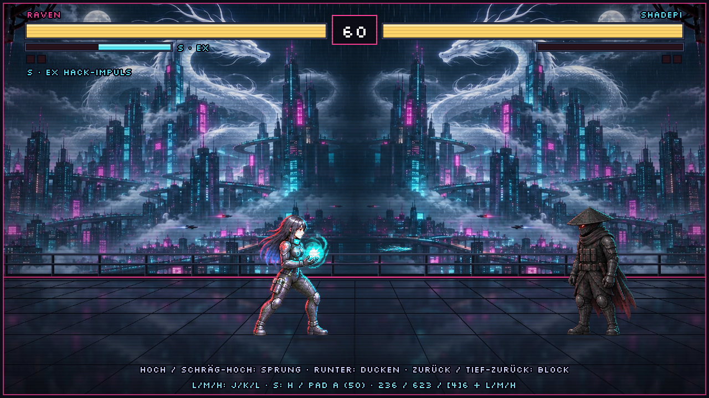
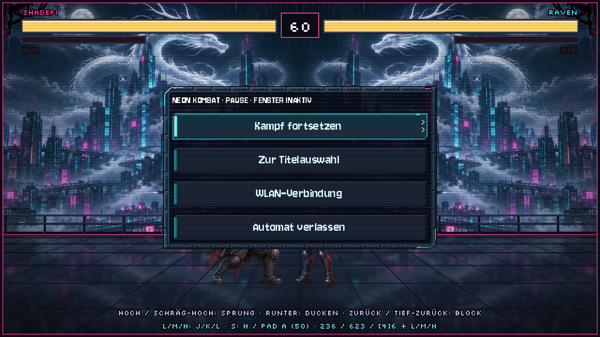

# Fehlerkorrekturen und Release · v0.67.1 · CodexAI

**20. November 2026.** [Änderungen](../CHANGELOG.md) · [Anleitung](../Spiel-README.md) · [GitHub-Releases](https://github.com/Inrouder/ShadepiRPG/releases) · [Prüfnachweis](pruefungen/v0671/ergebnisse.json).

**Veröffentlicht:** [v0.67.1 · CodexAI mit allen fünf Anhängen](https://github.com/Inrouder/ShadepiRPG/releases/tag/v0.67.1). [GitHub-Test-/Release-Lauf erfolgreich](https://github.com/Inrouder/ShadepiRPG/actions/runs/44800932004), alle Download-Header HTTP 200, Prüfsummendatei vollständig und „latest“ korrekt. [Veröffentlichungsnachweis](pruefungen/v0671/veroeffentlichung.json). Die Anhänge wurden für diese Erreichbarkeitsprüfung nicht vollständig erneut heruntergeladen/gehasht.

Der letzte öffentliche Download war v0.60.3; main und sämtliche Remote-Branches wurden erneut verglichen. v0.67.1 bündelt die zwischenzeitlichen HQ-Arcade-, Android-/WLAN-, Touch-, Fahrzeug- und Flugszenen-Verbesserungen mit drei reproduzierten Fehlerkorrekturen. Die ursprünglichen Figuren-/Weltquellen, Story und Spielstände bleiben erhalten.

**macOS-Nachtrag · v0.67.1 · CodexAI:** [Universal-ZIP, Startanleitung und eigener Nachweis](macos-v0671.md) ergänzen den ursprünglichen Release. Der ursprüngliche Fünf-Anhänge-Nachweis oben beschreibt den Stand vor diesem Nachtrag.

## Behobene Fehler

| Nachstellung im alten Stand | Korrektur |
| --- | --- |
| Ein einzelnes 250-ms-Bild überspringt den kurzen aktiven Zeitraum eines Light-Angriffs; Ravens Schuss wird trotz abgezogener EX-Energie nicht erzeugt. | Kampfsimulation in Schritten von höchstens 1/60 s, frische Buttons nur im ersten Schritt. Schläge und Emission werden nicht übersprungen; derselbe Button kostet nicht mehrfach Energie. |
| Eine neue Partie/Runde übernimmt den alten CPU-Lauf-/Blockplan. | Bewegungs-, Block-, Sprung- und Befehlsplan beim Rundenstart gemeinsam zurücksetzen. |
| Beim Verlassen des Fensters/Wechsel in den App-Hintergrund bleibt der Arcade-Kampf aktiv. | Fokusverlust und App-Unterbrechung öffnen das vorhandene Pausenmenü. Zeit, Schaden und CPU stehen; bewusstes Fortsetzen erforderlich. |

Die Simulation holt höchstens 250 ms je Bild nach. Ein langer Systemstillstand führt damit nicht zu mehreren Sekunden unsichtbaren Kampfes. Sprungbögen, Richtungsbefehle, Charge-Haltezeiten und Trefferpausen durchlaufen dieselben kleinen Zeitschritte.

Neue native Linux-PNGs in 1280×720. Die Unterbrechung wurde programmgesteuert als Godot-Anwendungsbenachrichtigung ausgelöst; keine Aufnahme eines physischen Android-Geräts. [Kampffilm aus v0.67.0](previews/arcade-inputs-v067.webp) zeigt die weiterverwendeten unveränderten HQ-Posen und klassischen Eingaben; der Film ist kein neuer Timing-Nachweis. [Bedienung](arcade-inputs-v067.md).

## Release-Pakete

| Datei | Verwendung |
| --- | --- |
| `ShadepiRPG-Windows.zip` | Vollständig entpacken, EXE starten. |
| `ShadepiRPG-Linux.zip` | Vollständig entpacken, ausführbare x86_64-Datei starten. |
| `ShadepiRPG-Android-Test.apk` | Android-Testfassung, weiterhin keine Store-Veröffentlichung. |
| `ShadepiRPG-Godot-Projekt.zip` | Vollständiger versionierter Godot-Projektstand. |
| `SHA256SUMS.txt` | SHA-256-Prüfsummen der vier vorgenannten Downloads. |

Der vorhandene GitHub-Actions-Ablauf baut und prüft vor der Veröffentlichung. Der Release-Job lädt jetzt auch Android, ergänzt Prüfsummen und übernimmt ausschließlich den passenden versionsbezogenen Changelog-Eintrag mit CodexAI. Tag und Projektversion müssen übereinstimmen. Ein finaler Commit mit `[release]` vermeidet den doppelten Main-Build; der zugehörige Tag startet den vollständigen Test-/Release-Lauf. Andere Main-/PR-/manuelle Läufe bleiben aktiv. Signaturverwaltung bleibt nach Nutzerwunsch außerhalb dieser Arbeit.

## Abnahme

**Ergebnis vor dem Release-Tag:** 55 Headless-Prüfreihen mit **5.034 Checks** ohne Fehler; zusätzlich 11 native Checks. Android-/Windows-/Linux-Export erfolgreich, Linux-Paket gestartet, APK-Version 0.67.1 / Code 6701 kontrolliert.

Die neue Nachstellung meldete im unveränderten v0.67.0 fünf Fehler bei acht Checks; nach der Korrektur wurden weitere Randfälle ergänzt. [Automatisierte Ergebnisse und lokale Paketnachweise](pruefungen/v0671/ergebnisse.json) · [Konsistenz-/Arbeitsnachweis](arbeiten/release-v0671.md).

Windows-/Android-Export und native Linux-Prüfung ersetzen keine physische Geräteabnahme. Die lokal dokumentierten Paketfingerabdrücke gehören zu den lokalen QA-Builds; die veröffentlichten Pakete besitzen ihre eigenen im Release mitgelieferten Prüfsummen. Cloud-Umgebung und App-Stores werden durch diesen GitHub-Release-Auftrag nicht veröffentlicht.
