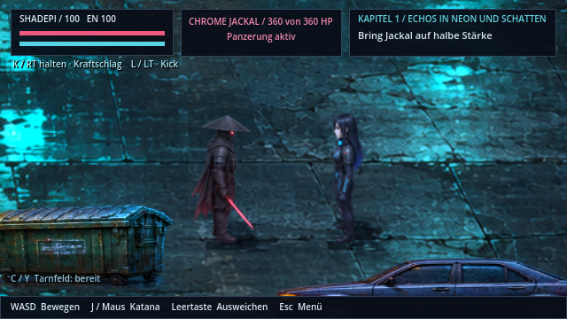

# Repository-Status und Orientierung

**v0.46.2 · CodexAI · 9. November 2026.** [Startseite](../README.md) · [Asset-Katalog](../assets/README.md) · [Werkzeuge](../tools/README.md) · [Entwicklungsarchiv](archiv/README.md).

## Was ist maßgeblich?

1. Aktuelle ausdrückliche Nutzerentscheidungen, [AGENTS](../AGENTS.md) und [KONSISTENZ](../KONSISTENZ.md).
2. [Spieleranleitung](../Spiel-README.md), [Architektur](architecture.md) und bebilderte [Stilbibel](stilbibel/README.md) für den gegenwärtigen Stand.
3. Aktive Ressourcen und tatsächlicher Code. Versionsbezogene Berichte erklären einzelne Arbeiten; sie überschreiben keinen neueren Stand.

| Status | Bedeutung | Verwendung |
| --- | --- | --- |
| **Aktiv** | Im Spiel oder im aktuellen Entwicklungsablauf verwendet. | Bestehendes Verhalten und Quellen erhalten. |
| **Referenz** | Historisches Vergleichsbild, das etwa eine Vorher-Galerie bewusst öffnet. | Kein Ersatz für aktive Grafik; nicht im Spieleexport. |
| **Backup** | Gewünschte unveränderte Sicherung. | Im Git erhalten, nicht als Spielressource laden oder ausliefern. |
| **Verworfen** | Durch Nutzerentscheidung ersetzt oder abgelehnt. | Nicht automatisch reaktivieren. Quelle und Grund bleiben nachvollziehbar. |
| **Historisch** | Früherer Ablauf, Entwicklungsbeschreibung oder damalige Vorschau. | Zum Nachlesen; keine aktuelle Bedien-/Setup-Anweisung. |
| **Herstellungsquelle** | Rohbilder, Compiler oder Generator. | Nicht automatisch beim Start ausführen; kann vorhandene Grafiken überschreiben. |
| **Verbindliche Quelle** | Nutzerbriefing, Dossier, Roman-/Storymaterial. | Inhaltlich weiterhin maßgeblich unter Vorrang neuerer Nutzerentscheidungen. |
| **Versionsnachweis** | Abnahme, Originalfehlerbericht oder Aufnahme eines bestimmten Stands. | Prüfzahlen und Bilder gelten für diesen Stand, nicht pauschal für heute. |

Der maschinenlesbare [Statuskatalog](repository-status.json) erfasst die besonders verwechselbaren Gruppen. Er ist keine Behauptung, jede Datei im Projekt einzeln inventarisiert zu haben. [Audit ausführen](../tools/audit_repository.py): `python3 tools/audit_repository.py`.

## Aktueller Grafikstand

- Raven und Shadepi: Originale unter `assets/sprites/heroes/`, acht Richtungen und acht Phasen. [Aktuelle Figurenentscheidung](original-helden.md).
- Menü: `assets/menu/start-city.png` und `start-heroes-hq.png`, Kontakt-/Reflexionskorrektur aktiv. [Menü](menue-kontrollpunkte.md).
- Heiligtum-Gegenwart: `assets/story/sanctuary/poses-game.png`; die beiden anderen Posenblätter sind Vergleichsquellen. [Quellstatus](../assets/story/sanctuary/README.md).
- Physischer Kampf: ursprüngliche Helden, zusätzliche Kampf-/Handblitzbilder, Gegnerkontaktbilder und [Blut-FX](bluteffekte.md) aktiv.
- `assets/memories/legacy/` und `scripts/memories/legacy_*` sind **aktive Erinnerung III „Das Vermächtnis“**. „Legacy“ ist hier kein Altlastenstatus.

## Archiv und stabile Verweise

Die abgelehnte Heldenvariante v0.45.0 samt ungenutztem Renderer, frühere Comictafeln und erste GIF-Vorschauen liegen unter [docs/archiv](archiv/README.md). Aktuelle Laufzeitdateien verweisen nicht darauf. Der Archivordner ist durch `.gdignore` vom Godot-Import und durch Exportfilter vom Spiel getrennt.

Historische Heiligtum-/Menü-Vergleichsbilder und Helden-Backups bleiben an dokumentierten stabilen Pfaden. Sie werden ebenfalls nicht exportiert. Ursprüngliche Grafikdateien wurden nicht neu gemalt; Archivdateien und Sicherungen bleiben im Git erhalten. `.godot/`, `node_modules/` und `build/` sind lokale generierte Verzeichnisse, keine versionierten Projektquellen.

Das [Universumsarchiv](universum/README.md) ist ausdrücklich **kein verworfener Altbestand**. Die [Arbeitsnachweise](arbeiten/README.md), [Originalfehlerberichte](fehlerberichte/README.md) und [Aufnahmen](previews/README.md) bleiben als Belege erhalten. Alte „Neu in“-Listen sind ins [Entwicklungsarchiv](archiv/README.md) ausgelagert; die vollständigen Versionshinweise stehen weiter in [CHANGELOG](../CHANGELOG.md).

## Pflege

Neue aktive Quellen, Ersetzungen und deren Grund im Statuskatalog und in den betroffenen Ordner-READMEs nachführen. Aktuelle Einstiegsseiten enthalten Bedienung und Orientierung; Versionschroniken gehören in Changelog/Archiv. Keine Datei allein wegen ihres Namens, Alters oder fehlender direkter statischer Referenz als ungenutzt löschen: dynamische Ladung, Tests, Vergleichswerkzeuge und Nutzerquellen zuerst prüfen.
