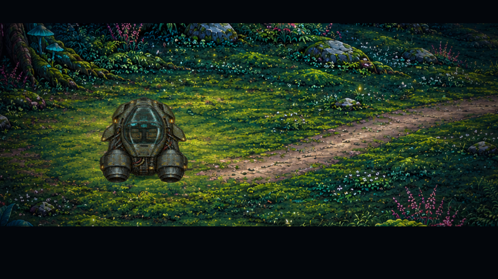
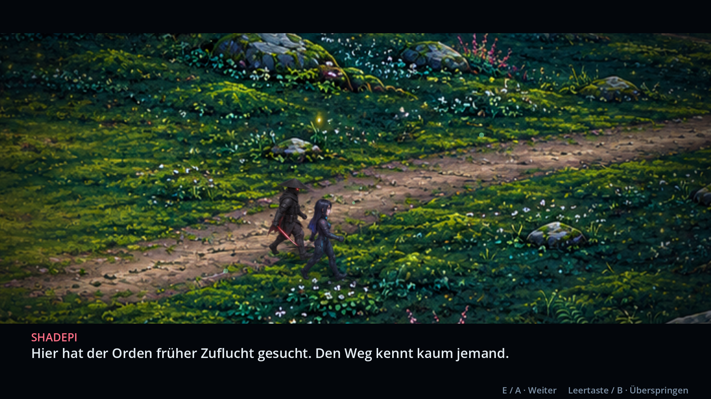
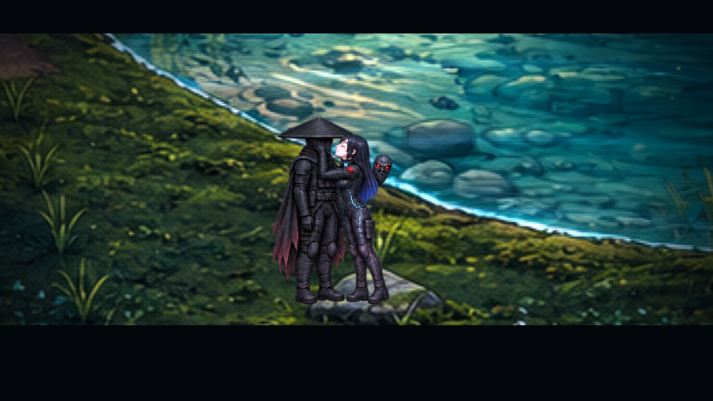
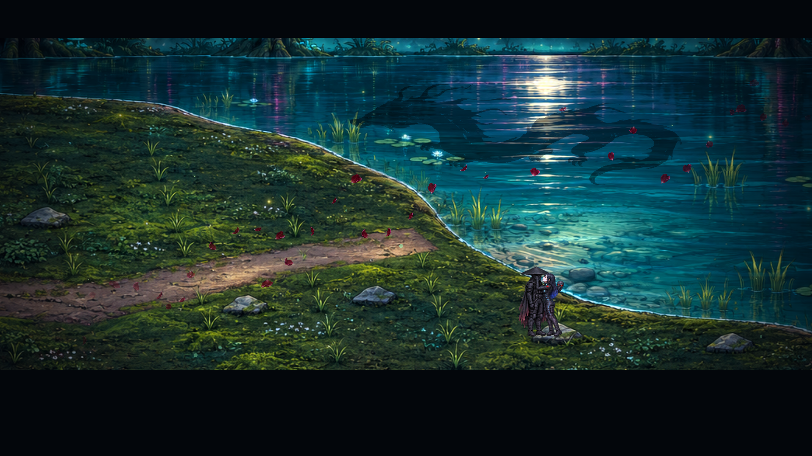
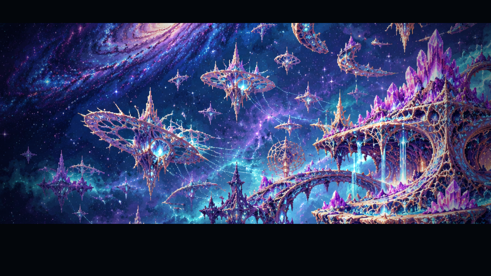
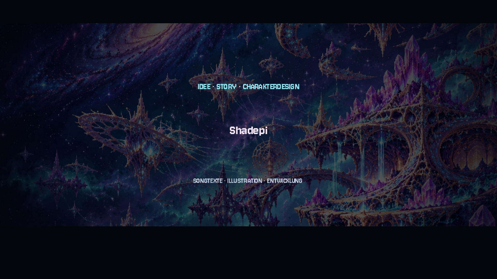
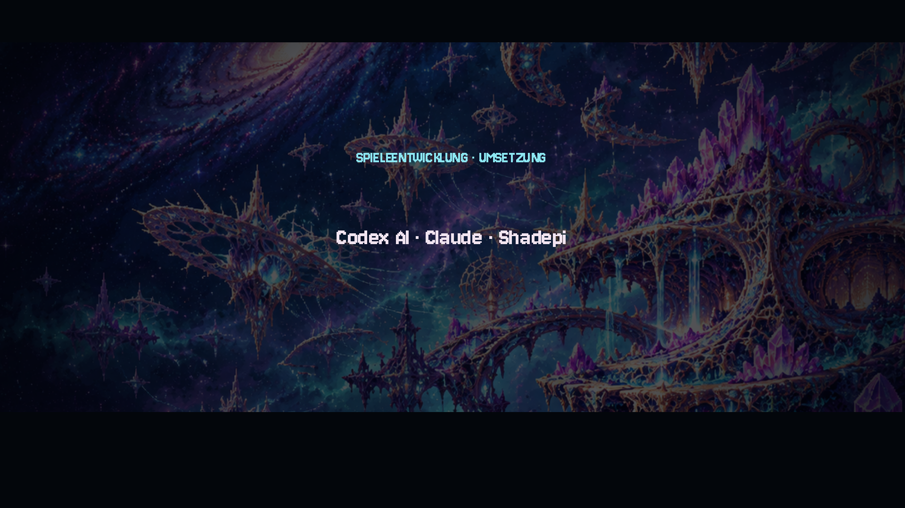

# Kapitel 7: Lichtung, Mondsee und unbekannter Schwarm · v0.69.0 · CodexAI

**23. November 2026.** [Spieleranleitung](../Spiel-README.md) · [Änderungen](../CHANGELOG.md) · [Bildquellen](../assets/story/lake/epilogue/README.md).

## Der neue Ablauf

1. Der Aerodyne fliegt in eine **eigene Waldlichtung**, setzt auf trockenem Gras auf und fährt die Triebwerke herunter. Raven und Shadepi steigen nacheinander sichtbar aus. Das Fahrzeug bleibt dort zurück.
2. Beide gehen gemeinsam unter alten Bäumen über den mondbeschienenen Pfad. Die Gespräche über den Zufluchtsort, die Prophezeiung und ihre persönliche Entscheidung laufen **während ihrer wirklichen Gehbewegung**, mit mitfahrender Kamera und versetzten Fußpunkten. Glühwürmchen und Cyan-Pilze begleiten den Weg.
3. Am Ende des Waldwegs führt eine kurze Abblende zum bestehenden Seezugang. Beide laufen weiter bis ans Wasser. Dort folgen die freiwillige Ordensaufnahme und das Heiligtumsritual; es wird keine Zustimmung vorweggenommen.
4. Der private Moment erhält nähere, langsam heranfahrende Kameraeinstellungen bis Zoom 3,15. Ravens eigene rechte Hand hebt die Maske, ihre linke verdeckt Shadepis Gesicht. Die vorhandenen acht Kontaktbilder und die Originalhelden bleiben erhalten.
5. Der sechsphasige Drachenschatten gleitet über das Wasser. Mit seinem Windstoß schweben **acht verschiedene Rosenblatt-Phasen** durch das Bild. Mondreflexion und mystisches Leuchten bleiben auf die echte Wasserfläche begrenzt.
6. Nach der Umarmung fährt die Kamera zum Mond. Ein langsamer Übergang öffnet den Blick ins Sternenfeld, dann zur Galaxie und schließlich auf den schimmernden Schwarm **unbekannter außerirdischer Strukturen**. Es wird keine Erklärung ihrer Herkunft erfunden.
7. Erst nach der Enthüllung beginnt der gegliederte Abspann. Anschließend bleibt der friedliche, wieder maskierte Schluss am See bestehen.

## Bilder und Film

| Landung in der Lichtung | Gespräch während des Gehens |
| --- | --- |
|  |  |

| Näherer privater Moment | Rosenblätter und Drachenschatten |
| --- | --- |
|  |  |

| Urheberschaft | Spieleentwicklung |
| --- | --- |
|  |  |

[**Gekürzter, beschleunigter Film aus nativen Godot-Frames**](previews/lake-epilogue-v069.webp) – 36,75 Sekunden, 640×360, unter 5 MB. Der Film kombiniert den vollständigen Durchlauf mit der abschließenden farbkorrigierten Weltraumaufnahme. Dialoge wurden für die Aufnahme automatisch bestätigt; im Spiel bestimmt der Spieler die Lesedauer. Die zusätzliche Dialog-Nahansicht nutzt dieselbe echte Geh-/Dialogfunktion.

Einzelbilder stammen aus dem Full-HD-Spielbild (1920×1080); Konzeptbilder wurden nicht als Spielaufnahme ausgegeben.

## Abspann nach Nutzervorgabe

| Bereich | Nennung |
| --- | --- |
| Idee, Story, Charakterdesign | **Shadepi** |
| Songtexte, Illustration, Entwicklung | **Shadepi** |
| Bildgenerierung | **ChatGPT · Gemini · Claude · Shadepi** |
| Spieleentwicklung / Umsetzung | **Codex AI · Claude · Shadepi** |
| Musik | **Shadepi · Suno** |
| Engine | Godot Engine; weitere Lizenz-/Audioquellen in der Spieldokumentation |

Die ursprüngliche SHAD3PI-/Claude-/OpenAI-Startgrafik und die Gesundheitsseite bleiben der Spieleinstieg. Die neuen Rollenangaben gliedern den anschließenden filmischen **Abspann von Kapitel 7**.

## Bedienung und sichere Rückkehr

Dialoge weiter mit E/Enter bzw. Controller A. Leertaste/Controller B überspringt die Inszenierung; das Pausenmenü hält auch Rosenblätter, Schimmern, Kamerafahrt und Credits an. Ein Kapitelwechsel oder Abbruch entfernt den kosmischen Canvas und stellt normale Figuren, Schatten und HUD wieder her. Abspannkarten sind ohne weitere Bestätigung lesbar getaktet und blenden ruhig ein/aus.

Die vorhandenen Kapitelnummern und Speicherfelder bleiben gleich. Ein ausstehender See-/Finale-Kontrollpunkt startet die zugehörige Inszenierung erneut; ein abgeschlossener Stand landet beim ruhigen Schlussbild. Keine neue Pflichtdatei für alte Spielstände, keine automatische Cloud-Veröffentlichung und kein Release-Tag.

## Konsistenz und Abnahme

Basis `1b344dc` / v0.68.1; alle Remote-Branches vor Beginn abgerufen und verglichen. `main` ist aktueller als ClaudeHelper v0.60.3. Nutzerauftrag vom 23. November 2026, Zeitzone Europe/Berlin. Neue Version **v0.69.0 · CodexAI**, Windows 0.69.0.0, Android 6900/0.69.0, Mac erbt die Projektversion.

Neue Kulissen/Rosenblätter mit dem Bildwerkzeug anhand der tatsächlich gesichteten See-/Figurenreferenzen erstellt; vollständige Quellen unverändert erhalten. Bestehende Schwarztöne, Cyan-Linien, Maske, Kasa, Haarfarben, Anatomie und Kontaktanker bleiben erhalten. Die Kamera macht die vorhandenen Detailpixel sichtbar, verändert aber keine Figurenproportionen. Der Comic liegt weiterhin nicht als Arbeitsdatei vor.

Gezielte Szenen-, Menü-, Story-, Koop- und Atmosphäre-Prüfungen: **724 Prüfungen ohne Fehler**. Neue Fälle prüfen tatsächliche Landung in der separaten Lichtung, Gehbewegung während Dialogen, vollständige kosmische Reihenfolge und sämtliche Credits, Pause im All sowie Abbruch während einer sichtbaren Abspannkarte. Zusätzlich **29 Prüfungen aus einem exportierten Linux-Ressourcenpaket**: neue Grafiken/Shader vorhanden, Ankunft/Ritual/Finale/Abspann überspringbar, alle Creditstexte innerhalb ihrer Flächen und saubere Rückkehr bei Kapitelwechsel. **753 gezielte Prüfungen insgesamt ohne Fehler.** Native X11-/llvmpipe-Sichtprüfung in Full HD einschließlich Dialog beim Gehen, vollständiger Füße beim Drachenschatten, Kontaktbilder, Rosenblätter, Sterne/Galaxie/Schwarm und sämtlicher sieben Credits.

Lokale Windows-, Linux-, Android- und Universal-Mac-Exporte sowie der Linux-Paketstart erfolgreich. Android-Versionscode 6900 und Testsignatur geprüft; Mac-Bundle/Version/Intel+ARM/Ad-hoc-Signatur strukturell geprüft. Kein nativer neuer Mac-/Windows-Lauf und keine physische Handy-/Controllerabnahme. Ton wurde bei der Sichtprüfung nicht akustisch bewertet; die bestehende Kapitel-7-Musikzuordnung bleibt erhalten.

[Maschinenlesbarer Prüf-/Paketnachweis](pruefungen/v069/ergebnisse.json) · [Konsistenzauftrag](arbeiten/see-epilog-v069.md).
