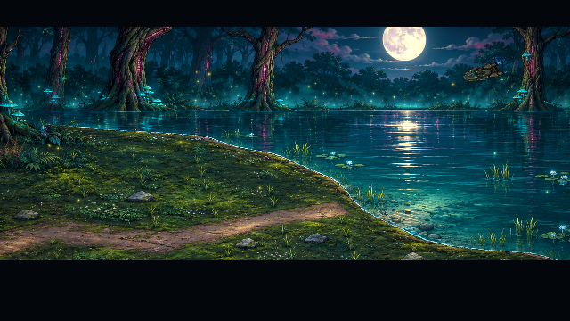
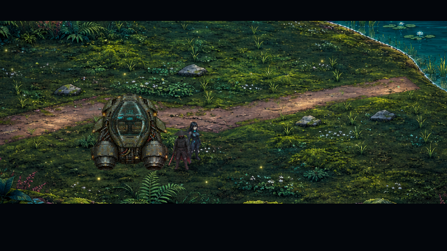
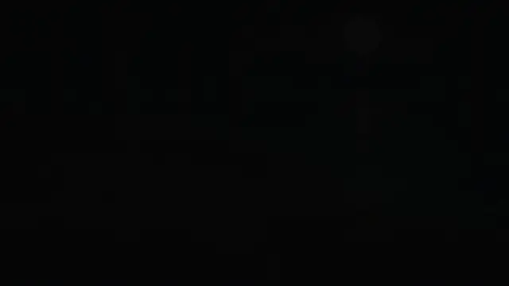
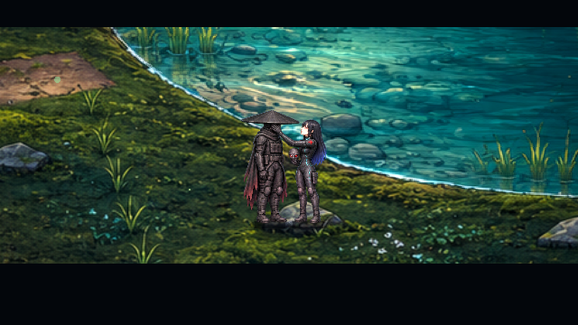
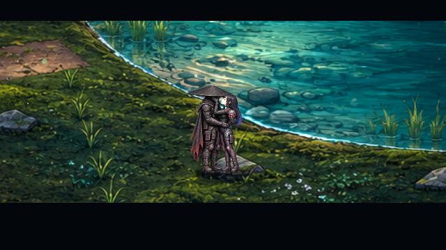
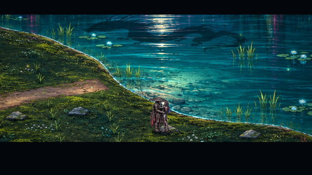
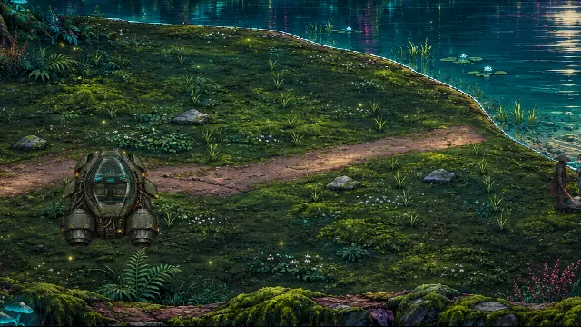

# Der See · v0.36.1 · CodexAI

**Handkorrektur v0.36.1 · CodexAI:** Raven hebt die abgenommene Maske mit ihrer **eigenen rechten Hand**. Ihre **eigene linke Hand** berührt und verdeckt Shadepis Gesicht. Die Zuordnung bleibt beim Kuss erhalten; rechts/links beziehen sich auf Raven, nicht auf die Bildschirmrichtung.

## Ankunft im Mondlicht

Der Aerodyne kommt aus der Ferne über den mondbeleuchteten See. Die Kamera begleitet die Annäherung und senkt sich zur freien Grasfläche am Ufer. Das Schiff bremst aus und setzt weich auf trockenem Boden auf. Raven und Shadepi steigen nacheinander seitlich aus der Kabine, an den Triebwerken vorbei, und gehen zum Wasser. Das geparkte Schiff bleibt sichtbar in der Spielwelt; seine Standfläche ist eine echte Kollision.

## Ein privater Moment

Die freiwillige Aufnahme Ravens in den Orden findet weiterhin vor der Maskenabnahme statt. Die Dialoge sind kürzer und persönlicher; die neue Szene ersetzt die bisherigen erklärenden Texttafeln zum Kuss. Raven fragt, Shadepi stimmt zu, und sie nimmt seine Maske ab. Ihre Hand, sein Kasa und der abgewandte Kopf verdecken seine Gesichtszüge während des gesamten Moments. Es gibt keine vollständig sichtbare unmaskierte Ansicht.

| Maskenabnahme | Kuss |
| --- | --- |
|  |  |

Im See steigt ein sanftes Leuchten auf. Ein Drachenschatten gleitet für wenige Sekunden über die Wasserfläche und verschwindet wieder. Anschließend bleiben beide in einer ruhigen Umarmung am Ufer. Die Frage nach Kenzōs Auftraggeber ist weiterhin offen; für diesen Abend lassen sie sie ruhen.

Die beiden Clips zeigen jeweils eine durchgehende Spielszene aus tatsächlichen Renderer-Frames, mit ihren Aufnahmezeitpunkten als Wiedergabezeit. Der spielbare Ritualteil dazwischen ist nicht Teil der Filme. Das Spiel animiert Fahrzeug, Figuren, Kontaktposen, Licht und Schatten selbst. Es spielt keine Comicseite oder vorgerenderte Filmdatei ab.

## Bedienung und Fortsetzen

E / Enter / A schaltet Dialoge weiter, Leertaste / B überspringt die aktuelle Szene, Esc / Start pausiert. Die vier Ritualpunkte bleiben erreichbar und erhalten den bisherigen Kapitelablauf. Der Kurzflug des Schattens läuft ohne wartenden Dialog durch.

Ein Spielstand während Ankunft oder Finale startet die jeweilige Szene erneut. Nach ihrem Abschluss lädt man am Ufer beziehungsweise in der maskierten Schlussumarmung, ohne dieselbe Szene erneut abzuspielen. Ältere Spielstände am Kapitelanfang oder Ende erhalten die jeweilige neue Szene einmal; Ritualfortschritt dazwischen wird erhalten. **Musikänderung v0.37.0 · CodexAI:** Ankunft, Ordensaufnahme und Finale spielen jetzt `assets/music/menu.mp3`. Ton- und Bildstiloptionen bleiben erhalten.

## Grafik, Herkunft und Prüfung

Vorhandene HQ-Kulisse und Aerodyne wurden wiederverwendet. Der neue Kontaktatlas verwendet die tatsächlichen Figurenkarten als Referenz; Kasa-Breite, Raven-Größe, Kostüm, Transparenz und Fuß-/Handkontakt wurden neben normalen Sprites im Renderer verglichen. Der Drache ist eine separat freigestellte neue HQ-Pixelquelle nach dem bestehenden Menümotiv. Schatten und Leuchten werden über die echte Uferkontur beschnitten.

Bei Einführung in v0.36.0 bestanden 920 gezielte Prüfungen und acht zusätzliche Prüfungen am exportierten Spielpaket ohne Fehler. Für die reine Handkorrektur in v0.36.1 bestanden erneut die betroffenen 32 Szenenprüfungen und acht Exportprüfungen; keine erneute Gesamtspielprüfung behauptet. Maskenabnahme, Kuss und vollständiger Finalablauf wurden zusätzlich im tatsächlichen Renderer gesichtet. [Aktuelle Abnahme](arbeiten/see-haende-v0361.md).

Der Comic wurde nicht hochgeladen. Für die Inszenierung gelten die konkrete Nutzerbeschreibung und die vorhandene Romanfassung mit den gekennzeichneten neueren Änderungen. [Assetquellen](../assets/story/lake/README.md) · [Archivbriefing](universum/teil-7/README.md) · [Arbeitsnachweis und aktuelle Prüfergebnisse](arbeiten/see-finale-v036.md).

Quellen im Code: [`lake_sequence.gd`](../scripts/lake_sequence.gd), [`lake_tableau.gd`](../scripts/lake_tableau.gd), [`lake_mystic.gdshader`](../shaders/lake_mystic.gdshader). Reproduzierbare Bilder: [`lake_gallery.gd`](../tools/lake_gallery.gd), neue automatische Prüfungen: [`lake_sequence.gd`](../tests/lake_sequence.gd).
