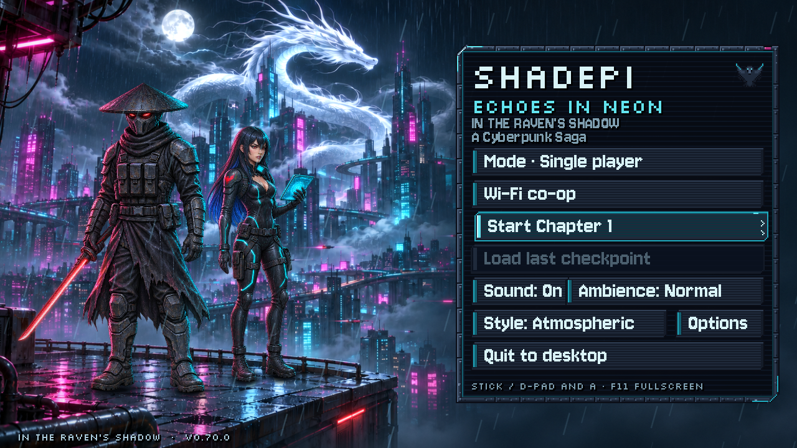
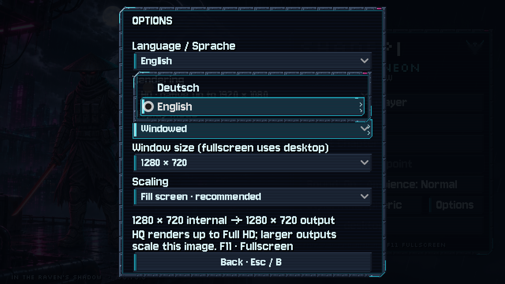
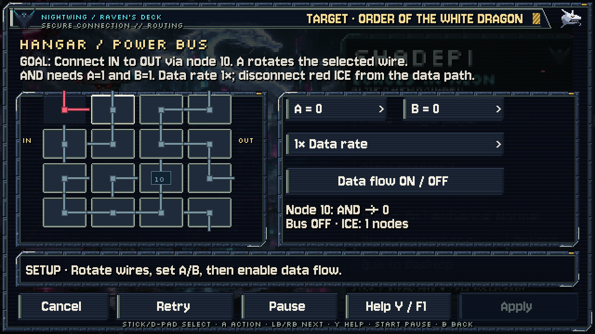
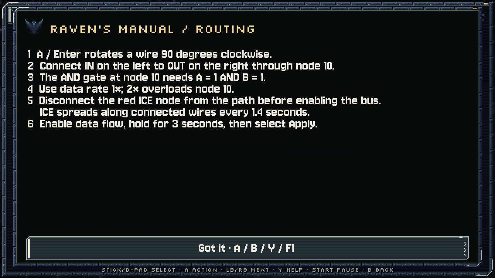
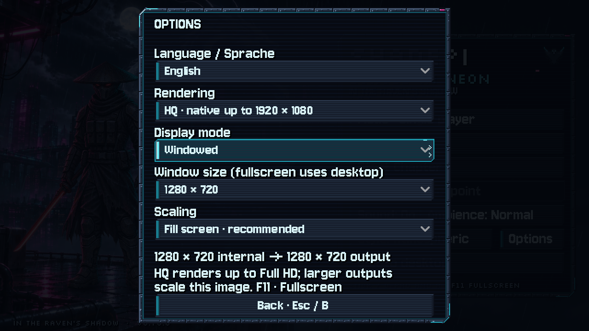
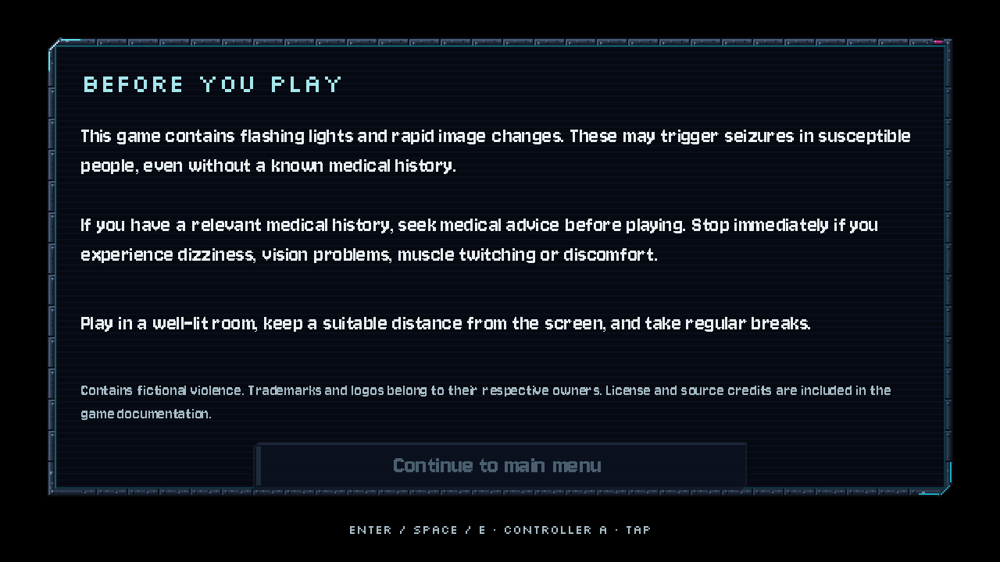

# Deutsch / Englisch · v0.70.0 · CodexAI

Im Haupt- oder Pausenmenü **Optionen → Sprache / Language → English** wählen. **Deutsch** stellt die Originalfassung wieder her. Die Auswahl gilt sofort und bleibt nach Neustart und Kapitelwechsel erhalten. Tastatur, Maus, Touch und Controller verwenden dieselbe Sprachliste; **A** öffnet/bestätigt, **B** schließt zunächst die Liste.

| Englisch im bestehenden Hauptmenü | Gespeicherte Sprachwahl |
| --- | --- |
|  |  |

## Umfang

Der zentrale Katalog enthält **1.066 Einträge**: Story und Erinnerungen aller sieben Kapitel, Ziele und Kontrollpunkte, Haupt-/Pausenmenüs, Steuerung und Kampfanzeigen, Hacks samt Schritt-für-Schritt-Handbuch, Arcade, Start-/Gesundheitshinweise, WLAN-Meldungen und Abspann. Die englischen Dialoge erhalten Figuren, Handlung und bestätigte Namen.

| Hack und Fortschrittsanzeige | Verständliche englische Anleitung |
| --- | --- |
|  |  |

| Gemeinsame Optionen | Hinweise vor dem Spiel |
| --- | --- |
|  |  |

Die deutsche Quellfassung bleibt unverändert verfügbar. Rätselcodes, Hexbytes, technische Pinbezeichnungen und Eigennamen werden nicht umbenannt. Illustrationen und Logos mit eingebauten Schriften bleiben Originalgrafiken. Im WLAN-Koop folgt das gemeinsame gestreamte Spielbild der Sprache des Hosts; die lokale Lobby nutzt die Geräteauswahl.

## Umsetzung und Pflege

[Sprachvertrag und aktiver PO-Katalog](../localization/README.md). `LanguageSettings` speichert separat in `user://shadepi-language.cfg`. Bestehende Spielstände, Kontrollpunkt-IDs und Netzwerkbefehle erhalten kein Sprachfeld.

Godots native UI übersetzt die Quelltexte beim Sprachwechsel. Der Übersetzungsadapter erkennt zusätzlich formatierte Zahlen-/Statusanzeigen und zusammengesetzte Menüfragmente, mit begrenztem Cache. Selbst gezeichnete Texte werden vor Zeichnen, Kürzen und Glitch lokalisiert. Englische Dialoge werden vor dem Seitenumbruch vermessen; beim Umschalten startet nur die aktuelle Sprechzeile erneut, keine Bewegung oder Storyaktion.

## Prüfung

- **Katalogaudit:** 2.313 Prüfungen, keine Fehler; sichtbare Prosa, Platzhalter und stabile Decoder-Codes.
- **Sprach-/UI-Suite:** 151 Prüfungen sowohl headless als auch mit nativem X11-Rendering bestanden. Tatsächliche Controller-Ereignisse öffnen die Sprachliste und wechseln Deutsch/Englisch; Speicherung, ungültige Einstellungen, Rückwechsel vorhandener Labels, Gesprächsumbruch und alle fünf Hackarten sind geprüft.
- **Bestehende Anzeigeoptionen:** 74 Prüfungen bestanden. **Terminal-Controller:** 186 Prüfungen bestanden.
- **Grundspiel-Regressionssuite:** 386 Prüfungen bestanden.
- Linux-Release lokal exportiert und headless gestartet. Kein neuer Download-Release angelegt; die Dokumentation trennt aktuellen Quellstand und bisher veröffentlichte Downloads.
- Die sechs Bilder oben stammen aus dem echten Spiel mit unveränderten Grafiken bei 1280×720. Kein physischer Windows-/Mac-/Android-Spieltest für diese Änderung behauptet.

[Maschinenlesbarer Nachweis](pruefungen/v070-sprachen/nachweis.json) · [Reproduzierbare QA-Befehle](../tools/localization/README.md).
