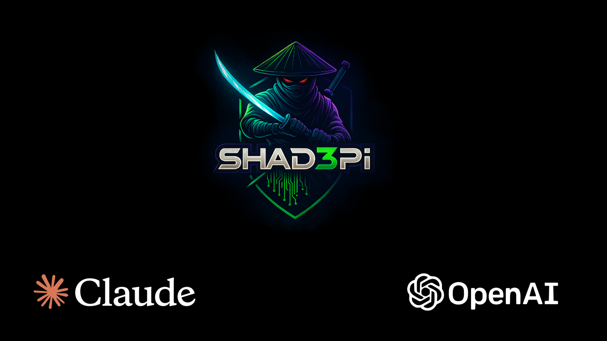
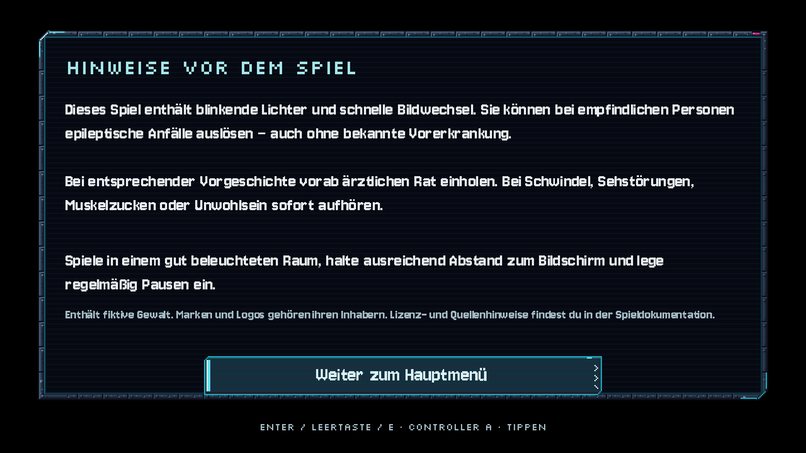

# Startbild und Hinweise · v0.68.0 · CodexAI

**20. November 2026.** [Anleitung](../Spiel-README.md) · [Änderungen](../CHANGELOG.md) · [Quellgrafik](../assets/branding/README.md).

Das vom Nutzer bereitgestellte Bild erscheint vor dem Hauptmenü: etwa **2,8 Sekunden**, ruhig ein- und ausgeblendet. Enter, Leertaste, E, Controller A/Start oder Tippen kann die Logozeit verkürzen. Die folgende Hinweisseite bleibt anschließend bis zu einer **frischen Bestätigung** sichtbar. Der Vorspann selbst verwendet keine Blink-/Glitch-Effekte.

**Weiter zum Hauptmenü:** Enter / Leertaste / E, Controller A oder Tippen auf den Knopf. Eine kurze Eingabesperre schützt vor unbeabsichtigtem Doppeldruck, Tastaturwiederholungen werden abgefangen. Die Bestätigung startet keine Partie; alle bisherigen Kapitel-, Kontrollpunkt-, Koop-, Anzeige- und Arcade-Menüaktionen bleiben im anschließenden Menü verfügbar. Beim Zurückkehren aus dem Spiel zum Menü wird das Intro nicht wiederholt.

[**Geraffter Startfilm**](previews/startup-v068.webp) aus echten nativen Godot-Frames. Er zeigt eine bewusst ausgelöste Bestätigung der Hinweise; die Hinweisseite hat im Spiel kein automatisches Zeitlimit. Native Einzelbilder in 1920×1080; keine nachgezeichneten Bildtafeln.

## Hinweise und Quelle

Die Seite behandelt blinkende Lichter, schnelle Bildwechsel, mögliche photosensitive/epileptische Reaktionen, ärztlichen Rat bei entsprechender Vorgeschichte, sofortiges Aufhören bei Beschwerden sowie Beleuchtung, Abstand und Pausen. Hinzu kommen fiktive Gewalt, Markeninhaberschaft und Verweise auf die vorhandene Lizenz-/Quellendokumentation. Es werden keine Altersfreigabe, Vertragseinwilligung oder umfassende rechtliche Zertifizierung behauptet.

Die Bilddatei bleibt unverändert: [Original](Game%20Logos.png) → [Laufzeitkopie](../assets/branding/game-logos.png), beide SHA-256 `65d219bf2067478099c4565d0ae74567c110ae075dcda8945d83d7d2fce9dc07`. Die Kopie stellt die Verfügbarkeit im Export sicher; das Dokumentationsarchiv bleibt vom Spielpaket getrennt. Das Brandingbild wird nicht als neue Helden-/Sprite-Stilvorlage behandelt.

## Technik und Abnahme

Neuer Projekteinstieg `scenes/startup.tscn`, anschließend weiterhin `scenes/chapter_one.tscn`. Die bestehende HQ-Darstellung bleibt aktiv; mobile Spieltasten werden während der Hinweise ausgeblendet. Fokus-/App-Verlust hält die Einblendzeit an. Vor dem Laden des Menüs erscheint ein lesbarer Ladezustand; es bleibt kein Hintergrund-Ladeauftrag beim frühen Beenden offen. Ein nicht verfügbares Menü zeigt eine erneute Versuchsmöglichkeit.

[Automatisierte Ergebnisse und Plattformpakete](pruefungen/v068/ergebnisse.json) · [Konsistenz-/Arbeitsnachweis](arbeiten/startup-v068.md). Geprüft werden Originaldatei, echte Eingabefolgen, Layoutgrenzen/Umbruch, Fokus, Weiterleitung ohne Spielstart und bestehende Menü-/HQ-/Touch-/Koop-Funktionen. Die native Sichtprüfung ersetzt keinen physischen Handy-/Controller-Test.
