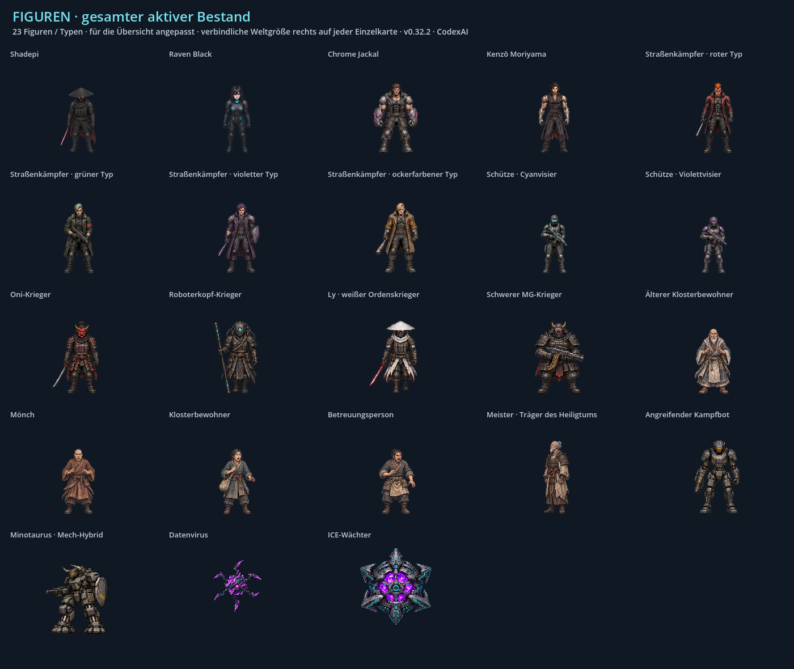

# ShadepiRPG · bebilderte Stilbibel für das gesamte Spiel

**Status v0.46.2 · CodexAI:** [Repository-/Quellenstatus](../repository-status.md) und [Asset-Katalog](../../assets/README.md). Die folgenden Versionsnotizen dokumentieren ihre damaligen Änderungen; aktuelle Originalhelden und aktive Quellen haben Vorrang. Verworfene v0.45.0-Bilder sind im Entwicklungsarchiv; `legacy` in Erinnerung III bleibt aktiv.

**Originalhelden v0.46.1 · CodexAI – ausdrücklicher Nutzerwunsch:** [Raven und Shadepi wieder in Originalgrafik](../original-helden.md). Aktive Standardquellen sind wieder `assets/sprites/heroes/raven.png` und `shadepi.png`, 1024×5120, 8×32 Raster, acht Gehphasen, Maßstab 0,5, Fußbasis 152, lineare Verkleinerung. Automatische Umleitung auf `heroes/gameplay` entfernt; diese Variante ist verworfen. Nicht ungefragt erneut aktivieren. Heiligtum-Kontaktposen wieder linear zu den Originalhelden. Übrige Fehlerkorrekturen, Sonderangriffe und Blut-FX erhalten. Figurenkarten müssen die aktiven Originale zeigen; die nachfolgenden v0.45.0-Angaben sind historisch.

**Gameplay-Figuren / Fehlerbericht v0.45.0 · CodexAI:** [Zwölf Berichtspunkte und native Vergleiche](../fehlerbericht-v045.md). [Neue Heldenquellen](../archiv/assets/helden-v045/README.md) besitzen tatsächliche Einzelregionen, Sohlenanker und Mündungen in `poses.json`, rund 58 Weltpixel Stand-/Gehhöhe und Nearest. Keine gleichmäßigen Zellen annehmen. Pro Actor Atlas und Metadaten, kein globaler Ressourcen-Cache. Alte Helden vollständig gesichert; NPC-/Custom-Verträge erhalten. Ersatzreaktionen blenden Körper und beide Schatten aus und müssen bei Abbruch idempotent bereinigt werden. Die folgende historische Angabe zur linearen Heldenabtastung ist für neue Gameplay-/Heiligtum-Posen überholt.

**Menü / Test-Kontrollpunkte v0.44.0 · CodexAI:** [Sohlenkontakt, Desktop und 40 direkte Test-Einstiege](../menue-kontrollpunkte.md). Vier statische Anker aus `boot_contacts()` einschließlich Ravens eigener Transformation; `menu_contacts.gdshader` bleibt auch in reduziertem Stil aktiv und vor der Dachkante begrenzt. `checkpoint_resume.gd` trennt Modus und normale/Test-Dateien; optionale Zeitmetadaten mit Legacy-Fallback. `test_checkpoints.gd` nur für vorgegebene sichere Zustände und separaten Admin-Dateiraum. Kontrollpunkt-Test benötigt isoliertes `XDG_DATA_HOME=/tmp/shadepi-…`; keine echten Spielstände als Fixtures verwenden.

**Kapitel-1-Auftakt v0.43.0 · CodexAI:** [Auftragsannahme, Pistolenprüfung, Dachzwischenschnitt und Landung](../kapitel1-auftakt.md). Aktiver Atlas `assets/story/chapter-one/poses.png` ist tatsächlich 1774×887; Ausschnitte und Boden-/Handanker in `chapter_one_intro.gd`. Standhöhe rund 59 Weltpixel, lineare Abtastung wie Helden; beide normalen Schatten mit der Ersatzfigur ausblenden. Der Dachzwischenschnitt ist keine neue spielbare Tower-Karte. Pause friert die Szene ein; Generationstickets und vollständige Bereinigung bei Abbruch/Laden erhalten; keine neuen Pflichtfelder für Kontrollpunkte.

**Technische Umgebung v0.42.0 · CodexAI:** [Bewegte Schaltkästen und Serverschränke](../technik-gegenstaende.md) mit festen Bodenankern aus `technology_art.gd`. Nur oberhalb halber Lebenspunkte neue Betriebsphasen; darunter die passenden alten Schadensbilder mit vollständig zurückgesetztem Sprite-Raster verwenden. Zugriff nur an explizit verbundenen Statusgeräten, keine neue Storysperre. Menü/Terminal frieren die Uhren ein; Abbruch/Laden/Wechsel lösen Referenzen und Generationstickets verhindern späte Rückmeldungen. Neue PNG-Vorschauen in Root-README und Doku-Galerie erhalten.

**Verfolgung v0.41.0 · CodexAI:** [Neun Wagenbilder und vier Frachtdrohnen-Rotorphasen](../verfolger-animationen.md). Tatsächliche Zellgrößen 418 beziehungsweise 627; gemeinsame Rumpf-/Mündungs-/Abwurfkontakte in `pursuit_car_art.gd` und `cargo_drone_art.gd`. Schusszustand vor Bestimmen der Mündung setzen; Pixel-Feuer bleibt an der bewegten Mündung. Beschädigter Wagen fächert den zweiten Schuss erst nach Austritt auf. Rotorlauf unabhängig vom Trudeln einer gehackten Drohne; Pause und Kapitelbereinigung erhalten.

**Fahrzeugbewegung v0.40.0 · CodexAI:** [Aerodyne-Kurvenlagen und Motorrad-Fahrposen](../fahrzeugbewegung.md). Separate Banklage von bisherigem Heading unterscheiden. Hinterer Reifenkontakt und Düsenpunkte je Quellbild sind fest registriert; keine transparenten Überblendungen verschiedener Silhouetten. Offene Kabine verwendet sofort wieder mechanischen Rumpf und passende gerade Düsenanker. Motorradquelle besitzt tatsächlich 418×418-Zellen; nur acht der neun Entwurfszellen sind aktiv.

**Aktualisierung v0.39.0 · CodexAI:** [Plattformfahrt und Hangarentdeckung](../hangar-entdeckung.md), vier eigene Shadepi-Schalterposen, sechs Entriegelungsbilder und texturierter Schacht. Fahrt mit den tatsächlichen Figuren; danach identischer Aerodyne in normaler Erkundung und Film. [Aktive Quellen und Kontaktanker](../../assets/story/hangar-discovery/README.md).

**Aktualisierung v0.38.0 · CodexAI:** [Eisbad und Kryospray-Rettung](../eisbad.md) mit acht eigenen HQ-Kontaktposen für Raven/Shadepi. Reale Weltgröße, unterschiedliche Zuschnitte der Paarposen und volle Kopf-/Haar-/Hutsilhouette beachten; normale Figurensätze bleiben gültig.

**Handkorrektur v0.36.1 · CodexAI:** Im [See-Finale](../see-finale.md) hebt Raven die Maske mit ihrer **rechten** Hand; ihre **linke** berührt und verdeckt Shadepis Gesicht. Diese Zuordnung gilt für Maskenabnahme und Kuss, jeweils aus Ravens eigener Sicht.

**v0.32.2 · CodexAI · 8. November 2026.** Gemeinsame Bild- und Gestaltungsreferenz für Menschen und KI: Figuren, Gegner, Schauplätze, Fahrzeuge, Requisiten, Menü, HUD, Hacks, Animationen, Effekte und Ton. Ergänzt die verbindlichen [Projektregeln](../../KONSISTENZ.md) und das [Universumsarchiv](../universum/README.md).



**Aktualisierung v0.37.0 · CodexAI:** [Gesamtspiel-Prüfung und Cinema-/Sprite-Roadmap](../cinema-roadmap.md), sechs registrierte [Aerodyne-Rumpfbilder](../../assets/vehicles/aerodyne/README.md) und neue Kapitel-7-Musikzuordnung. Ein Zustandsbild ist noch kein Bewegungszyklus; neue Kontakt- und Objektphasen jeweils im tatsächlichen Spiel abnehmen.

## Die fünf Teile

**Aktualisierung v0.36.0 · CodexAI:** [See-Finale](../see-finale.md) mit vier eigenen HQ-Kontaktposen nach den normalen Heldenquellen. Hand-/Fußanker, breite Kasa-Silhouette und Verdeckung des Gesichts sind Teil des Grafikvertrags; kein unmaskiertes Porträt. Landung auf trockenem Uferboden, neue Drachenquelle nur als kurzzeitiger Wasserschatten.

**Aktualisierung v0.35.1 · CodexAI:** [Tower- und Hangar-Inszenierung](../tower-inszenierung.md) mit freien Laufwegen und unveränderten Figurenquellen. **Start auf dem tatsächlichen Landeplatz**, danach Fall von oben am tieferen Balkon vorbei und Abfangen darunter; die v0.35.0-Balkonfassung ist ersetzt. Düsenanker, Perspektive und Körperbewegung bleiben gekoppelt. Die vorhandenen Figuren- und Materialkarten bleiben gültig.

**Aktualisierung v0.33.0 · CodexAI:** [Neue Tower-Zustände, Extraktion, knappe Flucht und KOBAN-TEC-Hangar](../tower-extraktion.md). Die 23 Grundfigurenkarten bleiben gültig; Spezialposen und die zusätzliche Filmkulisse sind bei Figuren und Welten verzeichnet. Nur die betroffene Weltübersicht wird neu gerendert.

| Teil | Inhalt |
| --- | --- |
| **[1 · Art Direction und Materialstil](artdirection.md)** | Bildsprache, Textur, Licht, Körperbau, Pixelraster, Maßstab, Animation und bekannte Unterschiede im Altbestand. |
| **[2 · Alle Figuren mit eigenen Bildern](figuren.md)** | Shadepi, Raven, Chrome Jackal, Kenzō, vier Punktypen, zwei Schützen, vier Ordenskrieger, Meister, vier Ziviltypen, Bot, Minotaurus, Datenvirus und ICE-Wächter. Merkmale und Quellen pro Karte. |
| **[3 · Welten und Kulissen](welten.md)** | 20 aktive Hintergrundquellen über alle Kapitel und Erinnerungen; Architektur, Material, Farb-/Lichtfamilien und ortsbezogene Atmosphäre. |
| **[4 · Fahrzeuge und Requisiten](fahrzeuge-requisiten.md)** | Aerodyne, Verfolgerauto, Motorrad, Drohne und geparktes Motorrad; neun Objektarten mit intaktem, beschädigtem und zerstörtem Zustand neben Raven als Größenreferenz. |
| **[5 · Oberflächen, Effekte und Ton](oberflaechen-effekte.md)** | Sechs UI-Familien, fünf Hackarten, Menü-/HUD-Beispiele, Projektile, Feuer/Rauch, Nanitenstrom, Aura, Musik und Kampfklang. |

## Was ist verbindlich, was zeigt den Bestand?

**Verbindlicher Soll-Standard:** bestätigte Figurenmerkmale, die in Teil 1 festgelegte HQ-Pixelart, nachvollziehbare Perspektive/Materialien, passende Weltgröße und die dokumentierten Kontaktpunkte. Neueste ausdrückliche Nutzervorgaben haben Vorrang.

**Bildreferenzen des Ist-Stands:** Die 23 Einzelkarten und acht weiteren Tafeln wurden aus den vorhandenen Spielgrafiken in Godot gerendert. Sie zeichnen keine Figuren neu und erfinden keine fehlenden Ansichten. Vergrößerungen sind beschriftet; die rechte Figur auf jeder Einzelkarte zeigt Weltmaßstab ×1. Neutraler Tafelgrund, Überschriften und Anordnung sind Dokumentationsgestaltung, keine neue Spielszene.

**Bekannte Unterschiede sind keine Gestaltungsvorgabe.** Insbesondere weichere normale Figuren gegenüber schärfer abgetasteten Erinnerungsfiguren und die unterschiedlichen Aerodyne-Ansichten sind in [Teil 1](artdirection.md#bekannte-unterschiede-im-altbestand) benannt. Ein altes Artefakt nicht allein deshalb übernehmen, weil es auf einer Bestandskarte zu sehen ist.

## So arbeitet man damit

1. Aktuellen Repo-Stand und [Projektregeln](../../AGENTS.md) prüfen.
2. Art Direction und die Bildkarten des betroffenen Bereichs ansehen. Merkmale und Darstellungsmaßstab getrennt festhalten.
3. [Arbeitsvorlage](../vorlagen/konsistenz-auftrag.md) ausfüllen; vorhandene passende Quellen wiederverwenden.
4. Neue Arbeit im tatsächlichen Spiel neben bestehenden Figuren/Objekten bei gleicher Kamera vergleichen. Alle Bewegungs- und Rücksetzphasen prüfen.
5. Referenzkarte und Quellenverzeichnis bei einer aktiven Änderung mit Version und Grund aktualisieren; historische Stände eindeutig kennzeichnen.

## Herkunft und Neuaufbau

Der [Figurenindex](figuren.json) nennt IDs, Familien, feste Merkmale und den Ausgangscommit. [style_bible_gallery.gd](../../tools/style_bible_gallery.gd) liest aktuelle Atlasregionen, Anker und Maßstäbe direkt aus den bestehenden JSON-Metadaten beziehungsweise dem bekannten normalen Heldenformat. Die Prop-Tafeln verwenden die originale `PropArt.apply()`-Darstellung. Die Weltübersicht liest `Painted.ART` und die aktiven zusätzlichen Erinnerungskulissen.

```sh
# Godot 4.7.2; mit echtem Renderer, z. B. Desktop oder Xvfb/Mesa
godot --audio-driver Dummy --script res://tools/style_bible_gallery.gd
# Bei Änderungen nur die betroffene Tafelgruppe neu rendern, z. B. Kulissen:
godot --audio-driver Dummy --script res://tools/style_bible_gallery.gd -- --part=worlds
```

Ausgabe: 31 PNG-Tafeln in `docs/stilbibel/bilder/`. Dieser Ordner hat eine `.gdignore`; die vorhandenen Exportprofile schließen `docs/*` und `tools/*` aus. Die Stilbibel ist Dokumentation und wird nicht als neue Grafik im Spiel geladen. Die vorhandenen Gameplay-Assets bleiben unverändert.

Teilgruppen: `figures`, `worlds`, `props`, `vehicles`, `ui`, `effects`; ohne Auswahl werden alle gerendert. Bei geänderten Referenzen auch Versions-/Commitangabe im Figurenindex und die betroffenen Beschreibungen pflegen.

[Ausgefüllter Arbeits- und Prüfnachweis dieser Erweiterung](../arbeiten/stilbibel-v0322.md).
