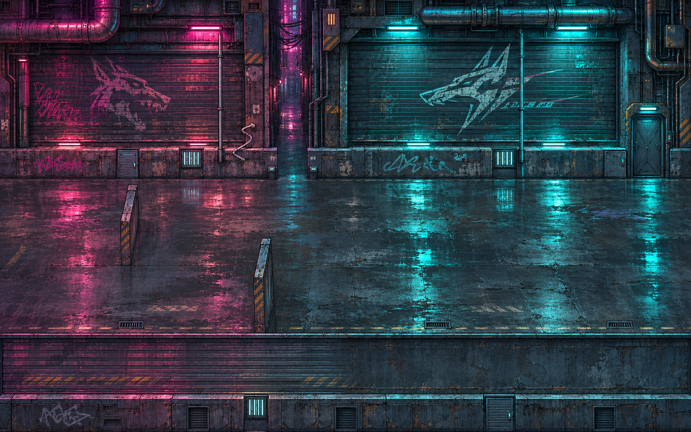
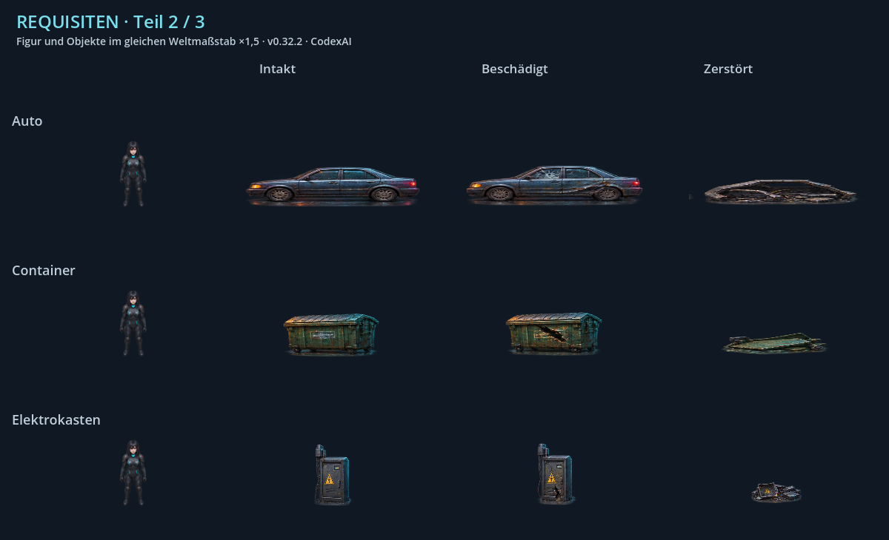

# Art Direction · v0.32.2 · CodexAI

[Stilbibel](README.md) · [Figuren](figuren.md) · [Welten](welten.md) · [Fahrzeuge/Objekte](fahrzeuge-requisiten.md) · [UI/FX/Ton](oberflaechen-effekte.md)

## Gemeinsame Bildsprache

ShadepiRPG verbindet detailreiche **HQ-Pixelgrafiken** mit einer dunklen Cyberpunkwelt und traditioneller Ordensarchitektur. Plastische Figuren, Materialtexturen, räumliche Schatten und Licht aus klaren Quellen tragen das Bild. Moderne Technik ist in der Architektur sichtbar; der Tempel ist die Tarnung einer großen Hightech-Untergrundbasis.

Der Detailgrad soll beim tatsächlichen Spielbild lesbar bleiben. Große PNGs, nachträgliches Hochskalieren oder eine glatte Zeichnung mit Rasterfilter ersetzen keine passenden Pixelcluster. Einfache Vektorfiguren, flache Ersatzkörper, gleichmäßiges Rauschen und zufälliges Dithering bilden keine neue Stilgrundlage.

## Figuren und Materialien

| Material/Funktion | Soll-Wirkung | Sichtbare Referenz |
| --- | --- | --- |
| Dunkle Heldenausrüstung | Ruhige schwarze bis gunmetallene Flächen, gezielte Lichtkanten, getrennt lesbare Rüstung und Stoff. | [Shadepi](bilder/figur-shadepi.png), [Raven](bilder/figur-raven.png). |
| Leder und ziviler Stoff | Falten, Säume, matte beziehungsweise leicht glänzende Stufen, sichtbare körperliche Form. | [Roter Punk](bilder/figur-punk-1.png), [Mönch](bilder/figur-monk.png). |
| Traditionelle Ordenspanzerung | Geschichtete Platten und gealterte Materialien dort, wo die Figur sie besitzt; trotzdem klare Silhouette. | [Oni](bilder/figur-oni.png), [Meister](bilder/figur-master.png). Bronze-/Brauntöne dieser Figuren nicht auf Shadepis schwarze Rüstung übertragen. |
| Schwere Mech-/Fahrzeugpanzerung | Große belastbare Formen, Nähte, Kanten, Gelenke/Servos und passende Abnutzung. | [Minotaurus](bilder/figur-minotaur.png), [Fahrzeugtafel](bilder/fahrzeuge.png). |
| Emission und Energie | Kleine klare Kerne, strukturierte Lichtausläufer, gezielte Überstrahlung. Gesichter, Kostüme und Gefahrensignale bleiben lesbar. | [FX-Tafel](bilder/effekte.png). |
| Physische Räume | Holz, Stein, Metall und Kabel behalten ihre unterschiedlichen Oberflächen und Perspektiven. | [Kulissenübersicht](bilder/welten.png). |

Identität, Haarform, Maskensegmente, Taschen, Schulterzeichen und Bewaffnung bleiben in allen Richtungen erkennbar. Beim Erstellen einer neuen Pose die [individuelle Karte](figuren.md) und einen normalen Nachbarsprite derselben Szene nebeneinander betrachten. Kleine rote Augen oder Schmuck nicht vergrößern, um die Figur künstlich detaillierter erscheinen zu lassen.

## Farbe und Lichtfamilien

- **Stadt:** dunkler Asphalt und Metall, kaltes Cyan, Magenta/Rot an Neonquellen, warme lokale Lampen. Nässe reflektiert vorhandene Lichtquellen.
- **Industrie, Garage und Hangar:** technische Schatten, Metall-/Ölspuren, warme Arbeitsleuchten und kalte Diagnoseanzeigen.
- **Wohnräume und physischer Orden:** wärmere Holz-/Steintöne, bernsteinfarbenes Licht; Technik bleibt durch klare kühle Anzeigen erkennbar.
- **Virtuelle Welt:** eigene violette/Cyan-Farbwelt, leuchtende Datenformen und eindeutige räumliche Wege.
- **Angriff und Erinnerungen:** Feuerschein, Rauch, Glut und Zerstörung nach Szenenfortschritt. Weiße Heiligtumsenergie hebt sich davon ab.
- **Tower:** dunkle hochwertige Oberflächen, kontrollierte Rot-/Goldakzente der Systeme; Alarm kommt aus nachvollziehbaren Quellen.
- **See:** kühle ruhige Wasser-/Nachtfarben, sparsame Reflexe und Glühwürmchen als Abschlusskontrast.

Das sind Rollen der vorhandenen Bildfarben, keine neu behauptete exakte Originalpalette. Die tatsächlich festgelegten UI-Farbwerte stehen separat in [ui_skin.gd](../../scripts/ui_skin.gd).

## Raster, Proportionen und Kontakt

Das Gameplay nutzt 640 × 360 als Basis; das Menü rendert eine eigene größere Komposition. **v0.45.0 · CodexAI:** Normale Helden verwenden die [neuen Gameplay-Quellen](../../assets/sprites/heroes/gameplay/README.md) mit einzeln registrierten vollständigen Regionen statt gleichmäßiger Zellen. Bereitschaft und Gehen haben rund 58 Weltpixel sichtbare Höhe. Die alten 128×160-Zellen bleiben für unveränderte NPC-/Custom-Quellen und die gesicherten Heldenoriginale relevant. Raven ist verbindlich **160 cm** groß; daraus folgt kein allgemeiner Pixel-pro-Zentimeter-Faktor.

Andere Figuren und Objekte haben eigene Maßstäbe. Krieger, Zivilpersonen und Minotaurus verwenden ihre JSON-Anker; Requisiten verwenden `PropArt.SIZES`. Sitzen und Liegen werden nach Körperlänge und Kontaktflächen kalibriert. Höhe eines Kastens, Länge eines Autos und Größe einer Person mit derselben Weltkamera vergleichen. Transparenter Zellrand ist kein Körpermaß.

Neue Gameplay-Helden und die angeglichenen Heiligtum-Kontaktposen nutzen Nearest; ältere NPC-/Sonderquellen behalten ihre eigene Abtastung. Eine neue Pose muss zur tatsächlich benachbarten Figur passen. Eine globale Umstellung aller Filter folgt daraus nicht. Keine scharfen Freistellshader über einen grauen oder weißen Hintergrund legen, um mangelhafte Transparenz zu verdecken.

## Bewegung, Inszenierung und Wirkung

| Bereich | Erhalten |
| --- | --- |
| Gehen/Laufen | Körperbau, Standhöhe, Kostüm, Fußkontakt und Richtung über den Zyklus. Klosterbewohner besitzen vier Gehbilder je Richtung. |
| Nahkampf | Deutliches Ausholen, Kontakt/Auslösen, Rücknahme; Waffe und Blickrichtung bleiben zur Trefferphase passend. |
| Aufladen | Aufbau, kurzes Bereitschaftssignal, Loslassen/Aussenden, Erholung. FX ersetzen die Körperaktion nicht. |
| Fernkampf | Pistolenmündung beziehungsweise offene Hand als tatsächlicher Ursprung, mit passenden getrennten Klängen. |
| Sitzen/Schlafen/Greifen | Passende Körperpose und feste Möbel-/Handkontakte; keine als Liegepose gedrehten Standfiguren. |
| Menü | Feste Füße und Plattform; nur freie Haar-/Stoffenden im Wind. Maus/Fokus verformen keine Körper. |
| Treffer/Tod | Lesbare Reaktion, kein dauerhaft weiß eingefrorener Körper; bestätigte Todeszustände nicht zurück auf lebendige Ruheposen setzen. |
| Szenenwechsel | Atlas, Rotation, Schatten, Aufhellung, Licht, Ton und Eingabezustände bei Abbruch/Laden korrekt zurücksetzen. |

Szenen spielen in der Welt mit Figurenbewegung und passenden Sprechblasen/Untertiteln. Neue Dialoge sollen natürlich sprechbar sein. Kontinuität nach aktueller Storyquelle prüfen; eine einzelne Kulisse nicht ohne Begründung für jedes Kapitel oder jede Erinnerung wiederverwenden.

## Bekannte Unterschiede im Altbestand

| Bestand | Verbindlicher Umgang |
| --- | --- |
| Normale Figuren wirken weicher als manche Erinnerungsfiguren. | Karten dokumentieren diesen Unterschied. Bei neuen Arbeiten zuerst Spielgröße und Abtastung mit der Zielszene vergleichen; die schärfste oder größte Karte nicht pauschal für alle Figuren verwenden. |
| Einzelne Kontaktposen unterscheiden sich in Detail oder Waffenhaltung vom normalen NPC-Atlas. | Bestandsbilder nicht als Begründung für wechselnde Ausrüstung verwenden. Bei neuen Übergängen Waffe, Körperbau und Handkontakt gegen beide angrenzenden Frames prüfen. |
| Einzelne Bereitschaftszellen der Ordenskrieger enthalten kleine Nachbarfragmente, besonders beim MG-Krieger sichtbar. | Das sind Atlasartefakte, keine Bestandteile der Figur und keine erwünschten freischwebenden Details. Neue Zellen benötigen saubere Freiräume; die Bestandsquelle wird durch diese Dokumentation nicht stillschweigend geändert. |
| Historische Hangar-/Flugtafeln zeigen unterschiedliche Aerodyne-Silhouetten. | v0.39.0 · CodexAI: Erkundung und Flug verwenden jetzt denselben Rumpfatlas. [Historischer Vergleich und aktive Quelle](fahrzeuge-requisiten.md); alte Tafel nicht als Soll-Variante übernehmen. |
| Frühere Heiligtum-Atlanten besitzen abweichende Körnung/Alpha-Kanten. | `poses-game.png` ist aktiv; `poses.png` und `poses-seated.png` sind historische Referenzen. [Vorher/Nachher](../heiligtum-figuren-v032.md). |
| Ältere Generierungsprompts nennen teilweise einen illustrierten Comicstil. | Sie erklären die Entstehung, überschreiben aber nicht die heutige HQ-Pixelart-Vorgabe. Merkmale aus aktiven Grafiken übernehmen, neue Stilbriefings nach dieser Art Direction schreiben. |
| Große Bilder erlauben im kleinen Spielbild nicht jedes Dossierdetail. | Silhouette und zentrale Merkmale erhalten; keine neue Gesichts-/Körperform oder blinkenden Großschmuck zur Kompensation erfinden. |

Ein Katalog ist keine Behauptung, dass der gesamte Altbestand bereits perfekt vereinheitlicht ist. Änderungen an solchen Punkten benötigen einen konkreten Arbeitsauftrag beziehungsweise einen nachvollziehbaren Umfang innerhalb des bestehenden Auftrags. Diese Stilbibel führt keine neue Freigaberunde ein.
