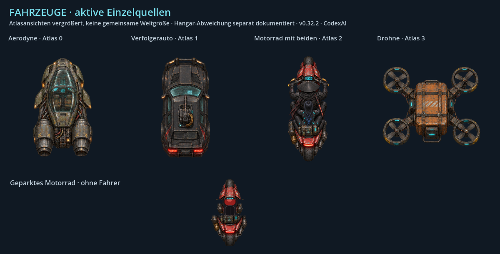
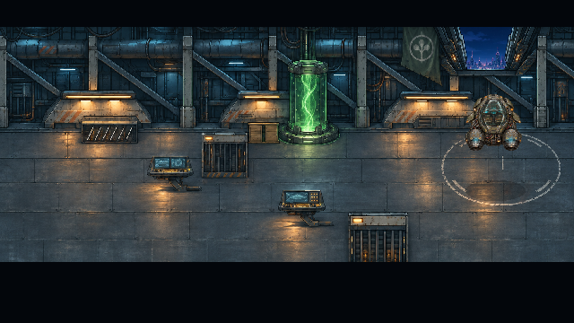
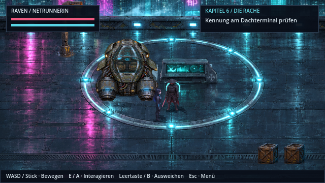
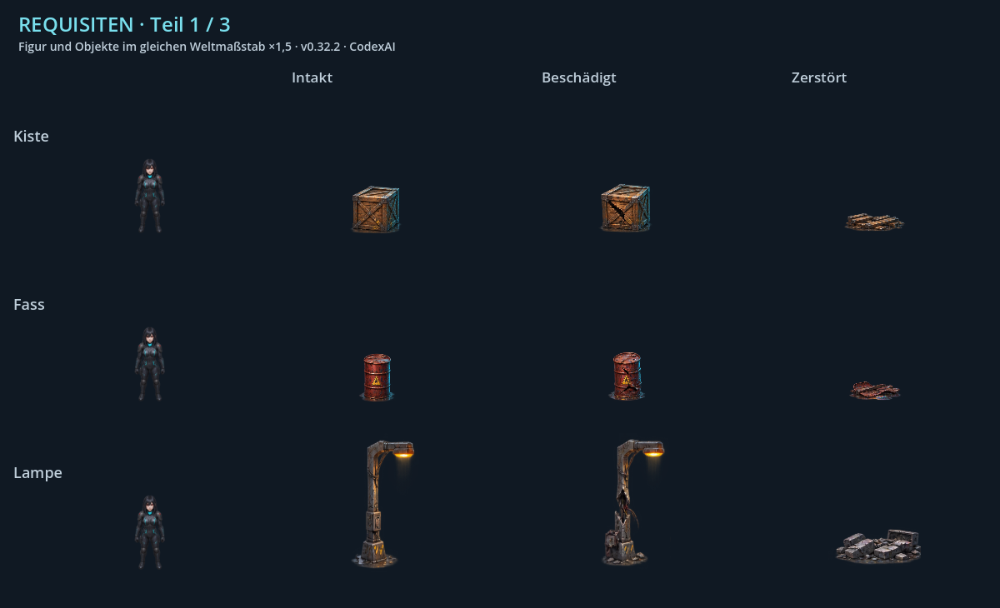
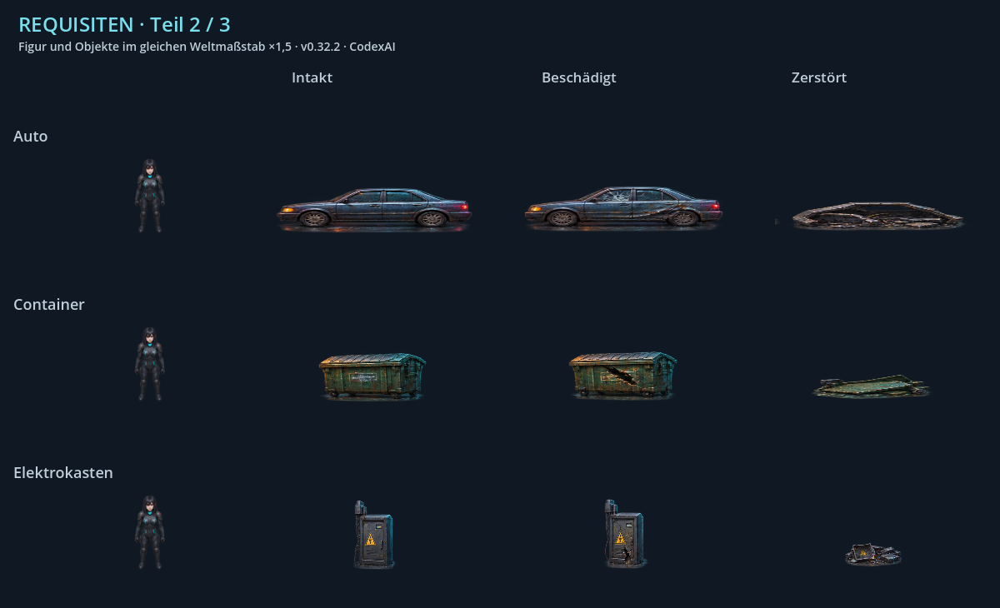
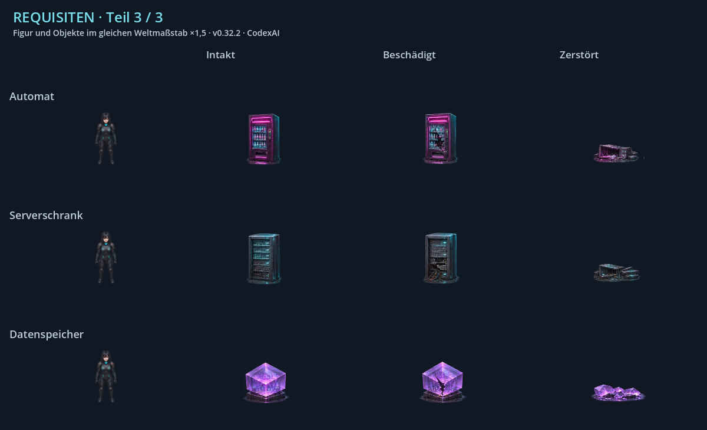

# Fahrzeuge und Requisiten · v0.32.2 · CodexAI

[Stilbibel](README.md) · [Art Direction](artdirection.md) · [Welten](welten.md)

## Fahrzeuge

Die Tafel zeigt vorhandene Quellbilder zur Form-/Materialerkennung, **keinen gemeinsamen Weltmaßstab**. Im Spiel werden Top-down-Verfolgung, Flug, Landung und Garagenobjekte unterschiedlich groß und mit unterschiedlichen Kameras gezeichnet.

| Objekt | Identität / Bildmerkmale | Aktive Quelle und Darstellung |
| --- | --- | --- |
| **Aerodyne** | Gepanzertes dunkles Fluggerät, sichtbares Cockpit, technische Fugen und Düsen; Lichtakzente passend zum Systemzustand. | [vehicles.png](../../assets/world/hq/vehicles.png), Zelle 0 im 2×2-Raster; [aerodyne_flight.gd](../../scripts/aerodyne_flight.gd), [Abflug](../../scripts/hangar_departure.gd). |
| **Verfolgerauto** | Dunkler gepanzerter Wagen, klare Dach-/Motorflächen und Rücklichter; eigene breite Silhouette. | Gleicher Atlas, Zelle 1; [Verfolgung](../../scripts/campaign_drive.gd). |
| **Motorrad mit Shadepi und Raven** | Rotes/dunkles Motorrad; Fahrer mit Kasa und maskiertem Kopf, Raven mit schwarz-blauem Haar und Cyan-Ausrüstung. Beide gehören sichtbar zum Motorrad, keine beliebigen generischen Fahrer. | Gleicher Atlas, Zelle 2. |
| **Drohne** | Kompakter technischer Körper mit vier deutlich erkennbaren Rotoren. | Gleicher Atlas, Zelle 3; Größe und Warn-/Angriffsflächen nach Flug-/Fahrmodus. |
| **Geparktes Motorrad** | Eigenständige Variante ohne Fahrer; dieselbe rote/dunkle Materialfamilie. | [bike-parked.png](../../assets/world/hq/bike-parked.png), Garage und Weltobjektdarstellung. |

### Sichtbarer noch offener Aerodyne-Unterschied

| Hangar-/Abflugdarstellung | Flug-/Dachdarstellung |
| --- | --- |
|  |  |

Die Silhouette und Helligkeit des im Hangar dargestellten Fahrzeugs unterscheiden sich noch vom Fahrzeugatlas. Das ist eine **bekannte offene Vereinheitlichung**, keine neu bestätigte zweite Aerodyne-Identität. Bei einem späteren gemeinsamen Fahrzeugatlas Cockpit, Rumpf, Düsen, Beschädigung und Farbfamilie über alle Ansichten erhalten. Dieses Dokument ersetzt die Grafiken nicht ungefragt.

## Neun Weltobjekte in allen drei Zuständen

Alle folgenden Tafeln benutzen denselben **Weltmaßstab ×1,5**, einschließlich Raven als Vergleich. Sie verwenden die tatsächliche `PropArt.apply()`-Darstellung und deren Zustandsskalierung; die Zellaußenmaße allein sind keine Objektgröße. Die normale Standfigur darf neben einem Container nicht plötzlich wie eine Miniatur wirken.

| Typ / Atlas-Spalte | Soll-Silhouette und Material | Angezeigter intakter Zielrahmen in Weltpixeln |
| --- | --- | --- |
| Kiste / 0 | Glaubhaftes Frachtobjekt mit Materialkanten, räumlicher Oberseite und passender Bodenfläche. | 54 × 58 |
| Fass / 1 | Zylindrischer Behälter mit Ringen und erkennbarem Volumen. | 44 × 58 |
| Laterne / 2 | Hohe schlanke Lichtquelle; Licht gehört an den Leuchtenkopf. | 74 × 111 |
| Geparktes Auto / 3 | Langer niedriger Wagen mit Rädern und lesbarer Karosserie. | 160 × 74 |
| Müllcontainer / 4 | Breiter niedriger Metallbehälter mit Deckel, Kanten und klarer Bodenauflage. | 104 × 70 |
| Elektrokasten / 5 | Technisches Gehäuse mit Scharnier, Warn-/Bedienelementen und Metalloberfläche. | 52 × 74 |
| Getränkeautomat / 6 | Aufrechter Automat mit Frontfeldern; nicht dieselbe Silhouette wie ein Müllcontainer. | 59 × 79 |
| Serverschrank / 7 | Hohes technisches Gehäuse mit Geräte-/Lüftungsfront. | 56 × 78 |
| Datenkristall / 8 | Virtuelles Speicher-/Kristallobjekt mit eigener leuchtender Formensprache. | 67 × 69 |

Diese Werte beschreiben den aktuellen Zeichenrahmen aus [PropArt](../../scripts/prop_art.gd), keine Lore-Maße. Kollisionsflächen stehen getrennt in [WorldProp.TYPES](../../scripts/world_prop.gd). Transparente Ränder und Perspektive beeinflussen den sichtbaren Umriss.

## Zustand und Kontakt erhalten

- Intakt, beschädigt und zerstört gehören zu demselben Objekt. Rost/Farbe, Hauptsilhouette und Standpunkt beim Übergang wiedererkennbar halten.
- Trümmer liegen auf der bisherigen Bodenfläche, nicht in ursprünglicher Schrankhöhe. Der bestehende Renderer flacht Zeile 2 bereits ab.
- Kollisionszustand, Lampenlicht und Trefferfeedback müssen zum sichtbaren Zustand passen. Ein kaputter Kasten darf nicht unverändert beleuchtet oder unsichtbar kollidierend bleiben.
- Verdeckungen und Weltpositionen nach [world_dressing.gd](../../scripts/world_dressing.gd) und der tatsächlichen Szene prüfen. Ein vorhandener Layoutname wird nicht automatisch in jeder Szene verwendet.
- Quelle ist [assets/world/hq/props.png](../../assets/world/hq/props.png) mit den Ausschnitten aus `PropArt`. Ältere `assets/world/props.png`-/`destructibles.png`-Bestände nicht allein anhand des Dateinamens als aktive HQ-Vorlage wählen.
