# Figurenkatalog · v0.32.2 · CodexAI

**Aktueller Stand v0.46.1 · CodexAI:** Originalhelden wieder aktiv; beide Karten und die vollständige Übersicht zeigen wieder diese Quellen. [Spielansicht und Rückkehr](../original-helden.md). Der folgende v0.45.0-Eintrag dokumentiert die inzwischen verworfene Zwischenfassung.

**Aktualisierung v0.45.0 · CodexAI:** Heldenkarten und vollständige 23-Figuren-Übersicht aus den aktiven Gameplay-Quellen erneuert. [Neue Quellen und Anker](../../assets/sprites/heroes/gameplay/README.md), [Originale als Backup](../../assets/sprites/heroes/backup-v0441/README.md), [Spielvergleich](../fehlerbericht-v045.md).

**Aktualisierung v0.39.0 · CodexAI:** [Plattformfahrt und Hangarentdeckung](../hangar-entdeckung.md), vier eigene Shadepi-Schalterposen, sechs Entriegelungsbilder und texturierter Schacht. Fahrt mit den tatsächlichen Figuren; danach identischer Aerodyne in normaler Erkundung und Film. [Aktive Quellen und Kontaktanker](../../assets/story/hangar-discovery/README.md).

**Aktualisierung v0.38.0 · CodexAI:** [Eisbad und Kryospray-Rettung](../eisbad.md) mit acht eigenen HQ-Kontaktposen für Raven/Shadepi. Reale Weltgröße, unterschiedliche Zuschnitte der Paarposen und volle Kopf-/Haar-/Hutsilhouette beachten; normale Figurensätze bleiben gültig.

**Handkorrektur v0.36.1 · CodexAI:** Im [See-Finale](../see-finale.md) hebt Raven die Maske mit ihrer **rechten** Hand; ihre **linke** berührt und verdeckt Shadepis Gesicht. Diese Zuordnung gilt für Maskenabnahme und Kuss, jeweils aus Ravens eigener Sicht.

[Stilbibel](README.md) · [Art Direction](artdirection.md) · [Welt und Kulissen](welten.md)

**23 aktive Figuren beziehungsweise visuell eigenständige Typen.** Jede Karte zeigt vorhandene Quellpixel, keine neu generierten Ansichten. Körper-/Masken-/Kleidungsmerkmale erhalten; Stil und Darstellungsmaßstab zusätzlich nach der [Art Direction](artdirection.md) abgleichen. Storyangaben dienen Mitwirkenden als Kontinuitätsreferenz.

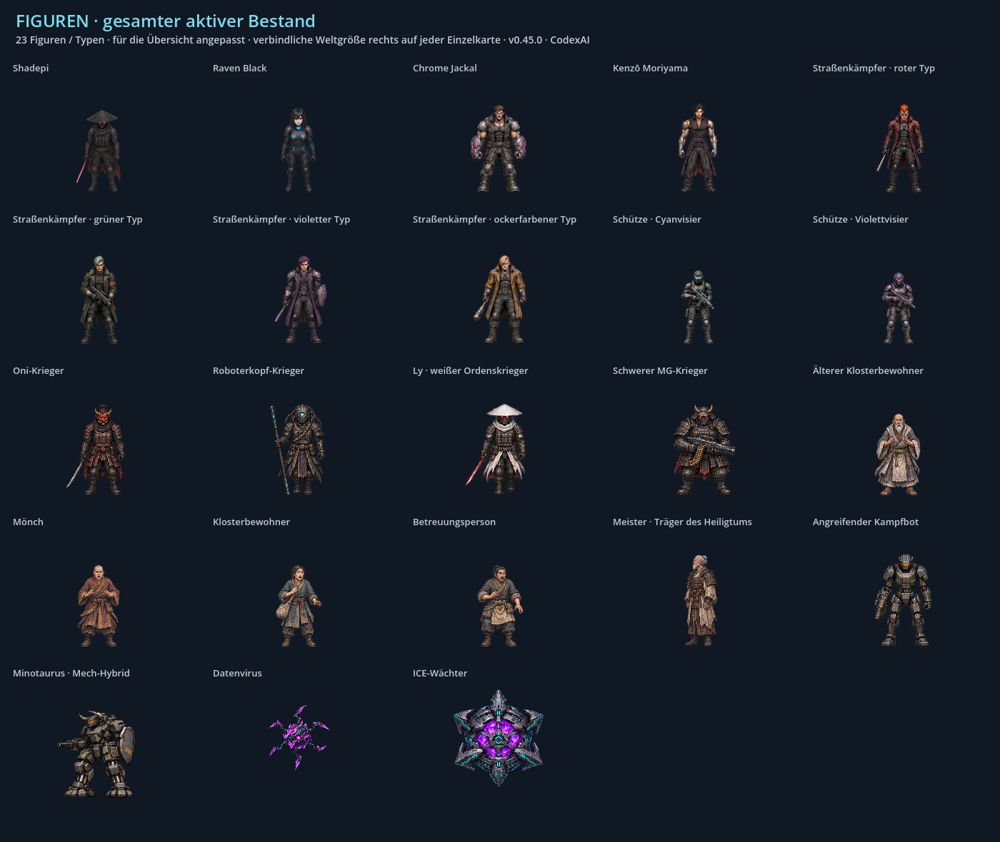

Die Übersicht passt die Vergrößerung zur Erkennbarkeit an. Auf jeder Einzelkarte stehen der Ansichtsmaßstab und rechts dieselbe Figur im **Weltmaßstab ×1** ohne Kamera-Zoom. Bei normalen Figuren: Vorder-/Seiten-/Rückansicht und Aktions- oder Gehpose. Der Meister besitzt keine separaten vollständigen Drehansichten; seine Karte zeigt nur die tatsächlich vorhandenen Szenenposen. Bei digitalen Gegnern ist nur eine schwebende Form vorhanden.

## Schnellzugriff

- [Shadepi](#shadepi)
- [Raven Black](#raven)
- [Chrome Jackal](#jackal)
- [Kenzō Moriyama](#kenzo)
- [Straßenkämpfer · roter Typ](#punk-1)
- [Straßenkämpfer · grüner Typ](#punk-2)
- [Straßenkämpfer · violetter Typ](#punk-3)
- [Straßenkämpfer · ockerfarbener Typ](#punk-4)
- [Schütze · Cyanvisier](#shooter-visor)
- [Schütze · Violettvisier](#shooter-violet)
- [Oni-Krieger](#oni)
- [Roboterkopf-Krieger](#robot)
- [Ly · weißer Ordenskrieger](#ly)
- [Schwerer MG-Krieger](#heavy)
- [Älterer Klosterbewohner](#elder)
- [Mönch](#monk)
- [Klosterbewohner](#resident)
- [Betreuungsperson](#caretaker)
- [Meister · Träger des Heiligtums](#master)
- [Angreifender Kampfbot](#bot)
- [Minotaurus · Mech-Hybrid](#minotaur)
- [Datenvirus](#dive-virus)
- [ICE-Wächter](#ice-guardian)

## Shadepi

**Familie:** Helden · **technische ID:** `shadepi`

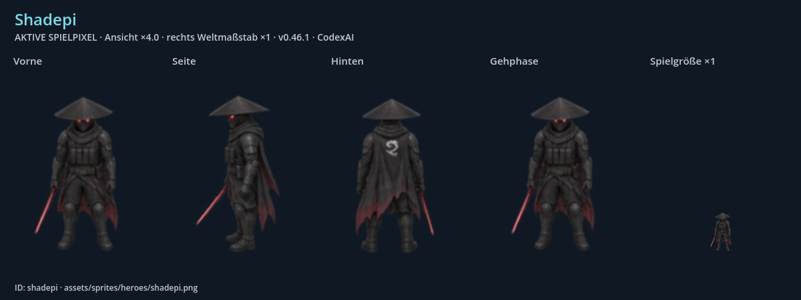

- Schwarzer Kasa, geschlossene segmentierte Maske, rote Linsen.
- Schal, taktische Weste und dunkle ausgefranste Stoffbahnen; rotes Laser-Katana.
- Keine bestätigte Zentimetergröße ergänzen. Körperbau anhand des normalen Sprites erhalten.

**Aktive Quellen und Darstellung:** [shadepi.png](../../assets/sprites/heroes/shadepi.png) · [pixel_actor.gd](../../scripts/pixel_actor.gd) · [sprite_assets.gd](../../scripts/sprite_assets.gd).

## Raven Black

**Familie:** Helden · **technische ID:** `raven`

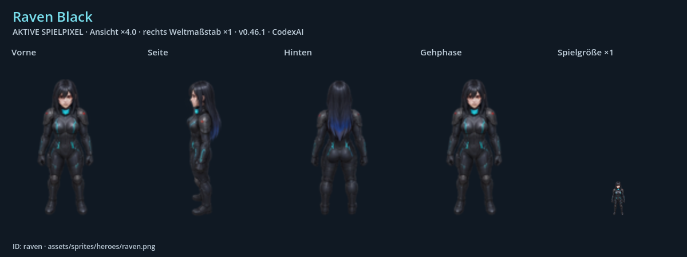

- Verbindlich 160 cm; schwarze Haare mit blauen Spitzen, rote Augen und goldenes Septum.
- Schwarzer Anzug mit schmalen Cyan-Linien, Cyan-Kragenmodule, rote Raben-Schulterzeichen.
- Pistole und Holster in der physischen Welt; offene Hand für Blitze im Deep Dive.

**Aktive Quellen und Darstellung:** [raven.png](../../assets/sprites/heroes/raven.png) · [pixel_actor.gd](../../scripts/pixel_actor.gd) · [sprite_assets.gd](../../scripts/sprite_assets.gd).

## Chrome Jackal

**Familie:** Gegner der Gegenwart · **technische ID:** `jackal`

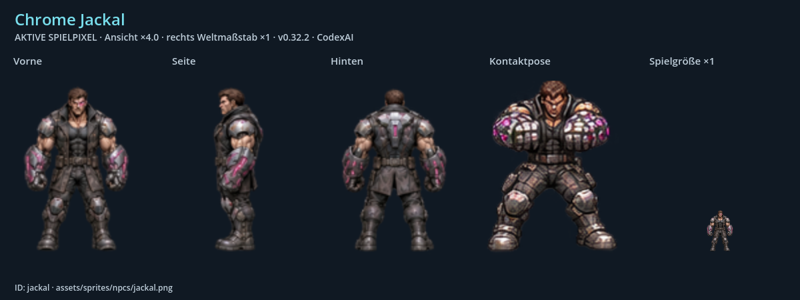

- Breiter cybernetischer Nahkämpfer, kurze braune Haare, massive gepanzerte Unterarme.
- Schieferfarbene Rüstung und magentafarbene Cyberoptik; keine Kasa-/Rabenmerkmale übernehmen.

**Aktive Quellen und Darstellung:** [jackal.png](../../assets/sprites/npcs/jackal.png) · [pixel_actor.gd](../../scripts/pixel_actor.gd) · [sprite_assets.gd](../../scripts/sprite_assets.gd) · [contact-poses.json](../../assets/sprites/npcs/contact-poses.json) · [contact-poses.png](../../assets/sprites/npcs/contact-poses.png).

## Kenzō Moriyama

**Familie:** Gegner der Gegenwart · **technische ID:** `kenzo`

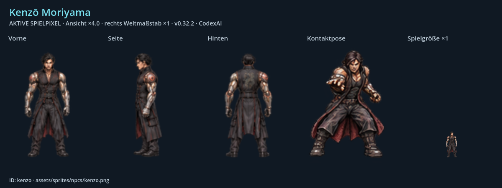

- Schwarze Haare, dunkle ärmellose Gewandung, sichtbare cybernetische Arme und Schultermechanik.
- Boss der Tower-Konfrontation; Aussehen und Körperbau nicht mit Jackal vertauschen.

**Aktive Quellen und Darstellung:** [kenzo.png](../../assets/sprites/npcs/kenzo.png) · [pixel_actor.gd](../../scripts/pixel_actor.gd) · [sprite_assets.gd](../../scripts/sprite_assets.gd) · [contact-poses.json](../../assets/sprites/npcs/contact-poses.json) · [contact-poses.png](../../assets/sprites/npcs/contact-poses.png).

## Straßenkämpfer · roter Typ

**Familie:** Gegner der Gegenwart · **technische ID:** `punk-1`

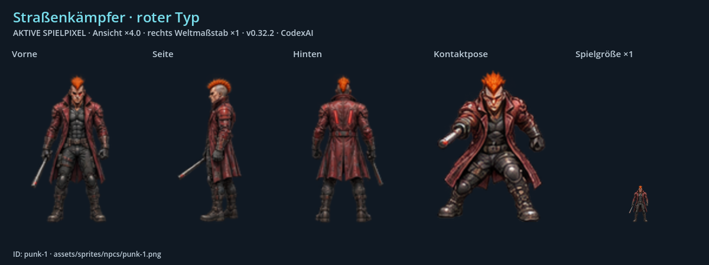

- Orangefarbener Irokesenschnitt, roter Mantel, dunkle Rüstung und Schlagwaffe.
- Farbkennung und Haarform bleiben über Geh- und Kontaktposen erhalten.

**Aktive Quellen und Darstellung:** [punk-1.png](../../assets/sprites/npcs/punk-1.png) · [pixel_actor.gd](../../scripts/pixel_actor.gd) · [sprite_assets.gd](../../scripts/sprite_assets.gd) · [contact-poses.json](../../assets/sprites/npcs/contact-poses.json) · [contact-poses.png](../../assets/sprites/npcs/contact-poses.png).

## Straßenkämpfer · grüner Typ

**Familie:** Gegner der Gegenwart · **technische ID:** `punk-2`

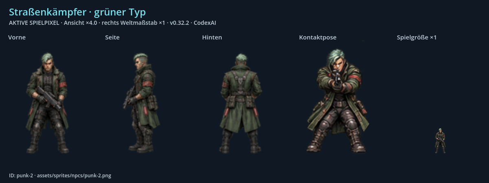

- Mintfarbene seitlich gelegte Haare, grüner taktischer Mantel, dunkle Panzerung.
- Aktuelle Gegnerrolle und Bewaffnung aus dem aktiven NPC-Code übernehmen; alte Generierungsprompts sind kein Gameplay-Vertrag.

**Aktive Quellen und Darstellung:** [punk-2.png](../../assets/sprites/npcs/punk-2.png) · [pixel_actor.gd](../../scripts/pixel_actor.gd) · [sprite_assets.gd](../../scripts/sprite_assets.gd) · [contact-poses.json](../../assets/sprites/npcs/contact-poses.json) · [contact-poses.png](../../assets/sprites/npcs/contact-poses.png).

## Straßenkämpfer · violetter Typ

**Familie:** Gegner der Gegenwart · **technische ID:** `punk-3`

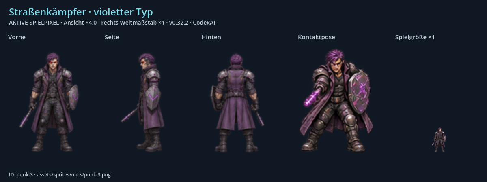

- Violette stachelige Haare, violette Panzerkleidung, markanter Unterarmschutz.
- Eigenständige Silhouette gegenüber den anderen Punktypen bewahren.

**Aktive Quellen und Darstellung:** [punk-3.png](../../assets/sprites/npcs/punk-3.png) · [pixel_actor.gd](../../scripts/pixel_actor.gd) · [sprite_assets.gd](../../scripts/sprite_assets.gd) · [contact-poses.json](../../assets/sprites/npcs/contact-poses.json) · [contact-poses.png](../../assets/sprites/npcs/contact-poses.png).

## Straßenkämpfer · ockerfarbener Typ

**Familie:** Gegner der Gegenwart · **technische ID:** `punk-4`

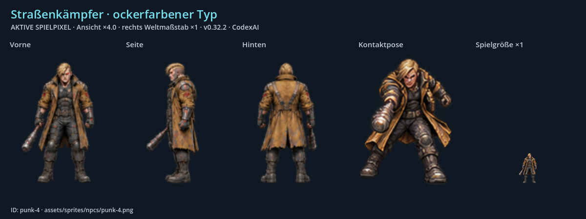

- Blonder seitlicher Undercut, ockerbrauner Mantel, dunkle Rüstung und Schlagwaffe.
- Keine weiße Hintergrundmatte aus älteren Quellstufen übernehmen.

**Aktive Quellen und Darstellung:** [punk-4.png](../../assets/sprites/npcs/punk-4.png) · [pixel_actor.gd](../../scripts/pixel_actor.gd) · [sprite_assets.gd](../../scripts/sprite_assets.gd) · [contact-poses.json](../../assets/sprites/npcs/contact-poses.json) · [contact-poses.png](../../assets/sprites/npcs/contact-poses.png).

## Schütze · Cyanvisier

**Familie:** Gegner der Gegenwart · **technische ID:** `shooter-visor`

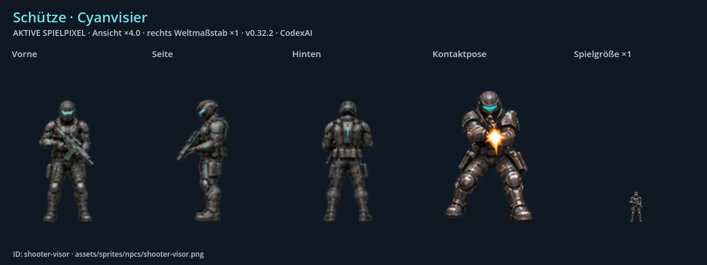

- Geschlossener schwarzer Taktikhelm mit Cyanvisier; segmentierte schwarze Rüstung.
- Kompakte Schusswaffe, erkennbare Mündung und passende Schuss-/Erholungsphase.

**Aktive Quellen und Darstellung:** [shooter-visor.png](../../assets/sprites/npcs/shooter-visor.png) · [pixel_actor.gd](../../scripts/pixel_actor.gd) · [sprite_assets.gd](../../scripts/sprite_assets.gd) · [contact-poses.json](../../assets/sprites/npcs/contact-poses.json) · [contact-poses.png](../../assets/sprites/npcs/contact-poses.png).

## Schütze · Violettvisier

**Familie:** Gegner der Gegenwart · **technische ID:** `shooter-violet`

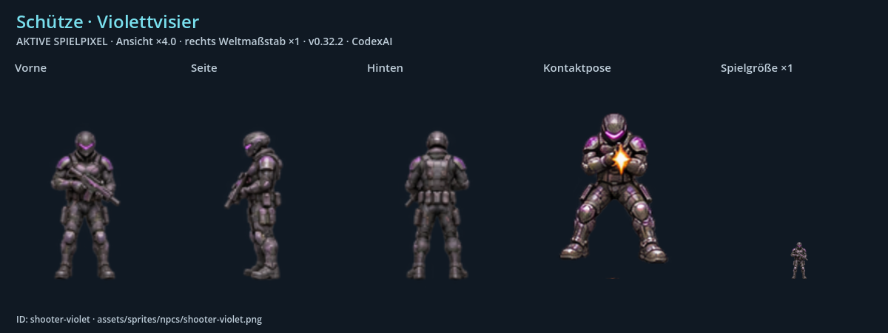

- Graphitfarbener geschlossener Helm mit violettem Visier und Akzenten.
- Vom Cyan-Schützen über Farbkennung unterscheiden; gleiche plausible Waffenhaltung.

**Aktive Quellen und Darstellung:** [shooter-violet.png](../../assets/sprites/npcs/shooter-violet.png) · [pixel_actor.gd](../../scripts/pixel_actor.gd) · [sprite_assets.gd](../../scripts/sprite_assets.gd) · [contact-poses.json](../../assets/sprites/npcs/contact-poses.json) · [contact-poses.png](../../assets/sprites/npcs/contact-poses.png).

## Oni-Krieger

**Familie:** Orden · **technische ID:** `oni`

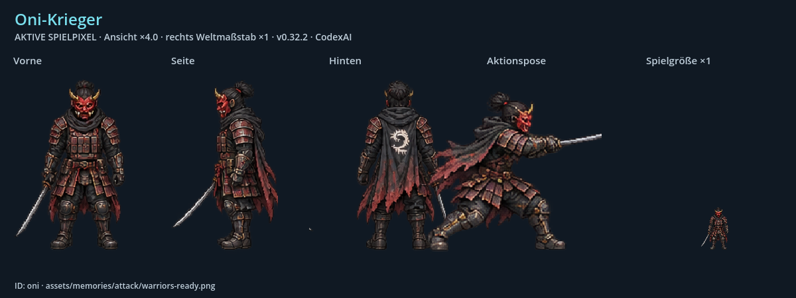

- Oni-Maske und Katana, dunkle Ordensausrüstung.
- Fällt in Erinnerung I, um Shadepi zu schützen. Kein bestätigter Eigenname.

**Aktive Quellen und Darstellung:** [warriors-ready.png](../../assets/memories/attack/warriors-ready.png) · [actors.json](../../assets/memories/attack/actors.json) · [combat.png](../../assets/memories/attack/combat.png) · [memory_actor.gd](../../scripts/memories/memory_actor.gd).

## Roboterkopf-Krieger

**Familie:** Orden · **technische ID:** `robot`

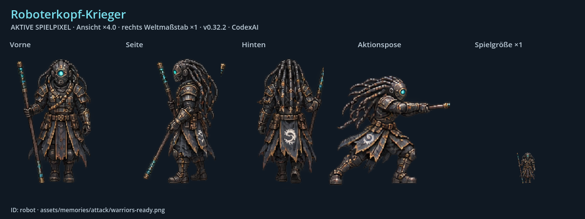

- Roboterkopf mit Dreadlocks aus Kabeln; Stab als bestätigte Bewaffnung.
- Überlebt Erinnerung I. Sein späteres Schicksal ist nicht festgelegt.

**Aktive Quellen und Darstellung:** [warriors-ready.png](../../assets/memories/attack/warriors-ready.png) · [actors.json](../../assets/memories/attack/actors.json) · [combat.png](../../assets/memories/attack/combat.png) · [memory_actor.gd](../../scripts/memories/memory_actor.gd).

## Ly · weißer Ordenskrieger

**Familie:** Orden · **technische ID:** `ly`

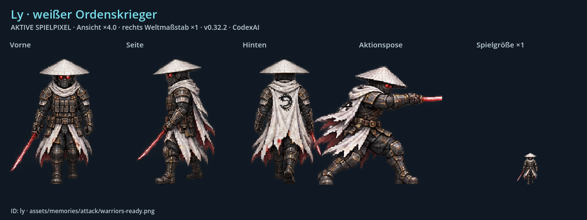

- Shadepi-ähnliche geschlossene Maske, weiße Gewandung und Klinge.
- Überlebt Erinnerung I und opfert sich in Erinnerung II. Nicht als weiß eingefärbter Shadepi ohne eigenes Kostüm behandeln.

**Aktive Quellen und Darstellung:** [warriors-ready.png](../../assets/memories/attack/warriors-ready.png) · [actors.json](../../assets/memories/attack/actors.json) · [combat.png](../../assets/memories/attack/combat.png) · [memory_actor.gd](../../scripts/memories/memory_actor.gd).

## Schwerer MG-Krieger

**Familie:** Orden · **technische ID:** `heavy`

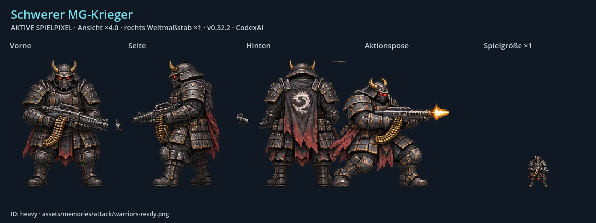

- Samurai-Maske, vollständige schwere Panzerung und großes MG.
- Fällt mit Oni in Erinnerung I zum Schutz Shadepis; Gewicht und Waffengröße sichtbar erhalten.

**Sichtbarer Altbestand:** Kleine abgetrennte Nachbarfragmente an den Bereitschaftszellen sind Atlasartefakte, keine zusätzlichen Waffen- oder Kostümteile. Neue Quellen sollen saubere Zellränder haben; die Bildkarte dokumentiert die unveränderte aktive Quelle.

**Aktive Quellen und Darstellung:** [warriors-ready.png](../../assets/memories/attack/warriors-ready.png) · [actors.json](../../assets/memories/attack/actors.json) · [combat.png](../../assets/memories/attack/combat.png) · [memory_actor.gd](../../scripts/memories/memory_actor.gd).

## Älterer Klosterbewohner

**Familie:** Zivilfiguren · **technische ID:** `elder`

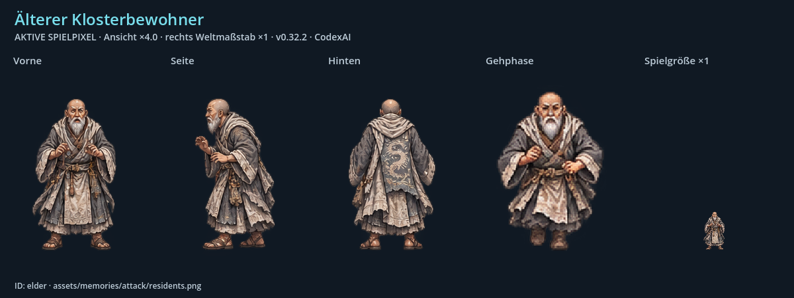

- Älterer unbewaffneter Bewohner in traditioneller Kleidung.
- Eigenständige Zivilfigur, nicht mit dem Träger des Heiligtums gleichsetzen.

**Aktive Quellen und Darstellung:** [residents.png](../../assets/memories/attack/residents.png) · [actors.json](../../assets/memories/attack/actors.json) · [residents-walk.png](../../assets/memories/attack/residents-walk.png) · [memory_actor.gd](../../scripts/memories/memory_actor.gd).

## Mönch

**Familie:** Zivilfiguren · **technische ID:** `monk`

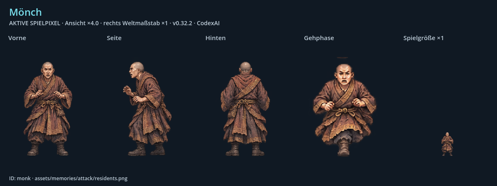

- Traditionelle Mönchskleidung, unbewaffnete zivile Silhouette.
- Flucht mit vier Gehbildern je Richtung; keine Kampfpose oder moderne Heldenrüstung hinzufügen.

**Aktive Quellen und Darstellung:** [residents.png](../../assets/memories/attack/residents.png) · [actors.json](../../assets/memories/attack/actors.json) · [residents-walk.png](../../assets/memories/attack/residents-walk.png) · [memory_actor.gd](../../scripts/memories/memory_actor.gd).

## Klosterbewohner

**Familie:** Zivilfiguren · **technische ID:** `resident`

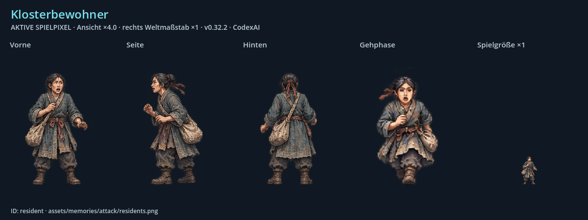

- Unbewaffnete Alltagskleidung des Klosters; Haar- und Kleidungsfarben aus dem aktiven Blatt übernehmen.
- Die Karte zeigt den vorhandenen Typ, keinen neu benannten Storycharakter.

**Aktive Quellen und Darstellung:** [residents.png](../../assets/memories/attack/residents.png) · [actors.json](../../assets/memories/attack/actors.json) · [residents-walk.png](../../assets/memories/attack/residents-walk.png) · [memory_actor.gd](../../scripts/memories/memory_actor.gd).

## Betreuungsperson

**Familie:** Zivilfiguren · **technische ID:** `caretaker`

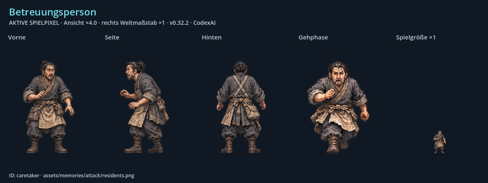

- Unbewaffnete zivile Klosterkleidung; eigene Kleidungs- und Haarsilhouette.
- Bezeichnung folgt der technischen ID caretaker; persönliche Biografie ist nicht bestätigt.

**Aktive Quellen und Darstellung:** [residents.png](../../assets/memories/attack/residents.png) · [actors.json](../../assets/memories/attack/actors.json) · [residents-walk.png](../../assets/memories/attack/residents-walk.png) · [memory_actor.gd](../../scripts/memories/memory_actor.gd).

## Meister · Träger des Heiligtums

**Familie:** Orden · **technische ID:** `master`

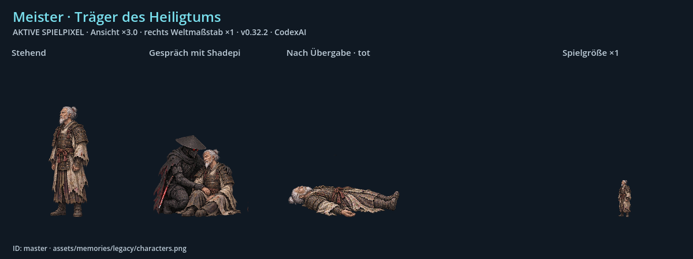

- Älterer Mann mit weißem Bart, gebundenem Haar und traditioneller bronze-/brauner Kampfausrüstung.
- Kein bestätigter Eigenname. Tod nach der Übertragung ist verbindlich; keine entspannte lebendige Nachherpose.
- Für fehlende Seiten-/Rückansichten keine erfundenen Ansichten als Original ausgeben. Die Tafel zeigt vorhandene Szenenposen.

**Aktive Quellen und Darstellung:** [characters.png](../../assets/memories/legacy/characters.png) · [master-death.png](../../assets/memories/legacy/master-death.png) · [actors.json](../../assets/memories/legacy/actors.json) · [legacy_figure.gd](../../scripts/memories/legacy_figure.gd).

## Angreifender Kampfbot

**Familie:** Roboter und digitale Gegner · **technische ID:** `bot`

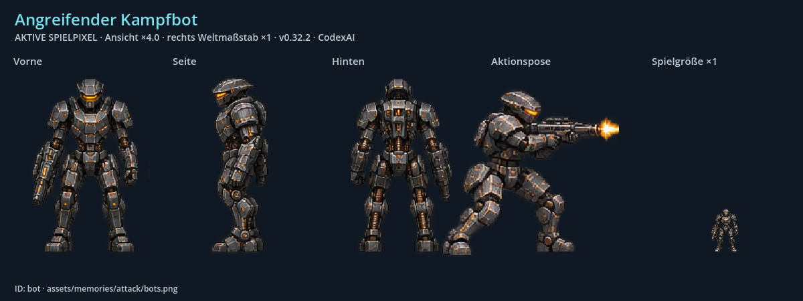

- Bewaffneter mechanischer Angreifer des Klosters mit klarer nichtmenschlicher Rüstung.
- Eigene Bereitschafts-, Geh-, Feuer-, Treffer- und Wrackzustände aus dem Bot-Atlas.

**Aktive Quellen und Darstellung:** [bots.png](../../assets/memories/attack/bots.png) · [actors.json](../../assets/memories/attack/actors.json) · [combat.png](../../assets/memories/attack/combat.png) · [memory_actor.gd](../../scripts/memories/memory_actor.gd).

## Minotaurus · Mech-Hybrid

**Familie:** Roboter und digitale Gegner · **technische ID:** `minotaur`

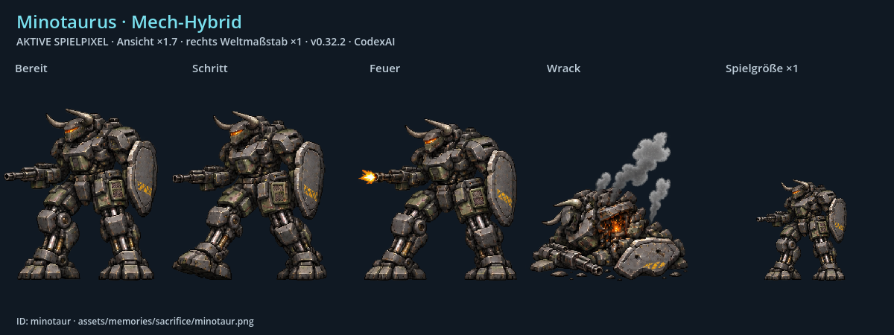

- Großer gepanzerter zweibeiniger Cyborg-/Mech-Hybrid mit Servomechanik und schwerer Bewaffnung.
- Beine und Lys konkrete Sprengtechnik sind dokumentierte Umsetzungsentscheidungen; kein neu bestätigtes Nutzerzitat.
- Ein Exemplar in Erinnerung II, zwei unabhängig besiegbare Exemplare in Erinnerung III. Gleicher Typ und gleiche Materialfamilie.

**Aktive Quellen und Darstellung:** [minotaur.png](../../assets/memories/sacrifice/minotaur.png) · [actors.json](../../assets/memories/sacrifice/actors.json) · [minotaur.gd](../../scripts/memories/minotaur.gd).

## Datenvirus

**Familie:** Roboter und digitale Gegner · **technische ID:** `dive-virus`

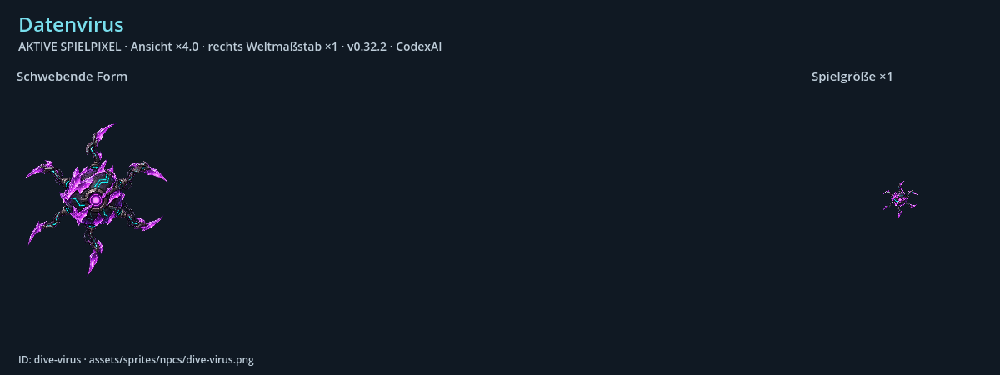

- Schwebende violette kristalline Digitalkugel mit Tentakeln und Cyan-Schaltlinien.
- Eigene virtuelle Form; nicht als physischer Kampfbot oder menschliche Figur darstellen.

**Aktive Quellen und Darstellung:** [dive-virus.png](../../assets/sprites/npcs/dive-virus.png) · [dive_threat.gd](../../scripts/dive_threat.gd).

## ICE-Wächter

**Familie:** Roboter und digitale Gegner · **technische ID:** `ice-guardian`

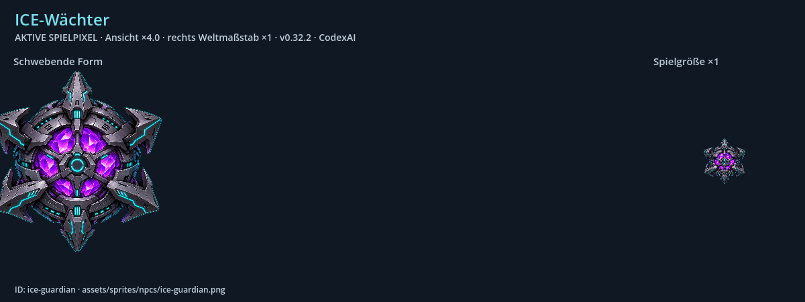

- Größere schwere digitale Wächterkugel mit dunklen gepanzerten Segmenten, violettem Kern und Cyan-Schaltlinien.
- Klar vom kleineren Virus unterscheiden; im Renderer größer, mit eigenem Strahl-/Verwundbarkeitsfenster.

**Aktive Quellen und Darstellung:** [ice-guardian.png](../../assets/sprites/npcs/ice-guardian.png) · [dive_threat.gd](../../scripts/dive_threat.gd).

## Zusätzliche Darstellungszustände der Hauptfiguren

**Nachtrag v0.33.0 · CodexAI:** [Neue Tower-Szenenposen](../../assets/story/tower/README.md) zeigen Kenzōs Griff nach Raven, den stark verletzten knienden Gefangenen, Raven am Extraktionsdeck und Kenzōs endgültigen Zusammenbruch. [Tatsächliche Spielansichten und Ablauf](../tower-extraktion.md). Dies sind Zustände der vorhandenen Figuren, keine neuen Identitäten; Kenzō lebt bis zur gesicherten Datenextraktion.

Die Identität bleibt bei Menü, normalem Spiel, Spezialangriffen und Szenenposen dieselbe. Die Formate und Abtastungen unterscheiden sich je Einsatz; nicht ungeprüft austauschen.

| Zustand | Sichtbarer Vergleich | Quellen und Vertrag |
| --- | --- | --- |
| Menü und ruhiger Wind | 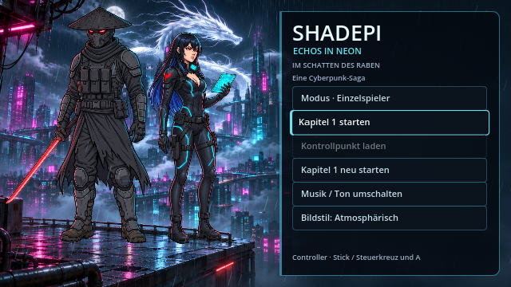 | [Figuren-PNG](../../assets/menu/start-heroes-hq.png), [Menübeschreibung](../live-startmenue.md). Größere Menüansicht mit festen Füßen; keine Mausverschiebung. |
| Raven: virtuelle Blitze / physische Pistole | 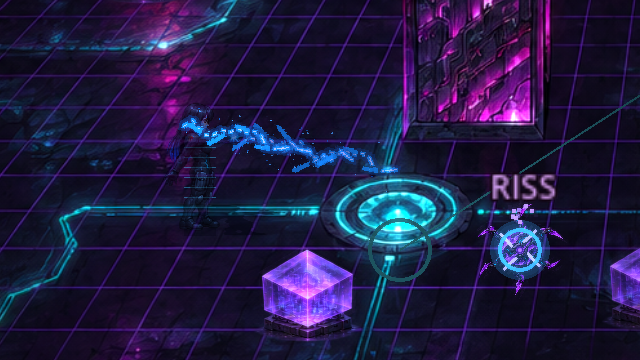 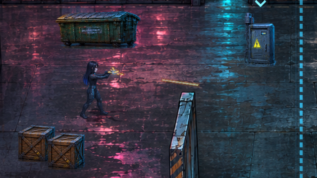 | [Handanker](../../assets/sprites/heroes/raven-hand-cast.json), [Kampfdetails](../raven-gegner-kampf.md). Keine Vertauschung von Hand und Mündung. |
| Aufgeladener Angriff und Kick | [Animierte Kampfbewegungen](../kampfbewegungen.md) | [Spezialposen](../../assets/sprites/heroes/combat-poses.png), [Player](../../scripts/player.gd). Zeilen: Shadepi laden, Knie anheben, Kick ausstrecken, Raven laden; Richtungen und Fußbasis erhalten. |
| Sitzen und Handkontakt | 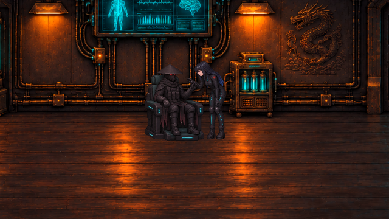 | [Aktuelles Posenblatt](../../assets/story/sanctuary/poses-game.png); eigenständige Szenenpose, keine neue Figur. |
| Raven schläft | 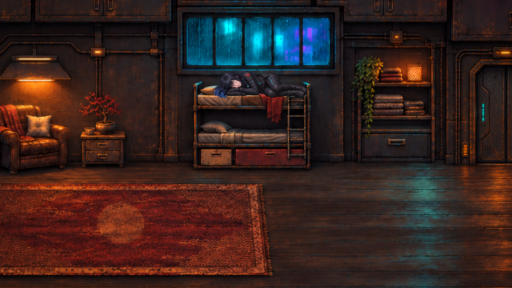 | Gleiches Blatt; Körperlänge gegen den normalen Sprite prüfen. |
| Heiligtumsübertragung und Aura | 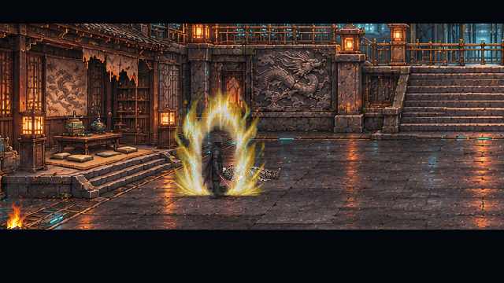 | [Aura-Atlas](../../assets/memories/legacy/shadepi-aura.png), [Auralaufzeit](../../scripts/memories/legacy_aura.gd). Goldweiß/Cyan, Körper und Maske nicht verformen. |

## Weitere Identitäten und Grenzen

- **ARToS-7** ist als Bord-KI, Stimme, Cockpit-/Terminaloberfläche dargestellt. Es liegt kein eigener menschlicher ARToS-Charaktersprite vor. Dafür keinen erfundenen Körper als bestehende Referenz hinzufügen.
- Der **weiße Drache** erscheint als mystisches Motiv der Stadt-/Menükulisse und in Ordenszeichen. Die vorhandenen Motive nicht mit einem bereits vorhandenen frei spielbaren Drachen-Sprite verwechseln.
- Hintergründe enthalten weitere gemalte Menschen-/Silhouettenmotive. Diese sind keine zusätzlichen einzeln animierbaren Charaktere im Katalog.
- Die zwölf ursprünglichen Chat-Figurenblätter bleiben im [Universumsarchiv](../universum/README.md) beschrieben; lokale Originalbilder fehlen. Diese Referenzkarten sichern den tatsächlich vorhandenen Spielbestand und ersetzen die Originaldossiers nicht.

**Kontaktposen v0.36.0 · CodexAI:** [Raven und Shadepi am See](../see-finale.md), [aktive Quelle](../../assets/story/lake/README.md). Händehalten, Maskenabnahme mit verdeckender Hand, privater Kuss und maskierte Umarmung sind Zustände der vorhandenen erwachsenen Figuren, keine neuen Identitäten. Normalen Weltmaßstab und Kontaktanker aus `lake_tableau.gd` beachten. In beiden maskenlosen Zellen bleibt Shadepis Gesicht verdeckt.
