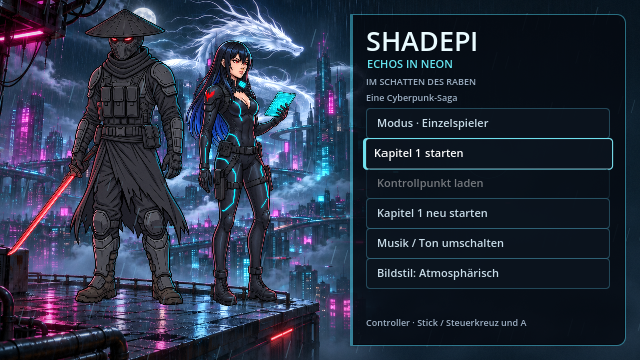
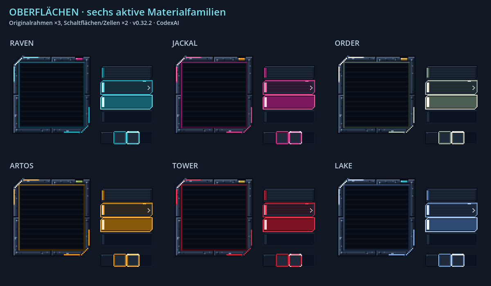
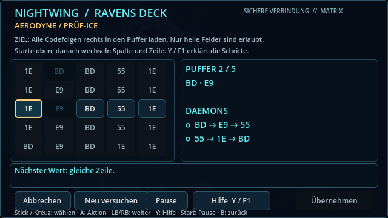
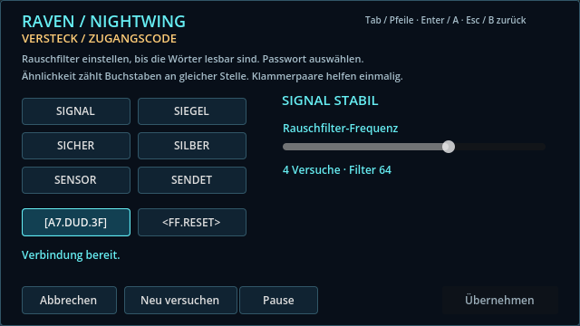
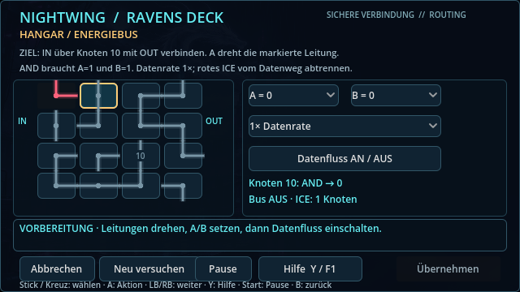
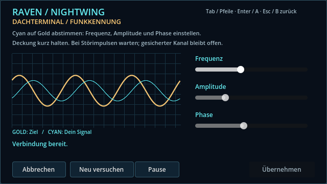
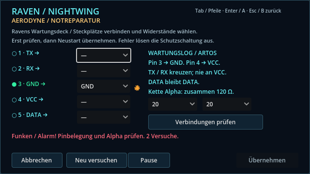
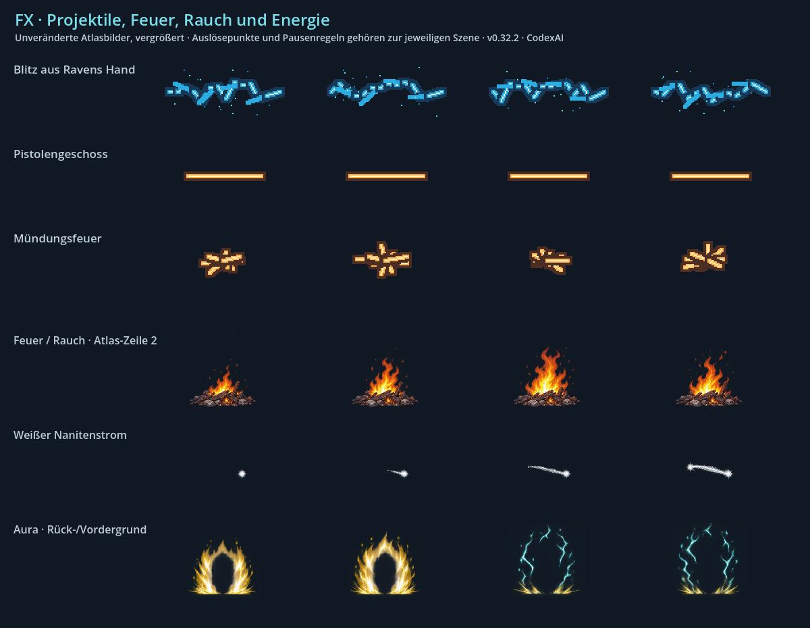

# Oberflächen, Effekte und Ton · v0.32.2 · CodexAI

[Stilbibel](README.md) · [Art Direction](artdirection.md) · [Figuren](figuren.md)

## Hauptmenü und HUD

Die Skyline mit weißem Drachen, vorderer Dachplattform und beiden Figuren ist das Menübild. Figurenmerkmale entsprechen dem [Figurenkatalog](figuren.md), obwohl das Menü eine größere eigene Darstellung nutzt. Füße und Dach stehen fest; nur freie Haar-/Stoffenden wehen. Maus und Controller bewegen den Fokus, nicht die Figurenkörper. Regen, Licht und Verkehr bleiben unter Text und Bedienflächen lesbar.

Das Gameplay-HUD nutzt das 640×360-Spielraster, erkennbare Lebens-/Energiebalken und knappe Interaktionshinweise. Fokus und bestätigbare Aktionen dürfen nicht nur durch eine schwer sichtbare Farbänderung unterscheidbar sein. Quelle: [Menü](../../scripts/start_menu_backdrop.gd), [Menügestaltung](../live-startmenue.md), [Pixel-UI](../pixel-ui.md).

## Sechs gemeinsame UI-Familien

| Familie | Verwendung / Emblem | Vorhandene Primär-/Akzentfarben |
| --- | --- | --- |
| `raven` | Ravens eigenes Netz, Rabe | Cyan `#62e3ee`, Magenta `#ff7fc0` |
| `jackal` | Gang-Technik / Chrome Jackal, Schakal | Pink `#ff5fa2`, Amber `#ffcf7a` |
| `order` | Ordenssysteme, weißer Drache | Elfenbein `#e9e2cf`, Gold `#f5dc96` |
| `artos` | Aerodyne / Bord-KI ARToS-7 | Amber `#ffb43a`, Oliv `#d6ecaa` |
| `tower` | Moriyama-Tower und zugehörige Systeme | Rot `#ff3150`, Gold `#f5e0a0` |
| `lake` | Abschluss am See | Eisblau `#bcd8ff`, Cyan `#7ff0ff` |

Die Werte stammen aus [ui_skin.gd](../../scripts/ui_skin.gd), nicht aus einer erfundenen globalen Farbpalette. Dort stehen auch Kapitel-/Terminalzuordnungen. Pixelrahmen, genietete Metallflächen, klare Neonränder und sichtbare Normal-/Fokus-/Gedrückt-/Gesperrt-Zustände erhalten. UI-Texturen verwenden Nearest und passende ganzzahlige Darstellung; Pixel-Schriften, Nine-Slice-Ränder und Embleme nicht durch glatte Standardwidgets ersetzen.

## Alle fünf Hackfamilien

| Aufgabe | Vorhandene Darstellung | Lesbare Handlungsinformation |
| --- | --- | --- |
| Matrix / Puffersequenz |  | Erlaubte Zeile/Spalte, Pufferkapazität und Zielsequenzen erkennen; Auswahl und verbrauchte Zellen unterscheiden. |
| Passwort-/Glitch-Decoder |  | Vergleich/Ähnlichkeit, Versuche und Filterfunktion verständlich erklären. |
| Schaltungsrouting |  | Start, Ziel, Leitungsausrichtung, Gefahr und Gegenwehr klar unterscheiden. |
| Wellen-Synchronisation |  | Ziel-/Spielersignal und Regler für Frequenz, Amplitude und Phase eindeutig kennzeichnen. |
| Hardware-Jumper |  | Pin-Bezeichnungen und Hinweise lesbar; gewählte Verbindung, Fehler und Erfolg sichtbar machen. |

Die vorhandenen Screenshots dienen der Oberflächenreferenz; Regeln und aktuelle Steuerung stehen in [Ravens Terminals](../ravens-terminals.md). Controller-Fokus, A zum Bestätigen, B zum Zurückgehen, LB/RB zum Elementwechsel und Hilfe/Pause erhalten. Bei Erweiterungen Ziel, Eingabe und Rückmeldung direkt im passenden Deck erklären. Eine separate Hilfe ist kein Ersatz für erkennbaren Fokus.

## Effektfamilien

Die Tafel zeigt Quellframes zur Form-/Farbreferenz, nicht jede Animation oder ihren vollständigen Spielmaßstab.

| Familie | Form / Farbe / Bindung | Aktive Quelle |
| --- | --- | --- |
| Raven: virtuelles Geschoss | Verzweigter Cyan-/Weißblitz, Beginn an der offenen Hand; elektrischer Klang. | [lightning.png](../../assets/fx/lightning.png), [PixelCombatFX](../../scripts/pixel_combat_fx.gd), Handanker im [Player](../../scripts/player.gd). |
| Physischer Pistolenschuss | Schmales warmes Geschoss, kurzes Mündungsfeuer an der Pistole; klarer Schussklang. | [bullet.png](../../assets/fx/bullet.png), [muzzle.png](../../assets/fx/muzzle.png). |
| Feuer, Rauch und Einschläge | Strukturierte orange Glut und dunkler/heller Rauch aus konkreten Brand-/Einschlagsorten. | [props-fx.png](../../assets/memories/attack/props-fx.png), [Ortsatmosphäre](../../scripts/scene_atmosphere.gd). |
| Weiße Übertragung | Weißer Nanitenstrom mit gezielter Aufhellung zwischen den tatsächlich beteiligten Figuren. | [transfer.png](../../assets/memories/legacy/transfer.png), [Heiligtum-Gegenwart](../../scripts/sanctuary_tableau.gd). |
| Shadepis Aura | Aufsteigende goldweiße Energie, Cyan-Blitze, getrennte Vorder-/Hintergrundlage. Keine Verzerrung von Kopf, Maske oder Körper. | [shadepi-aura.png](../../assets/memories/legacy/shadepi-aura.png), [LegacyAura](../../scripts/memories/legacy_aura.gd). |
| Ortsatmosphäre | Fensterregen, technische Dampfaustritte, Neonreflexe, Staub, Asche, Glut, begrenztes See-Wasser und Glühwürmchen. | [Profile](../../scripts/atmosphere_profiles.gd), [animierte Referenz](../previews/atmosphaere-v031.webp). |

Pause, Terminals und Qualitätsstufen nach dem jeweiligen vorhandenen Renderer erhalten. Keine Effekte endlos spawnen oder mit Zufall in der Spiellogik koppeln. Gegner, Gefahrensignale, Kollisionskanten und Text bleiben lesbar. Aufhellungen und Lichtströme nach Abbruch/Laden zurücksetzen.

## Akustische Konsistenz

| Datei / Familie | Bestehende Zuordnung |
| --- | --- |
| `Level.mp3` | Hauptmenü, Kapitel 1, Garage, See und ruhiger Abschluss. Hauptmenü und See teilen dieselbe Musik. |
| `Level2.mp3` | Industrie, Versteck, Hangar und Tower-Erkundung. |
| `Level3.mp3` | Pakt, Heiligtum, Echo, Flug und Flucht. |
| `Fight.mp3` | Normale Kämpfe einschließlich Deep Dive, Hinterhalt und Verfolgung. |
| `Boss.mp3` | Bosskämpfe gegen Chrome Jackal und Kenzō. |
| `menu.mp3` | Aufbewahrter früherer Menütitel; aktuell nicht zugeordnet. |
| Kampfklang | Pistole, Elektrizität, Anstrengung, Schmerz und Sterben sind unterschiedliche Ereignisse; Tod nicht mehrfach auslösen. [Vorhandene Hörprobe](../previews/combat-sounds.wav). |

MP3-Dateinamen einschließlich Groß-/Kleinschreibung gemäß [Musikzuordnung](../../assets/music/README.md) erhalten. [music_library.gd](../../scripts/music_library.gd) bleibt die technische Zuordnung. Ton-Aus, vorhandene Lautstärke-/Stimmenbegrenzung und Pausenverhalten gelten auch für neue Klänge. Leise eigene Umgebungsgeräusche pro Ort sind im [Designbericht](../design-atmosphaere.md) bislang ein Vorschlag, kein schon vollständig eingebauter Audiobestand.
