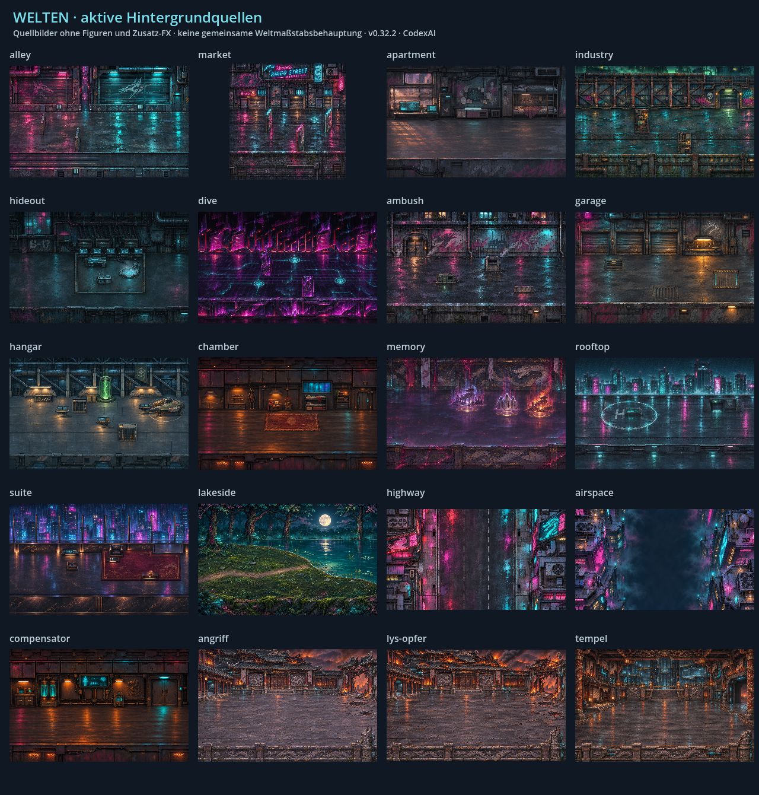
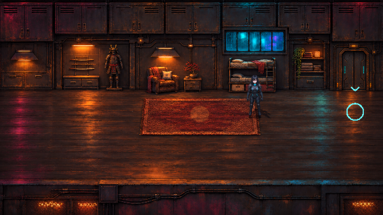
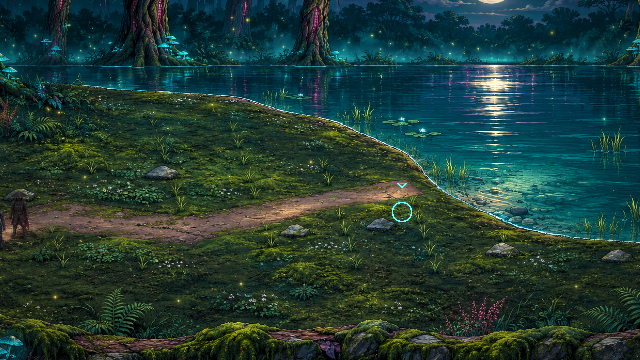

# Welten und Kulissen · v0.32.2 · CodexAI

**Ergänzung v0.43.0 · CodexAI:** Kapitel 1 besitzt einen sichtbaren Dachzwischenschnitt mit dem linken Ausschnitt der bestehenden Skyline aus `rooftop.png`; ohne Konzernlogo, Landeplatz oder Änderung der Spielkarte. [Aufnahmen und Ablauf](../kapitel1-auftakt.md).

**Aktualisierung v0.39.0 · CodexAI:** [Plattformfahrt und Hangarentdeckung](../hangar-entdeckung.md), vier eigene Shadepi-Schalterposen, sechs Entriegelungsbilder und texturierter Schacht. Fahrt mit den tatsächlichen Figuren; danach identischer Aerodyne in normaler Erkundung und Film. [Aktive Quellen und Kontaktanker](../../assets/story/hangar-discovery/README.md).

[Stilbibel](README.md) · [Art Direction](artdirection.md) · [Figuren](figuren.md)

## Gesamtübersicht

Die Tafel zeigt vorhandene Hintergrundquellen ohne die zusätzlich im Spiel gezeichneten Figuren, Objekte und FX. Den aktuellen Hangar-Verbund mit geschlossenem Dach, Plattform und separatem Aerodyne zeigen die oben verlinkten Spielbilder. Die kleinen Ansichten dienen dem Vergleich von Architektur und Licht; die verlinkten Originale enthalten die volle Texturauflösung. Die 16 registrierten `Painted.ART`-Quellen werden um den separaten Kompensator und die drei Erinnerungsschauplätze ergänzt.

## Schauplatzfamilien über das ganze Spiel

| Bereich / Kapitel | Vorhandene Quellen | Erhaltene Bildsprache und räumliche Regeln |
| --- | --- | --- |
| **Ravens Wohnung · Kapitel 1** | [apartment.png](../../assets/world/painted/apartment.png) | Kleine glaubhafte Wohnung, dunkle Technik, warme lokale Lichtquelle und Regen hinter dem Fenster. Möbel an menschlicher Größe ausrichten. |
| **Bingo Street / Markt und Gasse · Kapitel 1** | [market.png](../../assets/world/painted/market.png), [alley.png](../../assets/world/painted/alley.png) | Dichte Neonfassaden, nasser Asphalt und Reflexe; Anschlusskanten und gemeinsame Bodentiefe erhalten. Autos, Container und Laternen folgen dem [Objektmaßstab](fahrzeuge-requisiten.md). |
| **Industriegebiet · Kapitel 2** | [industry.png](../../assets/world/painted/industry.png) | Stahl, Leitungen, Ladeflächen und technische Dampfquellen. Sperrkörper haben echte Standflächen und Verdeckungen. |
| **Versteck / Erholung und Pakt · Kapitel 2–3** | [hideout.png](../../assets/world/painted/hideout.png) | Abgeschirmter technischer Innenraum, Becken/Kühlanlage, Geräte, Rüstung und passende Sitzmöbel. Der Pakt verwendet diesen bestehenden Ort. |
| **Deep Dive · Kapitel 2** | [dive.png](../../assets/world/painted/dive.png) | Violett/Cyan, Datenwege und schwebende digitale Gegner; virtuelle Formensprache klar von physischen Industrieanlagen unterscheiden. |
| **Hinterhalt · Kapitel 3** | [ambush.png](../../assets/world/painted/ambush.png) | Nasse enge Stadtfläche, Deckung und begrenzte Kampfarena; Licht-/Materialfamilie der Stadt bleibt erkennbar. |
| **Motorradverfolgung · Kapitel 3** | [highway.png](../../assets/world/painted/highway.png) | Bewegte Top-down-Fahrperspektive. Straßenobjekte liegen unter Fahrzeugen; Straßentexturen sauber fortsetzen. Keine unveränderte Sideview-Karte als Fahrbahn einsetzen. |
| **Garage · Kapitel 4** | [garage.png](../../assets/world/painted/garage.png) | Werkstatt, Tor, warme Arbeitsleuchten und kalte Technik. Geparktes Motorrad liegt auf seiner eigenen Plattform mit passender Kollision. Nach dem Decoder fahren beide Figuren und Motorrad sichtbar durch den neuen Schacht. |
| **Hangar · Kapitel 4 / Abflug nach Heiligtum** | [hangar.png](../../assets/world/painted/hangar.png), [hangar-empty.png](../../assets/story/departure/hangar-empty.png), [Cockpit](../../assets/story/departure/cockpit.png) | Großer technischer Raum; Konsolen stehen auf dem Boden. Erkundung und Abflug verwenden die leere Raumvariante mit separat bewegtem Aerodyne; bei der unterirdischen Entdeckung ist das Dach durch die ursprüngliche geschlossene Dachtextur verdeckt. Plattform/Motorrad bleiben zurück. Cockpit, Einsteigen und Abheben sind eigene Szenenphasen. |
| **Wohnraum · Kapitel 5** | [chamber-connected.png](../../assets/world/painted/chamber-connected.png) | Warmes Holz-/Metallinterieur, Bett, alte Rüstung und in die Wand integrierte Tür. Menschlicher Innenraummaßstab statt voller Kartenbreite. |
| **Kompensator · Kapitel 5** | [compensator-clear.png](../../assets/world/painted/compensator-clear.png) | Separater Raum mit Diagnostik und Tanks. Stuhl kommt aus den Figurenposen; nicht erneut ins Hintergrundbild malen. |
| **Erinnerungsanker · Kapitel 5** | [memory.png](../../assets/world/painted/memory.png) | Virtueller Zwischenraum mit drei Ankern, eigene Daten-/Energieästhetik. Die eigentlichen Erinnerungen haben andere Kulissen. |
| **Erinnerung I: Angriff** | [attack/courtyard.png](../../assets/memories/attack/courtyard.png) | Traditioneller Klosterhof, Flucht und zunehmender Angriff mit Feuer, Bomben, Rauch, Bots und Ordenskriegern. |
| **Erinnerung II: Lys Opfer** | [sacrifice/courtyard.png](../../assets/memories/sacrifice/courtyard.png) | Erkennbar verwandter, stärker zerstörter Verteidigungsbereich. Minotaurus dominiert Größe und Bedrohung; Ly bleibt durch Weiß eindeutig. |
| **Erinnerung III: Vermächtnis** | [temple-interior.png](../../assets/memories/legacy/temple-interior.png), [geschlossener Zugang](../../assets/memories/legacy/temple-closed.png), [Türatlas](../../assets/memories/legacy/temple-door.png) | **Tempelinneres** über der getarnten Hightech-Untergrundbasis. Meister und Übergabe, Torbruch und Kampf bleiben im selben Innenraum. Technische Ebenen unter traditioneller Hülle sichtbar halten. |
| **Aerodyne-Anflug · Kapitel 6** | [airspace.png](../../assets/world/painted/airspace.png), [Flugobjekte](../../assets/world/hq/flight-props.png) | Häuserschluchten, mehrere Tiefen, vorbeiziehende Stadt, Laser/Drohnen und klare Landegeometrie. [Aktueller Flug](../aerodyne-flug.md). |
| **Towerdach · Kapitel 6** | [rooftop.png](../../assets/world/painted/rooftop.png) | Nasse Dachfläche, Skyline, Landekreis und Technik; Landefläche und Standebene der Figuren müssen passen. |
| **Penthouse, Konfrontation und Flucht · Kapitel 6** | [suite.png](../../assets/world/painted/suite.png) | Dunkles hochwertiges Interieur mit Stadtblick und eigenem roten/goldenen Systemthema. Laser-/Kamerazonen und Interaktionspunkte lesbar halten. |
| **See / Finale · Kapitel 7** | [lakeside.png](../../assets/world/painted/lakeside.png) | Ruhiger kühler Abschluss, natürliches Ufer, Nachtreflexe und wenige Glühwürmchen. Wasseranimation endet an der tatsächlichen Uferkontur. |

Menü-Skyline: [start-city.png](../../assets/menu/start-city.png) mit mystischem weißem Drachen und vorderer Dachplattform; siehe [Menü und UI](oberflaechen-effekte.md).

## Raumtiefe und Verdeckung

- Die Standebene ist Teil der Karte. Kollisionen, Säulen-/Möbelverdeckungen, Figurenfüße, Kontaktschatten und Zielpunkte müssen dieselbe Transformation nutzen.
- Die Wohn-/Kompensatorräume verwenden derzeit `CHAMBER_RECT` und Faktor 0,55 aus [painted_world.gd](../../scripts/painted_world.gd). Andere Räume und Erinnerungen besitzen eigene Transformationen; diesen Faktor nicht global anwenden.
- Zugang, Bett, Sessel, Rüstung und Technik sichtbar erreichbar anordnen. Ein freier Bildausschnitt beweist keine freie Kollision; einen gemalten Gerätefuß nicht als zusätzliche Vordergrundwand doppeln.
- Kapitelsprünge oder Scrollübergänge erhalten Bodenhöhe und Anschlussgeometrie. Dramatische Nahkamera darf keine falschen Proportionen verdecken.

## Atmosphärische Referenz im tatsächlichen Spiel

| Warmer Wohnraum | Ruhiger See |
| --- | --- |
|  |  |

Diese vorhandenen Spielaufnahmen dokumentieren die Atmosphäre ab v0.31.0; die neue Weltübersicht zeigt die Quellbilder. Regen nur auf freiem Himmel beziehungsweise Glas, Dampf am technischen Austritt und Glut an Bränden. Keine flächige Wetterlage über Innenraumfiguren legen. Zusatz-FX respektieren Pause, Terminals, Erinnerungswechsel und die drei Bildstile. [Ortsprofile](../../scripts/atmosphere_profiles.gd), [Renderer](../../scripts/scene_atmosphere.gd), [Detailbericht](../design-atmosphaere.md).

## Historische Quellen

**Nachtrag v0.33.0 · CodexAI:** Die [Tower-Außenansicht](../../assets/story/tower/exterior.png) ist eine zusätzliche Filmkulisse für das Kippen und Abfangen des Aerodyne, keine neue begehbare Karte. Die [Weltübersicht](bilder/welten.png) zeigt im Hangar jetzt die aktive KOBAN-TEC-Brandschicht statt des historischen Emblems. Sie wird sowohl im normalen Hangar als auch beim Hangar-Abflug gezeichnet; [Herkunft](../../assets/story/tower/README.md).

`legacy/courtyard.png` ist die ersetzte Außenhofvariante von Erinnerung III. `chamber.png` und `compensator.png` sind frühere Raumstände vor integrierter Tür beziehungsweise Entfernung des Hintergrundstuhls. Sie sind keine aktuellen Layoutvorgaben. Die Höfe aus `attack` und `sacrifice` bleiben dagegen eigene gültige Schauplätze.
