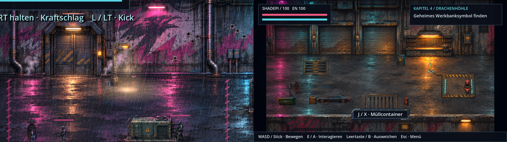
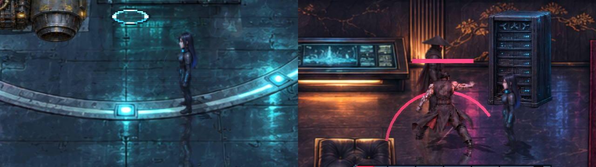
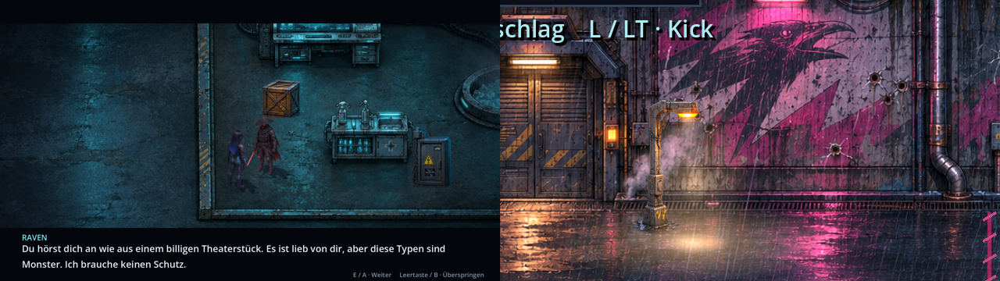

# Szenenpolitur v0.52.0 · ClaudeHelper

**Stand 10. November 2026.** Nutzerauftrag nach dem Full-HD-Update: Sprites kalibrieren, Aktionsringe unter die Figuren, Gegenstände vor Türen, Laufwege sowie cinematische Lichteffekte und Reflexionen. Es wurden keine Figuren neu gezeichnet; die Kalibrierung ordnet vorhandene Pixel nur neu an.

## Sprites kalibriert

Ein neues Prüfwerkzeug (`tools/sprites/audit_atlases.py`) vergleicht jedes Posenblatt mit genau den Ausschnitten, die das Spiel herausschneidet. Es fand **214 sichtbare Fehler** in zehn Blättern: Teile der Nachbarpose im Bild oder abgeschnittene Glieder und Waffen.

| Blatt | Wo man es sah |
| --- | --- |
| `heroes/combat-poses.png` | Shadepis Tritt und Ravens Ladepose: Fuß bzw. Pistole ragten in die Nachbarzelle |
| `npcs/contact-poses.png` | Angriffsposen aller Gegner: Schlagstöcke und Mündungsfeuer am Zellenrand |
| `memories/attack/*` (5 Blätter) | Krieger, Bewohner und Bots der Kloster-Erinnerungen in Lauf- und Kampfposen |
| `memories/legacy/*`, `memories/sacrifice/ly-charge.png` | Figuren der Erinnerungen II und III |

`tools/sprites/calibrate_atlases.py` gibt jeder Pose eine eigene, größere Zelle mit leerem Rand. Jede zusammenhängende Form wird der Pose zugeordnet, zu der sie gehört, und vollständig mitgenommen. Die Position auf dem Bildschirm bleibt gleich: Rasterblätter wachsen gleichmäßig um die Zellmitte, bei Katalogblättern wandern `region` und `anchor` mit. Die normalen Lauf-Sprites von Raven, Shadepi und allen Gegnern waren bereits sauber.

Nach der Kalibrierung meldet die Prüfung **0 Fehler**. `tests/scene_polish.gd` prüft in CI, dass jede Pose ringsum einen leeren Rand hat.

## Aktionsringe unter den Figuren

Der Bodenring eines Aktionspunkts lag über den Helden. Er wird jetzt als Bodenmarkierung direkt nach der Kulisse und **vor** den Figuren gezeichnet; Helden laufen darüber. Nur der schwebende Pfeil bleibt über den Figuren.

## Türen und Tore frei

- **Kapitel 3, Hinterhalt:** Die Laterne stand mitten vor der Tür des Verstecks. Sie steht jetzt rechts neben dem Türrahmen.
- **Kapitel 4, Garage:** Der Werkzeugkasten stand vor dem dritten Rolltor, der Müllcontainer vor dem ersten. Der Kasten steht jetzt am Pfeiler neben der Werkbank, der Container an der unteren Wand.
- **Laufwege:** `tools/story/walk_audit.gd` spielt die Kinoszenen der Kampagne ab und meldet jedes Bild, in dem eine geführte Figur in einem Hindernis steckt. In den geprüften Szenen (Pakt, Hinterhalt, Garage, Hangar, Heiligtum, Dach, Tower, See) fand es nur die gewollten Gänge durch Türen. Kapitel 1 und 2 sind damit noch nicht geprüft.

## Spiegelungen und Kinolicht

- **Bodenspiegelung aller Figuren:** Helden und Gegner spiegeln sich auf nassem Asphalt, dem Tower-Dach, Marmor und Hallenboden. Das Spiegelbild folgt jeder Pose, läuft zum Kopf hin aus und wellt sich leicht. Teppich, Gras und das Netz spiegeln nicht. Im Bildstil „Reduziert“ ist die Spiegelung aus.

- **Kino-Vignette:** In Filmszenen dunkeln die Bildränder weich ab, zusammen mit den Filmbalken.
- **Laternen:** Jede Straßenlaterne wirft einen sichtbaren Lichtkegel und einen warmen Schein auf den Boden. Beschädigt wird er schwächer, zerstört erlischt er.

## Prüfung

Alle 41 CI-Testsuiten laufen lokal ohne Fehler, darunter die neue `scene_polish` mit 54 Prüfungen. Das Repository-Audit meldet 0 Fehler. Die Bilder sind Godot-Aufnahmen dieses Stands in 1920×1080.
