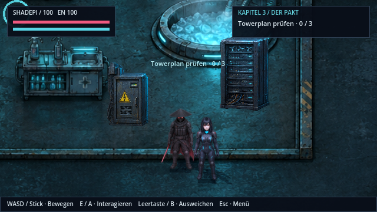
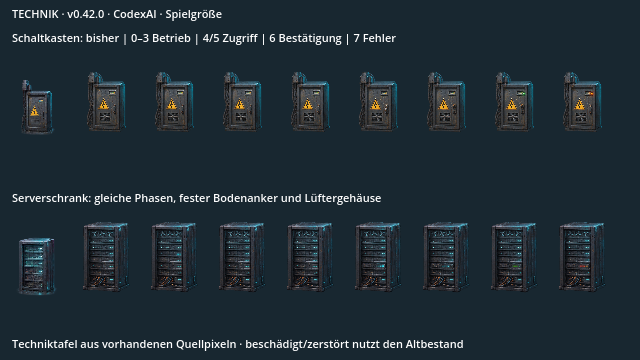
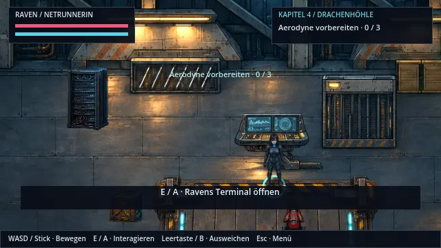
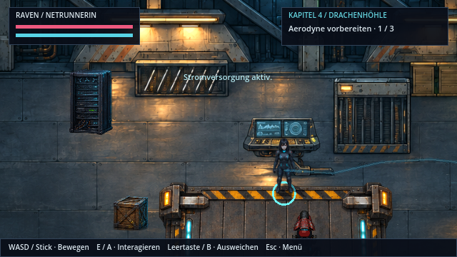
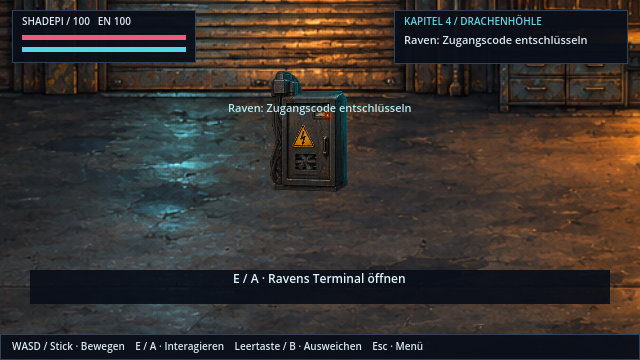
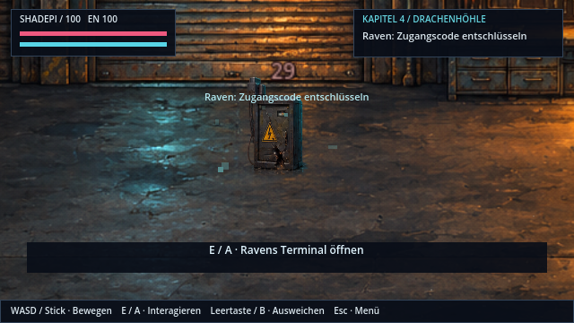
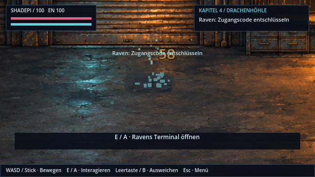

# Technik, die sichtbar arbeitet · v0.42.0 · CodexAI

Schaltkästen und Serverschränke besitzen jeweils acht eigene HQ-Pixelbilder. Im Betrieb bewegen sich Lüfter, Messwerk und kleine mechanische Teile. Gehäuse und Bodenbezug bleiben ruhig. An ausgewählten verbundenen Geräten lassen sich Zugriff, Bestätigung und Störung direkt ablesen.

Die Techniktafel zeigt bestehende und neue Quellpixel in normaler Spielgröße. Beschädigte und zerstörte Zustände stammen weiterhin aus dem vorhandenen Prop-Atlas.

## Rückmeldung beim Hacken

Das Rack links bestätigt Ravens Energiebus-Zugriff. Die vorhandene Konsole und das Storyziel bleiben erhalten. Der Film ist eine tatsächliche Renderer-Aufnahme mit realen Aufnahmeabständen. Für die Abnahme setzt ein QA-Helfer Raven am richtigen Interaktionspunkt ein und löst das vorhandene Rätsel automatisch; der Geräteablauf danach läuft im Spiel. Es ist keine neue Storyszene oder vollständig manuell gelöste Hack-Aufgabe.

| Bestätigung am Rack | Fehler am verbundenen Kasten |
| --- | --- |
|  |  |

Während das Terminal geöffnet ist, bleiben die Geräteuhren stehen. Nach erfolgreichem Übernehmen durchläuft die Mechanik Zugriff, Einrasten und grüne Bestätigung und kehrt dann zum Betrieb zurück. Ein Alarm zeigt die Störung; gewöhnliches Abbrechen zeigt keinen falschen Erfolg. Die Rückmeldung gehört zu ausdrücklich verbundenen Statusgeräten und ersetzt keine vorhandene Konsole.

## Schaden bleibt Schaden

| Beschädigt | Zerstört |
| --- | --- |
|  |  |

Unterhalb bzw. bei halber Lebensenergie gelten die vorhandenen Schadensbilder; bei Zerstörung stoppt die Animation. Laden erhält diesen Zustand. Ein defektes Statusgerät macht das bestehende Storyrätsel nicht unzugänglich. Es gibt keine neue Tastenbelegung: E/Enter/A für das Terminal, Esc/Start für Pause. Die Geräte reagieren auch auf bestehende Controller-Aktionen.

[Quellen, Größen und Verbindungen](../assets/world/technology/README.md) · [Prüfungen und Export](arbeiten/technik-v042.md) · [Weitere Cinema-Schritte](cinema-roadmap.md).
