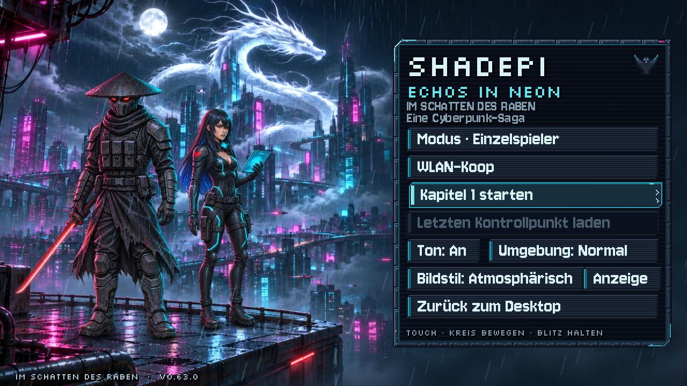
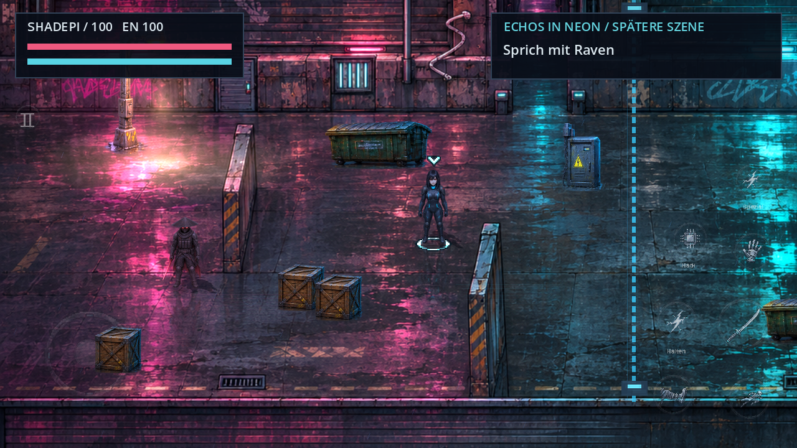
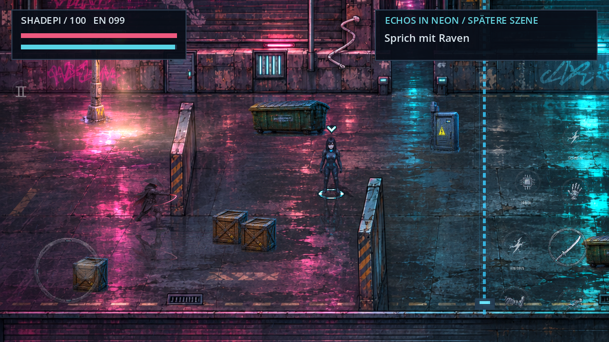
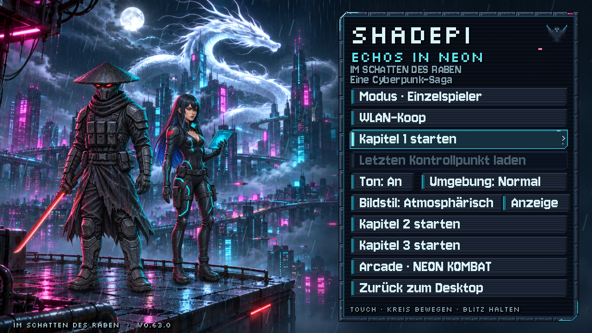
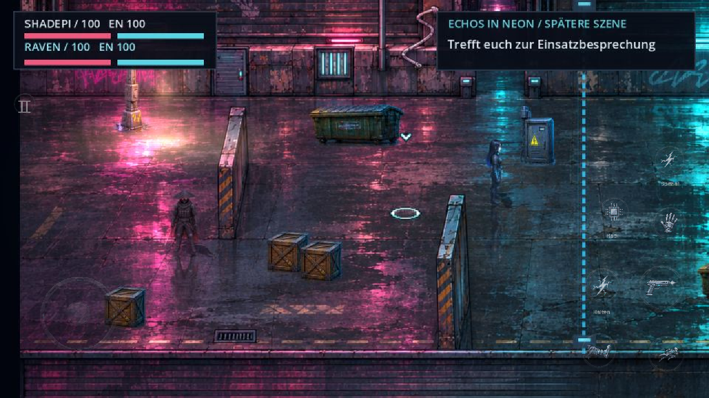

# Transparentes Touch-HUD und WLAN-Menü · v0.63.0 · CodexAI

**15. November 2026.** WLAN-Koop steht jetzt als normaler Eintrag im Haupt- und Pausenmenü. Der schwebende Zusatzknopf entfällt. Auf Android ersetzen transparente Pixel-Bildtasten und ein analoger Kreisstick die großen rechteckigen Textfelder. Grundlage ist die vom Nutzer gezeigte HUD-Anordnung; die neuen Grafiken sind eigene generierte Pixel-PNGs.

## Stick und Bildtasten

Links unten liegt ein sehr transparenter Kreis mit einem beweglichen inneren Knopf. Ziehen steuert Richtung **und Stärke** der Bewegung, auch diagonal. Eine kleine Totzone verhindert Drift. Beim Loslassen oder Wechsel in den Hintergrund springt der Knopf zur Mitte und gibt die Achsen frei.

| Bildtaste | Aktion |
| --- | --- |
| Pistole beziehungsweise Katana | Schuss beziehungsweise Angriff der gesteuerten Figur |
| Stiefel | Shadepis Kick, wie im bisherigen Kampfsystem |
| Ausweichende Figur | Ausweichen |
| Offene Hand | Interaktion / Weiter / Bestätigen |
| Blitz mit „Halten“ | Aufladen, beim Loslassen auslösen |
| Blitz mit „Spezial“ | Vorhandene Spezialaktion |
| Chip mit „Hack“ | Hack |
| Kleines Pausensymbol links | Gemeinsames Pausenmenü |

Tasten sitzen näher am rechten Rand und werden beim Drücken deutlicher. Der Stick bleibt besonders zurückhaltend; keine undurchsichtige Fläche liegt über dem Spiel. Mehrere Finger funktionieren unabhängig, darunter gleichzeitiges Bewegen und Angreifen oder das Halten eines Ladeangriffs. Der untere Tastaturbalken wird auf Mobilgeräten ausgeblendet. Lokale Menüs und Hackfenster blenden die Spieltasten aus und bleiben direkt per Touch bedienbar.

[Film mit Stickbewegung, Aufladen und Loslassen](previews/touch-stick-v063.webp). Die PNGs und der Film sind native Godot-Aufnahmen unter Linux im Touch-Modus, keine Fotos eines Telefons.

## WLAN als Teil des Menüs

**WLAN-Koop** öffnet die vorhandene Verbindungseinstellung für Host-IP und Code. Nach dem Schließen kehrt der Controller-Fokus zum aufrufenden Eintrag zurück. Während einer verbundenen Host-Partie zeigt der Menüeintrag den Verbindungszustand; der Modus heißt WLAN-Koop. Auch mit allen freigeschalteten Kapiteln und Arcade bleibt die Liste im Rahmen.

WLAN-Client: Das Pausensymbol bedient die gemeinsame Partie. **Android-System-Zurück** öffnet die lokale Verbindungsverwaltung, sodass man seinen eigenen Beitritt beenden kann. Am PC bleibt **F8** verfügbar. Beide Geräte müssen auf dieselbe Version aktualisiert werden. Die bisherige Architektur bleibt [Remote-Koop mit gemeinsamem Bild](android-wlan-v062.md); diese Änderung erhöht nicht die Übertragungsbildrate.

## APK, Quellen und Prüfung

Die aktualisierte signierte Test-APK entsteht im [GitHub-Actions-Artefakt **ShadepiRPG-Android-Test**](https://github.com/Inrouder/ShadepiRPG/actions/workflows/build.yml). Eigenbau weiterhin mit [tools/android/build.sh](../tools/android/build.sh). Native APK-Version 0.63.0 / Code 6300. Beim Wechsel des Debug-Signierschlüssels können Test-APKs nicht direkt übereinander installiert werden; das bestehende Testformat wird hier beibehalten.

[PNG-Quellen und Transparenzvertrag](../assets/ui/touch/README.md) · [unveränderte Generatorquelle und Registrierung](../tools/mobile-ui-v063/README.md) · [Arbeits- und Prüfnachweis](arbeiten/touch-hud-v063.md).

Der Nutzer bestätigt den Android-Start und den rudimentären WLAN-Koop von v0.62.0. Die neue Oberfläche wurde mit echten gerenderten Spielansichten und isolierten Touch-/Menü-/Controller-/WLAN-Tests geprüft. Eine erneute physische Handy-Abnahme von v0.63.0 wird damit nicht behauptet. Figuren, Weltgrafiken, Story und Kampfregeln bleiben unverändert.
