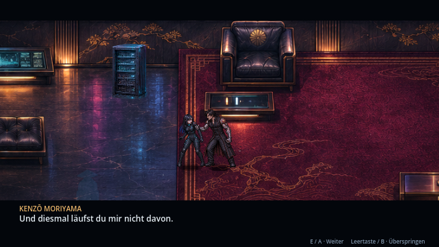
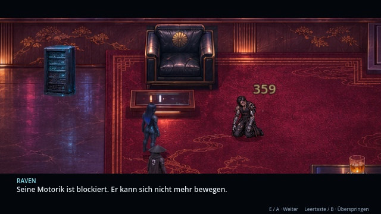
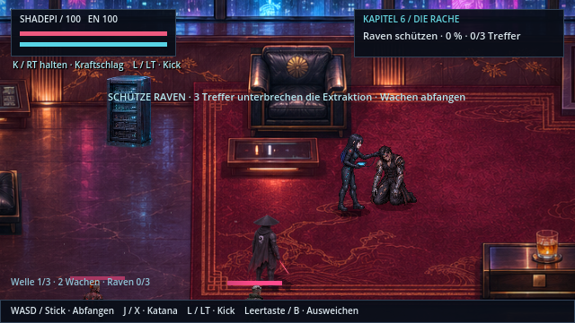
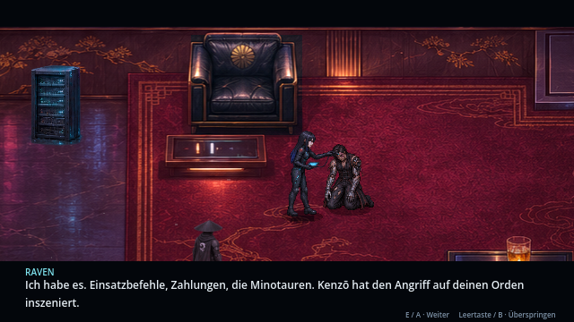
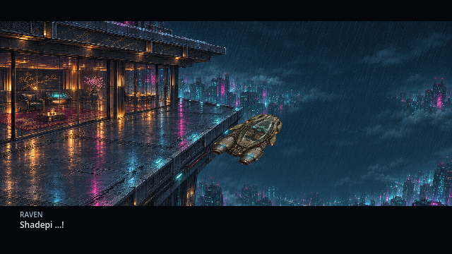
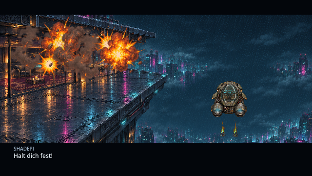
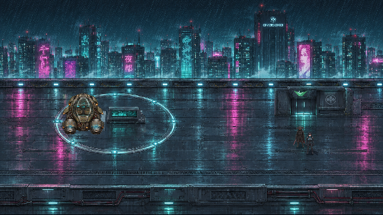
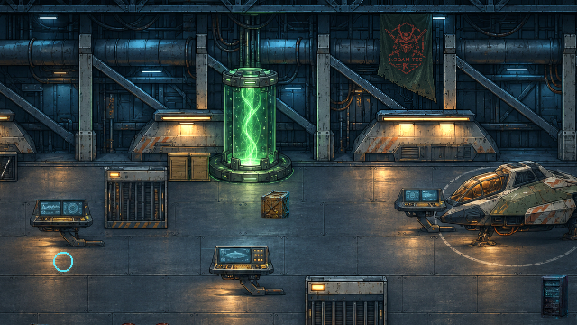
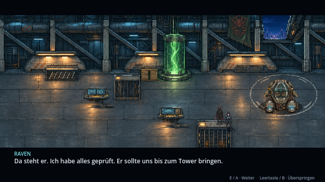

# Tower: Daten, Abrechnung und Flucht · v0.33.0 · CodexAI

**Aktuelle Inszenierung v0.35.0 · CodexAI:** [Ravens Eintritt, Shadepis Lauf zum Eingreifen, freie Hangarwege und durchgehende Flucht](tower-inszenierung.md). Die neue Filmfassung ersetzt den hier gezeigten historischen v0.33-Abflug mit Ansichtswechsel. Extraktion, Trefferregeln, Hintergrund und Kontrollpunkte gelten weiterhin.

Kenzō packt Raven im Gespräch sichtbar am Oberarm. Erst dann beendet Shadepi seine Tarnung und schlägt dazwischen. Der normale Bosskampf bleibt bei Shadepi; Raven steht abseits und kann über den vorhandenen Implantat-Hack unterstützen.

## Niederlage bedeutet zunächst Gefangennahme

Kenzōs Kampf-HP enden, ohne den normalen Sterbelaut oder die generische Fallanimation auszulösen. Danach kniet er schwer verletzt, mit beschädigtem Gesicht, zerrissener Kleidung und defekten Armservos. Er ist gelähmt und lebt noch. Die frühere gedrehte Standfigur wird durch eine eigene Kniepose ersetzt.

## Raven bei der Extraktion schützen

Raven bleibt am Deck und schließt ihre Leitung an Kenzō an. Du steuerst Shadepi und fängst **drei Wachwellen mit insgesamt acht Gegnern** ab. Die Wachen können Raven auch im Einzelspieler angreifen. Tritt Shadepi nahe an sie heran, kann er ihre Aufmerksamkeit auf sich ziehen.

- **WASD / linker Stick:** bewegen; **J / X:** Katana; **L / LT:** Kick; **K / RT halten und loslassen:** Kraftschlag; **Leertaste / B:** ausweichen.
- Die Anzeige nennt Datenfortschritt und Treffer auf Raven. Die Übertragung benötigt mindestens 24 aktive Spielsekunden; die Verifikation wartet zusätzlich auf das Ende der Wachenwellen.
- **Drei getrennte Treffer** auf Raven unterbrechen die Verbindung. Ihre normale kurze Treffer-Unverwundbarkeit verhindert, dass derselbe schnelle Kontakt mehrfach zählt. Der Wiederholungsbildschirm setzt Fortschritt, Treffer und Wellen zurück; **der Kenzō-Bosskampf wird nicht wiederholt**.
- Raven kann währenddessen keine Wachen hacken und läuft Shadepi nicht hinterher. Ihre sichtbare Pose und der tatsächliche Angriffspunkt bleiben verbunden.
- Pause und Dialog halten den Transfer an. Die eigentlichen Fluchtkonsolen sind bis zum gesicherten Abschluss gesperrt; der 60-Sekunden-Timer läuft noch nicht.

## Die Daten und Kenzōs Ende

Die gesicherten Einsatzbefehle und Zahlungen belegen: **Kenzō hat den Angriff auf den Orden inszeniert.** Warum, bleibt unklar. Die Identität des Auftraggebers ist aus den verfügbaren Daten entfernt; es wird kein neuer Name als Tatsache eingeführt. Raven beendet erst jetzt Kenzōs Implantatfunktionen endgültig. Ihre Rache ist damit erfüllt, die Suche nach dem Hintergrund des Massakers geht weiter. Sie bietet Shadepi ausdrücklich an, gemeinsam weiterzusuchen.

Danach beginnen die bekannten 60 Sekunden. Die bereits extrahierten Daten müssen nicht erneut an einer Konsole „gesichert“ werden. Es bleiben Aufzugssperre, Fernstart der Treibstoffpumpe und Dachausgang. Die vorhandenen Controller-/Tastatur-Hacks bleiben Teil dieses Abschnitts.

## Sichtbare knappe Flucht

Beide rennen über das Dach zum Aerodyne und steigen ein. Außenaufnahme: Das Triebwerk zündet zunächst nicht, das Fluggerät kippt über die Kante und fällt. Erst dann greift der Schub. Während Shadepi es abfängt, explodiert das Penthouse hinter ihnen. Der eigentliche Fall läuft ohne wartenden Textdialog durch; Pause und bewusstes Überspringen bleiben möglich.

Der Film besteht aus unverändert aufgenommenen Godot-Frames. Im Spiel werden Figuren, Schiff, Triebwerks-FX und Explosion tatsächlich animiert; es läuft kein vorgerendertes Video. Anschließend folgt der See. Das Ordensritual bleibt erhalten; der Schlussdialog verweist auf die offene Spur und die gemeinsame Suche.

## KOBAN-TEC im Hangar

| Normaler Hangar | Hangar-Abflug |
| --- | --- |
|  |  |

Das frühere fremde Zeichen ist im aktiven Hangarbild und in der Hangar-Abflugssequenz durch ein KOBAN-TEC-Banner ersetzt. Die örtliche Grafikschicht erhält die Raumgeometrie und Konsolenpositionen. Herkunft und Rekonstruktion des nicht lokal vorhandenen Chat-Logos sind in den [Asset-Notizen](../assets/story/tower/README.md) dokumentiert.

## Kontrollpunkte und Prüfung

Neue Speicherstände unterscheiden Schutzphase, bereits gesicherte Daten, die eigentliche Flucht und den begonnenen Abflug. Laden während der Schutzphase startet diese fair von vorne; Laden nach erfolgreicher Extraktion führt nur ins Abschlussgespräch. Ein unterbrochener Abflug beginnt mit dem Rennen zum Schiff. Frühere Spielstände mit erledigten Aufzugwachen bleiben hinter der neuen Schutzphase; sie müssen den alten Boss nicht wiederholen.

Die neue Prüfreihe [tower_sequence.gd](../tests/tower_sequence.gd) kontrolliert Griff/Reihenfolge, kampfunfähigen statt toten Kenzō, echte Raven-Treffer mit Unverwundbarkeitsfenster, vollständigen Neustart, Pause, Sperren, Speichern/Laden und die geordnete Abflugfolge. Bestehende Gameplay-, Wellen-, Story-, Kampf-, Controller-, Flug-, Atmosphären- und Fehlerbericht-8-Prüfungen wurden mit dem neuen Ablauf gegengeprüft.

**1.628 Prüfungen ohne Fehler in zehn relevanten Prüfreihen.** Alle 14 Galerieansichten sowie die Flucht im tatsächlichen Godot-Renderer gesichtet; neue Ressourcen wurden zusätzlich im exportierten Spielpaket erfolgreich geladen und gestartet. [Arbeitsnachweis](arbeiten/tower-v033.md).
