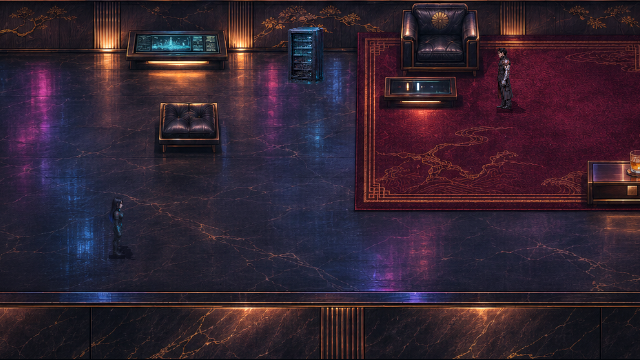
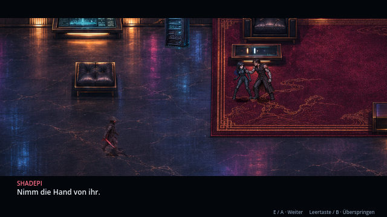
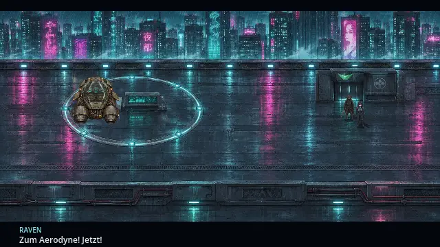
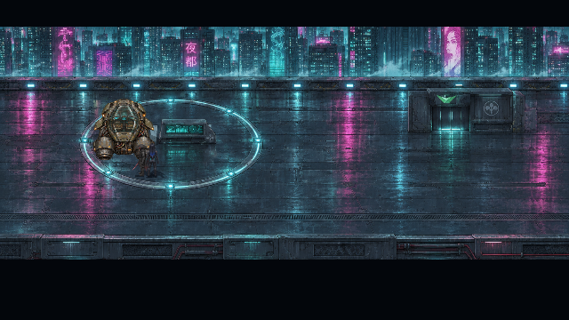
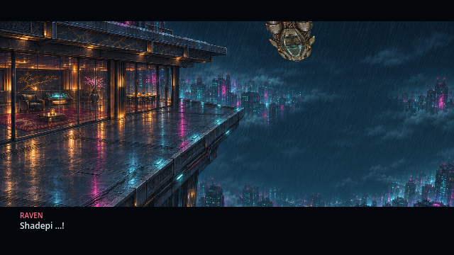
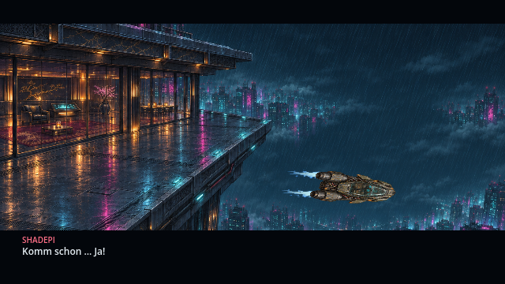
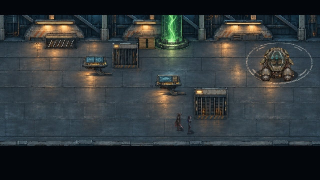

# Laufwege und Aerodyne-Szenen · v0.35.1 · CodexAI

## Im Penthouse

Kenzō ist schon im ersten Bild neben dem Sessel zu sehen. Raven kommt vom Eingang, geht über die freie Fläche an den Möbeln vorbei und tritt erst dann näher an ihn heran. Kenzōs Griff und Ravens Gegenwehr bleiben der Auslöser für Shadepis Eingreifen. Shadepi wird am Eingang sichtbar und läuft durch den Raum zum Griffpaar; er erscheint nicht unmittelbar neben Kenzō.

Die vorhandenen Figurensprites und die Griffpose bleiben erhalten. Der anschließende Einzelspieler-Bosskampf, Kenzōs Verletzungen, Ravens geschützte Datenextraktion, die offenen Hintergründe und ihre endgültige Abrechnung laufen wie in [v0.33.0](tower-extraktion.md) weiter.

## Vom Landeplatz am Balkon vorbei

**Korrektur nach Nutzervorgabe:** Der Start erfolgt auf dem vorhandenen Dach-Landeplatz. Die Balkon-Abflugfassung aus v0.35.0 war räumlich falsch und ist ersetzt. Beide laufen vom Dachausgang zum selben Aerodyne, den sie beim Anflug dort abgestellt haben. Raven steigt zuerst ein, dann Shadepi. Das Schiff hebt ab und bekommt erst danach Antriebsprobleme.

Nachdem der Aerodyne die Dachkante verlassen hat, zeigt die Kamera die Fassade darunter. Das Schiff kommt von oberhalb des Bildes und fällt neben dem Balkon nach unten. Es bekommt dort erst wieder Schub und fängt sich unterhalb der Balkonebene ab. Beim anschließenden Wegflug explodiert das Penthouse.

| Von oben ankommend | Unterhalb abgefangen |
| --- | --- |
|  |  |

Der Blickwechsel folgt dem fallenden Schiff; er platziert es niemals auf dem Balkon. Derselbe Fahrzeugknoten behält passende Bildgröße, Orientierung und projizierte Geschwindigkeit. Die folgende Flugbewegung bleibt stetig. Während des Falls wartet kein Dialog auf Eingaben. Die gekoppelten Düsen und die einmalige Explosion aus v0.35.0 bleiben erhalten.

Die Animation läuft in Godot. Der Film zeigt tatsächliche Renderer-Frames mit ihren Aufnahmezeitpunkten als Wiedergabezeit. Vorhandene HQ-Kulissen und Fahrzeuggrafiken werden wiederverwendet; keine neue Balkon- oder Startplattform wurde erzeugt.

## Durch den Hangar

Beide beginnen auf freiem Boden vor der Vorderwand und gehen unterhalb des großen Kastens durch den Raum. Rechts davon nähern sie sich dem Aerodyne und steigen nacheinander ein. Der Kameraausschnitt hält den Gang innerhalb der Kinobalken. Cockpitaufnahme, ARTOS-Ausfall, Armatur-Schlag und Abheben bleiben Teil des Ablaufs. Das KOBAN-TEC-Banner wird weiterhin in beiden Hangaransichten verwendet.

**Bedienung:** E / Enter / A schaltet Dialoge weiter, Leertaste / B überspringt die Szene und Esc / Start pausiert. Auch Schrittanimationen beim Einsteigen und die Shaderuhr der Düsen pausieren. Laden während eines Abflugs setzt weiterhin an dessen Anfang auf; der freie Flug bleibt nach dem Hangar-Abflug steuerbar.

## Prüfung und Quellen

**Aktueller Prüfstand v0.35.1 · CodexAI:** **731 Prüfungen ohne Fehler** in fünf gezielten Prüfreihen: filmische Laufwege/Geografie/Speicherfeld 50, Tower 42, Gameplay/Speichern 383, Story 206 und Aerodyne-Flug 50. Die sichtbare Abfolge wurde zusätzlich im echten Renderer aufgenommen. [Arbeitsnachweis](arbeiten/tower-landeplatz-v0351.md).

- [`cinematic_blocking.gd`](../tests/cinematic_blocking.gd): komplette Wege mit Figurenradius gegen die vorhandenen Möbelkollisionen, tatsächliche Annäherung und Intervention, Geschwindigkeitskontinuität, Pause der Düsen und Einstiegsschritte, Reihenfolge und Szenenabbruch. Bestandteil des GitHub-Builds.
- [`cinematic_gallery.gd`](../tools/cinematic_gallery.gd): aktuelle Spielbilder unter `/tmp/shadepi-v0351/`, mit `-- --film` zusätzlich Rohframes der Flucht; `--escape-only` begrenzt die Aufnahme auf den Abflug.
- [`cinematic_aerodyne.gd`](../scripts/cinematic_aerodyne.gd) und [`cinematic_exhaust.gdshader`](../shaders/cinematic_exhaust.gdshader): dieselbe vorhandene HQ-Fahrzeugzelle, feste Düsenanker und isolierte Flammenpixel. Der normale spielbare Flug benutzt weiterhin seinen bestehenden Renderer.
- [Aktueller Arbeitsnachweis](arbeiten/tower-landeplatz-v0351.md); [historischer v0.35.0-Nachweis](arbeiten/tower-inszenierung-v035.md).

Aufnahmen vom 9. November 2026, Godot 4.7.2, OpenGL/Mesa. Spielbilder zeigen die tatsächliche 640×360-Pixelbasis; die Anzeigeoptionen skalieren diese wie bisher auf Full HD, 1440p und 4K.
