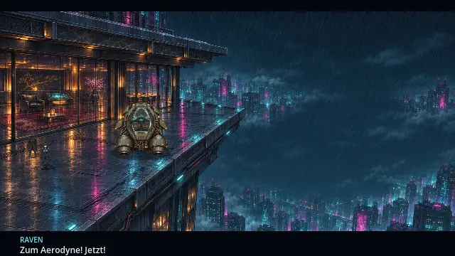
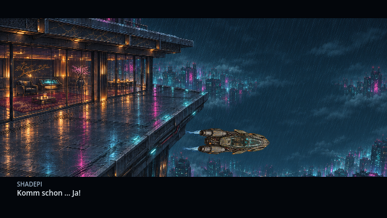

# Laufwege und Aerodyne-Szenen · v0.35.0 · CodexAI

## Im Penthouse

Kenzō ist schon im ersten Bild neben dem Sessel zu sehen. Raven kommt vom Eingang, geht über die freie Fläche an den Möbeln vorbei und tritt erst dann näher an ihn heran. Kenzōs Griff und Ravens Gegenwehr bleiben der Auslöser für Shadepis Eingreifen. Shadepi wird am Eingang sichtbar und läuft durch den Raum zum Griffpaar; er erscheint nicht unmittelbar neben Kenzō.

Die vorhandenen Figurensprites und die Griffpose bleiben erhalten. Der anschließende Einzelspieler-Bosskampf, Kenzōs Verletzungen, Ravens geschützte Datenextraktion, die offenen Hintergründe und ihre endgültige Abrechnung laufen wie in [v0.33.0](tower-extraktion.md) weiter.

## Ein durchgehender Abflug

Die Außenansicht bleibt vom Rennen auf der Terrasse bis zum Wegflug bestehen. Raven steigt zuerst ein, dann Shadepi. Auf den fehlgeschlagenen Start folgen langsames Abdriften über die Kante, ein zunehmend schnellerer Fall, ansteigender Schub und Abfangen. Erst während des Wegflugs explodiert das Penthouse. Mitten im Fall gibt es weder einen anderen Hintergrund noch eine Schwarzblende. Erst nach der gelungenen Flucht folgt die Blende zum See.

Positionskurven teilen an ihren Übergängen auch die Geschwindigkeit. Deshalb hält das Fluggerät zwischen Kippen, Fall und Abfangen nicht kurz an. Die Nase richtet sich auf die Flugbahn aus. Schiff und Triebwerkseffekte verwenden dieselbe Perspektive und Drehung; die Flammen beginnen an den Düsen des vorhandenen Fahrzeugbilds. Texturierte Flammenbilder werden sanft überblendet. Die früher verwendeten Holz-/Brandstellenbilder und davon getrennten Glühkreise entfallen. Die Explosion läuft einmal an den Fenstern ab.

Die Animation läuft in Godot. Der Film zeigt tatsächliche Renderer-Frames; deren Aufnahmezeitpunkte bestimmen die Wiedergabedauer. Für diesen Auftrag wurden keine Ersatzfiguren oder neuen Fahrzeugbilder generiert.

## Durch den Hangar

Beide beginnen auf freiem Boden vor der Vorderwand und gehen unterhalb des großen Kastens durch den Raum. Rechts davon nähern sie sich dem Aerodyne und steigen nacheinander ein. Der Kameraausschnitt hält den Gang innerhalb der Kinobalken. Cockpitaufnahme, ARTOS-Ausfall, Armatur-Schlag und Abheben bleiben Teil des Ablaufs. Das KOBAN-TEC-Banner wird weiterhin in beiden Hangaransichten verwendet.

**Bedienung:** E / Enter / A schaltet Dialoge weiter, Leertaste / B überspringt die Szene und Esc / Start pausiert. Auch Schrittanimationen beim Einsteigen und die Shaderuhr der Düsen pausieren. Laden während eines Abflugs setzt weiterhin an dessen Anfang auf; der freie Flug bleibt nach dem Hangar-Abflug steuerbar.

## Prüfung und Quellen

**1.132 Prüfungen ohne Fehler** in neun gezielten Prüfreihen: filmische Laufwege 37, Tower-Ablauf 42, Fehlerbericht 8 21, Gameplay/Speichern 383, Story 206, Atmosphäre 134, Aerodyne-Flug 50, Terminal-Controller 186 und Anzeige/Skalierung 73. Dazu wurden alle drei vollständigen Abläufe im echten Renderer gesichtet.

- [`cinematic_blocking.gd`](../tests/cinematic_blocking.gd): komplette Wege mit Figurenradius gegen die vorhandenen Möbelkollisionen, tatsächliche Annäherung und Intervention, Geschwindigkeitskontinuität, Pause der Düsen und Einstiegsschritte, Reihenfolge und Szenenabbruch. Bestandteil des GitHub-Builds.
- [`cinematic_gallery.gd`](../tools/cinematic_gallery.gd): aktuelle Spielbilder unter `/tmp/shadepi-v035/`, mit `-- --film` zusätzlich Rohframes der Flucht; `--escape-only` begrenzt die Aufnahme auf den Abflug.
- [`cinematic_aerodyne.gd`](../scripts/cinematic_aerodyne.gd) und [`cinematic_exhaust.gdshader`](../shaders/cinematic_exhaust.gdshader): dieselbe vorhandene HQ-Fahrzeugzelle, feste Düsenanker und isolierte Flammenpixel. Der normale spielbare Flug benutzt weiterhin seinen bestehenden Renderer.
- [Konsistenz- und Arbeitsnachweis](arbeiten/tower-inszenierung-v035.md).

Aufnahmen vom 9. November 2026, Godot 4.7.2, OpenGL/Mesa. Spielbilder zeigen die tatsächliche 640×360-Pixelbasis; die Anzeigeoptionen skalieren diese wie bisher auf Full HD, 1440p und 4K.
