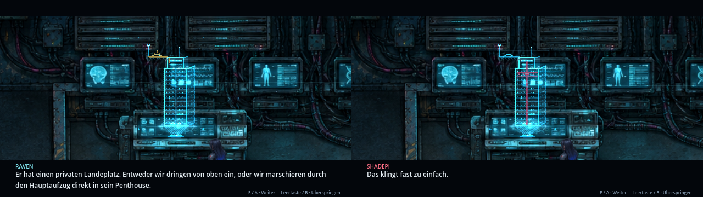
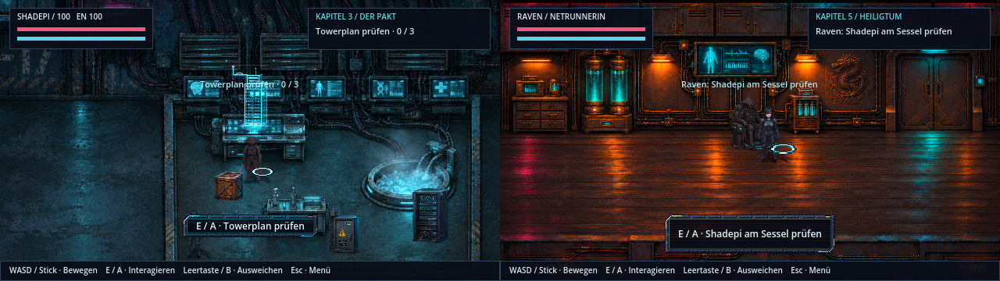
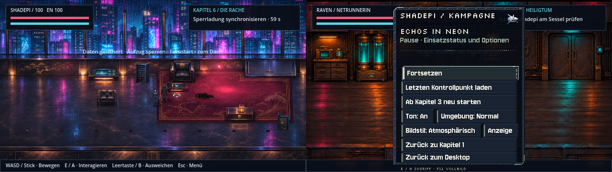
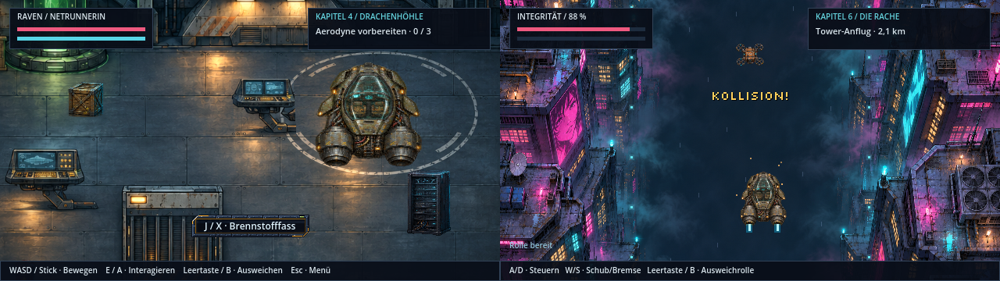

# Verbesserungen v0.48.0 · ClaudeHelper

**Stand 9. November 2026.** Umsetzung der Verbesserungsliste nach der Story-Durchsicht ([v0.47](story-durchsicht.md)). Story-Vorgaben für einen späteren zweiten Teil wurden bewusst **nicht** eingebaut. Alle neuen Grafiken sind einzeln gesetzte Pixel aus kleinen Materialrampen; Herstellungsskripte stehen im [Werkzeugkatalog](../tools/README.md).

## Kapitel 3: Pakt und Towerplan

- **Pakt in drei Gesprächsschritten.** Der frühere lange Textblock zwischen zwei stehenden Figuren ist aufgeteilt in Ravens Grenze, das gemeinsame Ziel und den Plan am Terminal.
  - Raven wendet sich beim Erzählen ab. Shadepis Fäuste ballen sich, die Servos surren.
  - Er bietet ihr Dienste oder Abschied an (Roman). Raven kehrt zurück und stupst gegen seinen Kasa: „Wir sind keine Freunde.“
- **Towerplan als Objekt.** Raven projiziert ein Pixel-Hologramm des Arasaka-Towers über ihre Hauptkonsole (`assets/story/tower-plan.png`, 4 Ebenen à 64×96). Es baut sich zeilenweise auf und flackert. Eine Abtastzeile läuft darüber, und die Projektion steht still, solange Pause oder Terminal offen sind.
- **Prüfschritte und Planbesprechung.** Jeder Prüfschritt hebt seine Ebene farbtreu hervor: Aufzug und Wachetage rot, Landeplatz bernstein, Scanner magenta. Die Planbesprechung zeigt jeweils auf das, worüber gerade gesprochen wird.
- Test: `tests/story_plan.gd` (15 Prüfungen, in CI).

## Interaktionshinweise

- **Pixelmarker statt Vektorgrafik.** Der frühere Vektorkreis mit Vektorpfeil ist durch einen Pixel-Bodenring mit drei Pulsbildern und einen Pixelpfeil ersetzt (`assets/ui/marker.png`). Cyan bedeutet bereit, Rot gesperrt bzw. warten.
  - Der Pfeil erscheint nur, solange das Ziel außer Reichweite ist.
  - Alle Kapitel teilen sich den Marker (`scripts/pixel_marker.gd`). Er wird in einer eigenen Ebene mit scharfer Abtastung gezeichnet.
- **Kompakte Aktionszeile.** Statt einer bildschirmbreiten flachen Leiste erscheint ein Pixel-Chip im Kapitel-Design, so breit wie sein Text.
  - Er nennt nur die Handlung. Zähler und „Raven:“-Präfix stehen schon im Missionsfeld.

## Tower-Flucht: Alarm aus echten Quellen

- Die rote Vollfläche und die Vektor-Bodenpfeile sind ersetzt.
- **Drei Wandbeacons** mit rotierendem Pixelreflektor (`assets/story/tower/alarm-lights.png`) erzeugen das Alarmlicht:
  - Sie werfen pulsierendes rotes Licht auf die Figuren.
  - Ihr Schein liegt auf der Wand, und ein Reflex wandert wie bei einer Rundumleuchte über Teppich und Marmor.
- **Eingelassene Boden-LEDs** leuchten als Lauflicht Richtung Dachausgang.
- **Aufzugtüren:** Beim Öffnen strahlt echtes Licht in den Raum (`scripts/tower_alarm.gd`).

## Umgebungsgeräusche

- Fünf leise, nahtlose 12-Sekunden-Loops, synthetisiert ohne Aufnahmen (`tools/ambient/generate_ambient.py`): Regen an Glas, ferne Stadt mit Sirene, Lüftung, See mit Grillen und Wasser, Netz-Drohne.
- Die Loops hängen an den vorhandenen Atmosphäre-Profilen, bis zu zwei Schichten pro Ort, mit weicher Überblendung beim Ortswechsel (`scripts/ambient_audio.gd`).
- **Eigene Stufe im Menü:** „Umgebung: Aus / Leise / Normal“, gespeichert neben dem Bildstil. Dafür teilen sich jetzt „Ton“ und „Umgebung“ eine Zeile, „Bildstil“ und „Anzeige“ die nächste.
- Test: `tests/ambient_audio.gd` (56 Prüfungen, in CI).

## Aerodyne

- Die Sichtprüfung zeigt: Hangar, Abflug, Flug, Dach und See verwenden inzwischen alle denselben Bronze-Rumpf. Codex hat das in v0.37–v0.39 vereinheitlicht.
- Übrig waren die weichen Vektorkreise der Düsen in Flug und Landung. Sie sind jetzt Pixel-Düsenstrahlen mit heißem Kern, Ionenmantel und flackernder Spitze, beim Bremsen orange.

## Technik

- GitHub Actions laufen auf Node 24: `checkout@v5`, `upload-artifact@v6`, `download-artifact@v7`.
- **Repository-Größe:** Der Verlauf wird nicht umgeschrieben, damit Klone und Zweige gültig bleiben.
  - [CONTRIBUTING](../CONTRIBUTING.md) zeigt schnelles Klonen (`--filter=blob:none` oder `--depth 1`).
  - Das Repository-Audit bremst neue Vorschaufilme über 5 MB.
- Neue Aufnahmewerkzeuge unter `tools/story/` für Towerplan, Marker, Alarm und Aerodyne-Ansichten.

## Prüfung

Alle 35 CI-Testsuiten (inklusive der beiden neuen) und das Repository-Audit laufen ohne Fehler. Die Bilder oben sind echte Godot-Aufnahmen dieses Stands.
