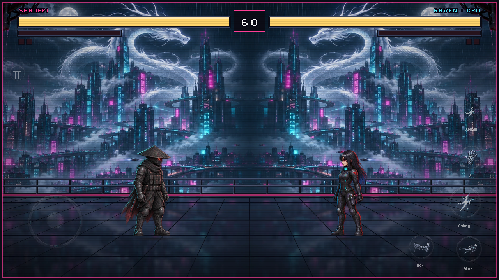
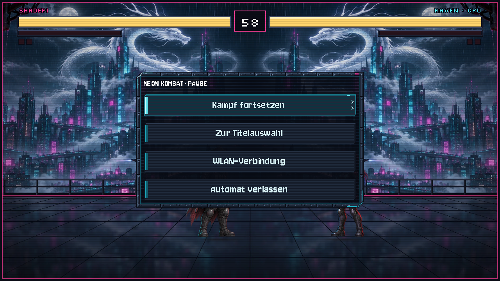
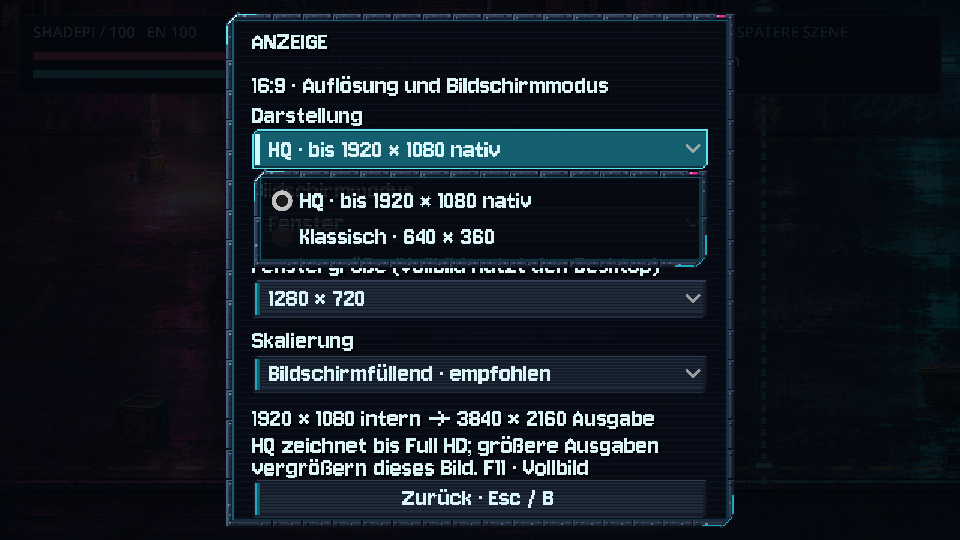

# Stabilität, Steuerung und Darstellung · v0.64.0 · CodexAI

**15. November 2026.** Umsetzung auf Basis des GitHub-Stands `6b6303d`; sämtliche Remote-Branches vor Arbeitsbeginn verglichen. Die [Gesamtanalyse v0.63.0](projektanalyse-v063.md) bleibt der historische Ausgangsbefund. Dieser Bericht beschreibt die tatsächlich umgesetzte erste Verbesserungsrunde. Story, Originalhelden, Grafikquellen, Sampling und Kapitel-Enums bleiben erhalten.

## Arcade bedienen und sicher pausieren

Der aus dem Hauptmenü geöffnete Automat besitzt jetzt sichtbare Touch-Steuerung, auch wenn das darunterliegende Hauptmenü die Welt weiterhin anhält. **Schlag, Kick, Spezial und Block** lösen ihre tatsächlichen Arcade-Aktionen aus; nach oben springen, links/rechts bewegen, OK bestätigt die Auswahl. Die nicht vorhandenen Story-Aktionen Aufladen/Hack werden im Automaten ausgeblendet. Außerhalb des Automaten wird Raven kein nicht verfügbarer Kick angeboten. Die zentrale Geräte-Reihenfolge wird nicht mehr numerisch umsortiert.

**Esc / Start** öffnet die eigene Arcade-Pause. „Kampf fortsetzen“ erhält die Runde, „Zur Titelauswahl“ beginnt die Auswahl neu und „Automat verlassen“ führt zur bisherigen Mission beziehungsweise zum Hauptmenü zurück. „WLAN-Verbindung“ öffnet die lokale Verwaltung. Bei Pause oder Peer-Verlust stehen Rundentimer, CPU, Kämpfer, Projektile und Schaden still. Es gibt kein verdecktes Pausenmenü unter einem weiterlaufenden Kampf.

[Kurzer Film aus dem nativen Linux-Spiel im Touch-Modus](previews/arcade-pause-v064.webp). Diese Bilder sind keine Aufnahme eines physischen Android-Telefons. Vorhandene Pixelrahmen, Schriften, Aktionsbilder und Figurenatlanten wurden wiederverwendet; keine neuen Figurengrafiken erzeugt.

## WLAN-Verbindung und Eingaben

- Der Peer wird nach dem ENet-Polling abgebaut. Ein ganzzahliger Sitzungszähler verwirft verspätete Trennsignale einer vorherigen Verbindung. Der Peer wird nicht als Argument an seinen eigenen Callback gebunden; dadurch entsteht kein RefCounted-Zyklus.
- Beide rechten Zielstickachsen werden endlichkeitsgeprüft übertragen, bei Kapitelwechsel erhalten und bei Timeout/Trennung/Fokusverlust freigegeben. Ravens Blick-/Schussrichtung kann damit dem Controllerziel folgen.
- Der Host überträgt den aktiven Eingabekontext. Der Client verwendet passende Arcade-/Story-Tasten. Ein inaktiver Touch-Stick sendet bei Kontextwechsel keine künstlichen Nullbewegungen, die eine Hardwareeingabe überschreiben würden.
- Protokollversion 2, Spielversion **v0.64.0 auf beiden Geräten** erforderlich. Es bleibt eine autoritative Host-Partie mit gemeinsamer Kamera, keine zweite Story-Simulation.

## Begrenztes gemeinsames Streambild

Die JPEG-Quelle ist ein eigenes **960×540- beziehungsweise 640×360-Renderziel**. Welt, gemeinsames HUD, Szenen und Menücanvases werden darin dargestellt. Lokale Host-Tasten und WLAN-Verwaltung bleiben lokal. Der Host behält seine eigene HQ-Anzeige, auch bei 4K-Ausgabe. Kameras, Physik, GUI-Fokus und Eingaben bleiben auf dem ursprünglichen Root-Viewport.

**Eingebettete Fenster werden ausdrücklich übernommen:** Ihre Texturen erscheinen über dem gemeinsamen Spielbild. Die bisher korrigierten Dropdowns werden dadurch nicht erneut unsichtbar.

Die native Pixelprüfung vergleicht mit/ohne lokale Host-Steuerung vor einem statischen gemeinsamen Prüfhintergrund. Dieser vermeidet Wetteränderungen durch Shader-TIME als falsches Vergleichssignal. Zusätzlich prüft sie sichtbare Dropdown-Pixel und beide Zielgrößen bei einem realen 4K-Fenster. Ein gesonderter Zwei-Prozess-Test bestätigt echten JPEG-Empfang und Touch-Fernsteuerung.

| Linux / llvmpipe, Warmmedian | Vorher v0.63.0 | Jetzt v0.64.0 |
| --- | ---: | ---: |
| 4K-Host: Bild vom Renderer lesen | 42,3 ms | 2,8 ms |
| 4K-Host: CPU-Verkleinerung | 11,2 ms | entfällt |
| 4K-Host: JPEG erzeugen | 9,0 ms | 8,1 ms |
| Hauptmenü: gemeldeter Texturspeicher | 481 MiB | 382 MiB |
| Nach Öffnen des Automaten | 619 MiB | 520 MiB |
| Gasse, HQ | 490 MiB | 391 MiB |

[Neue Rohmessungen](pruefungen/v064/messungen.json), [historische Vergleichsmessungen](analysen/v063/ergebnisse.json). Je Fenstergröße vier Zeitproben; erste Probe aus den Medianen ausgeschlossen. Der neue 4K-Warmmedian stammt aus dem zweiten Galerie-Durchgang. Das sind Software-Renderer-Messungen, **keine Handy-FPS oder Gesamt-RAM-Werte**. Die zusätzliche Renderarbeit des gemeinsamen Bildziels ist nicht Teil dieser Readback-/JPEG-Zeitstufen. 15/12 FPS, JPEG-Encoding und WLAN-Latenz bleiben Grenzen des Remoteplay-Verfahrens; keine Behauptung eines 60-FPS-Netzcodes.

`Painted.texture(key)` lädt die entsprechende Weltquelle beim ersten Gebrauch statt sämtliche Weltbilder bei Skriptimport vorzuhalten. Bereits geladene Bilder bleiben zunächst gecacht; vollständige Entladung, asynchrones Vorladen, weitere direkte Preloads und Mobil-VRAM-Profile bleiben spätere Leistungsarbeit. Die HQ-Dateien wurden nicht verkleinert, neu komprimiert oder geglättet.

## Verlässliche Kapitelstände und Tonwahl

Die Kapitel-CFGs benutzen einen gemeinsamen Speicherdienst: Zustand prüfen, temporäre Datei schreiben/flushen, validieren, letzte gültige Vorversion sichern und die neue Datei per Umbenennen einsetzen. Lesefehler, leere/abgeschnittene Dateien und ungültige Kernzustände führen zur geprüften `.bak`. Ein fehlgeschlagener temporärer Schreibvorgang ersetzt keinen gültigen Hauptstand; eine bereits beschädigte Hauptdatei überschreibt keine gültige Sicherung. Betriebssystem-/Datenträgerausfälle sind damit nicht vollständig ausgeschlossen.

Formatfeld 1 ergänzt die bestehenden Daten. Alte Dateien ohne Formatfeld bleiben lesbar; Solo-/Koop-Felder in Kapitel 1 und die gemeinsame Kapitel-2–7-Struktur bleiben erhalten. Die Kontrollpunktzeit wird monoton gegenüber vorhandenen Ständen fortgeschrieben, auch wenn die Geräteuhr zurückgestellt wurde. Test-Spielstände bleiben über die bisherigen separaten Pfade isoliert.

**Ton-Aus** ist eine Gerätepräferenz und bleibt bei Kapitelwechsel und Neustart erhalten. Sie gilt auch für Remote-Audio. Der lokale Tonknopf im WLAN-Fenster funktioniert unabhängig von der Einstellung des anderen Geräts. Der Remote-Generator wird leise weiter abgenommen, damit Stummschaltung keinen langen Audiostau aufbaut. Hörbare Latenz/Jitter auf realen Telefonen wurde hier nicht gemessen.

## Android-Build und CI

Windows-/Linux-Version und Android-Versionsname sind **0.64.0**, Android-Versionscode **6400**. Die lokale Test-APK nutzt den bereits vorhandenen Schlüssel außerhalb des Git; `build/android/signature.txt` enthält nur öffentliche Zertifikatsdaten. Ein ausdrücklich konfigurierter fehlender Schlüssel bricht den Build ab, statt unbemerkt eine neue Identität anzulegen.

Der Workflow kann eine dauerhafte Testidentität aus Repository-Secrets übernehmen:

| Secret | Inhalt |
| --- | --- |
| `SHADEPI_ANDROID_KEYSTORE_B64` | Base64 des vorhandenen Keystores, ausschließlich als Secret |
| `SHADEPI_ANDROID_KEYSTORE_USER` | Alias |
| `SHADEPI_ANDROID_KEYSTORE_PASSWORD` | Passwort |

Godot erhält `GODOT_ANDROID_KEYSTORE_DEBUG_PATH`, `GODOT_ANDROID_KEYSTORE_DEBUG_USER` und `GODOT_ANDROID_KEYSTORE_DEBUG_PASSWORD` über die Umgebung. Der entschlüsselte temporäre Schlüssel wird entfernt; er gehört weder ins Git noch in ein Artefakt. **Die dauerhafte CI-Signierung ist vorbereitet, aber hier nicht als eingerichtet abgenommen:** Der verfügbare GitHub-API-Zugang ist nicht gültig, daher konnten Secrets nicht eingerichtet oder überprüft werden. Ohne diese Secrets baut CI weiterhin eine ausdrücklich gekennzeichnete Testsignatur ohne Updategarantie. Ein zertifikatsgleiches Update über eine vorhandene Telefoninstallation mit erhaltenem Fortschritt bleibt abzunehmen; eine öffentliche Release-Signierung ist gesondert.

Die CI ergänzt die neuen Integrationstests, Host-zuerst-Abbruch und native Stream-/Popup-Pixelprüfung. Godot-Binärdatei und Exporttemplates werden versionsgebunden gecacht. Import erfolgt vor den Laufzeittests; lokale Daten, Schlüssel und Buildausgaben bleiben außerhalb Git.

## Prüfnachweis und offene Folgearbeiten

[Prüfübersicht mit Ergebnissen](pruefungen/v064/ergebnisse.json). 51 headless Prüfreihen mit **4.885 Prüfungen ohne Fehler** einschließlich neuer Integrationstests; zusätzlich native Stream-Pixel- und Zwei-Prozess-WLAN-Prüfungen. Die Arcade-Regression wurde an die neue bewusste Pausenbedienung angepasst und erneut ausgeführt. Beschädigter Primärstand, Backup, unzulässige Kernwerte, fehlender Zielordner, rückwärts laufende Uhr, Kapitelwechsel mit Ton-Aus, Touch-Auswahl/Kick/Spezial und eingefrorene Pause sind konkret geprüft. Windows/Linux exportiert, Linux-Export gestartet, Android-Test-APK gebaut und Signatur geprüft. Kein physischer Android-/Bluetooth-Test und kein vollständiger manueller Durchgang aller sieben Kapitel.

Offen bleiben individuelle Kampfprofile und Balance-Spieltests, konfigurierbare Touch-Layouts, reale Audio-/Latenzprofile, weitere Speicherbudgets und Entladung sowie das Aktualisieren des alten erzwungenen Story-Walk-Audits. Diese Vorschläge werden nicht als erledigt ausgegeben. Der bestehende Bildstil und die bestätigte Story wurden in dieser Runde nicht umgebaut.
