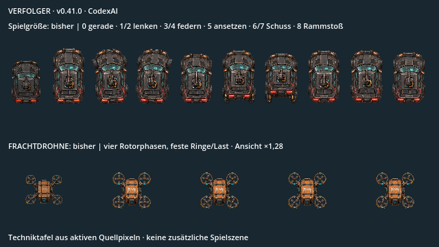
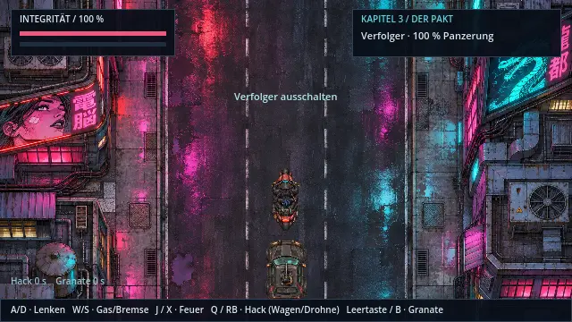
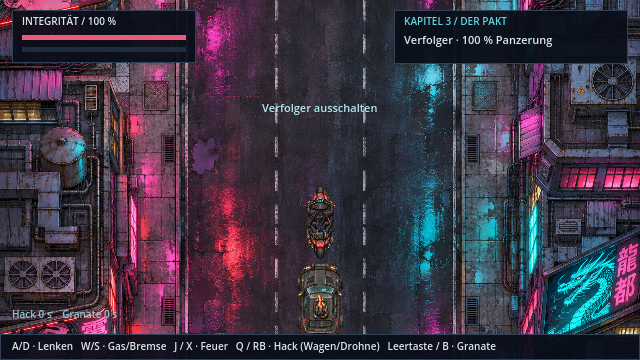
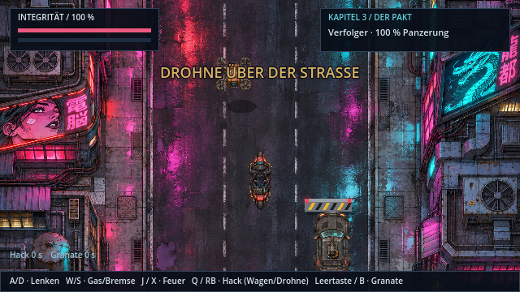
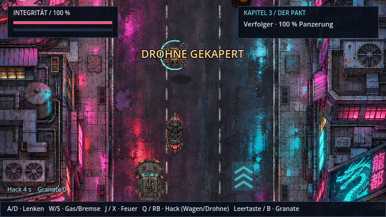
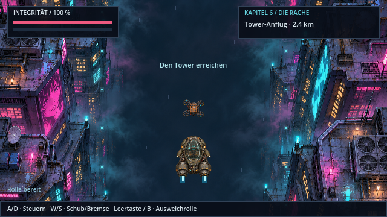

# Mehr Gewicht in der Verfolgung · v0.41.0 · CodexAI

Der Verfolgerwagen besitzt jetzt neun eigene Bilder: Geradeausfahrt, Links-/Rechtslenkung, Ein-/Rückfedern, Ansetzen zum Rammstoß, zwei Geschützphasen und Rammstoß-Rückfederung. Die Frachtdrohne erhält vier Rotorphasen. Ringe und Frachtkörper bleiben dabei an derselben Stelle.

Die Techniktafel verwendet tatsächliche Quellpixel. Oben stehen Wagenbilder in Spielgröße, unten Drohnenbilder um Faktor 1,28 vergrößert. Die erste Darstellung jeder Reihe ist der frühere Einzelbild-Bestand. Der folgende Film zeigt dagegen die tatsächliche Spielansicht:

In der Aufnahme werden alle neun Wagen- und alle vier Rotorbilder erreicht. QA-Gottmodus verhindert Schaden, die Verfolgerpanzerung wird für die Bildabnahme erhalten. Für den Hack setzt der Helfer das Motorrad unter das aktuelle Ziel und löst die bestehende Hack-Aktion aus. Der restliche Verkehr, Schüsse, Minen und Flugbewegungen laufen durch die tatsächliche Fahrintegration. Das ist kein behaupteter vollständig erspielter Verfolgungssieg. Die Wiedergabe nutzt reale Aufnahmeabstände.

| Geschütz mit Pixel-Mündungsfeuer | Drohne in der Spielansicht |
| --- | --- |
|  |  |

Das Mündungsfeuer sitzt am sichtbaren Lauf der jeweiligen Geschützpose. Auch beide Geschosse des beschädigten Wagens verlassen diesen Punkt, bevor der zweite Schuss auffächert. Trefferwerte, Schussintervalle und Verfolgungsmuster bleiben erhalten; der Ursprung und der sichtbare Fächerweg sind korrigiert. Minen und ihr Abwurfimpuls beginnen am hinteren Frachtkontakt.

| Gehackte Drohne | Gleiche Quelle im Aerodyne-Flug |
| --- | --- |
|  |  |

**Bedienung:** Lenken wie bisher mit A/D oder Stick, Hack mit Q/RB in Reichweite. Der Controller-Hack bleibt erhalten. Esc/Start pausiert auch Rotorlauf und Geschützrückstoß. Laden beginnt mit sauberem vorübergehendem Fahrzeugzustand; beim Kapitelwechsel bleiben keine Schuss- oder Rotorobjekte hängen.

[Quellen, Raster und Kontakte](../assets/vehicles/pursuit/README.md) · [Prüfungen, Export und Grenzen](arbeiten/verfolger-v041.md) · [Cinema-Roadmap](cinema-roadmap.md).
