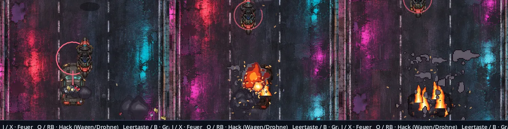

# Verfolgung: Finale und Zerstörung · v0.56.0 · ClaudeHelper

**11. November 2026.** [Bildgalerie](README.md) · [Spieleranleitung](../Spiel-README.md) · [Versionshinweise](../CHANGELOG.md).

Nutzerbericht vom 11. November 2026: Am Ende der Motorrad-Verfolgung fuhr der besiegte Wagen einfach weiter, dann begann ohne Übergang die Garage.

## Ablauf nach dem letzten Treffer

| Zeit | Geschehen |
| --- | --- |
| 0 s | Treffer-Explosion auf der Haube, „VOLLTREFFER!“. Drohnen und Minen im Bild explodieren. |
| 0–0,9 s | Der Wagen brennt, schlingert führerlos, kleine Folgeexplosionen laufen über die Karosserie. |
| 0,9 s | Große Explosion mit Lichtblitz, Blechteile fliegen. „WEG FREI · ZUR GARAGE“. |
| danach | Das ausgebrannte Wrack dreht sich aus und fällt hinter dem Motorrad aus dem Bild. Nach 4,6 s beginnt die Garage. |

## Der Wagen und die Straße

- Baken, die der Wagen trifft, zerbersten in Betonbrocken und Lampensplitter. Sie schaden ihm nicht.
- Rammt er ein brennendes Wrack, explodiert es und kostet ihn 6 % Panzerung. Wer den Wagen in ein Wrack lockt, spart Munition.

## Technik

- `scripts/campaign_drive.gd`: `_destroy_car()`, `_advance_car_wreck()`, `car_smash()`, `chunks()`. Die Effekte liegen auf der Kindebene `DriveFX` mit harter Abtastung.
- Pixelblätter in `assets/fx/drive/` und `assets/vehicles/pursuit/wreck.png`, erzeugt mit `python3 tools/fx/build_drive_fx.py` (feste Zufallswerte, wiederholbar).
- Prüfungen: `tests/drive_action.gd` (Bake, Wrack, Nachbarspur), `tests/run.gd` (Brand, Explosion, Wrack fällt zurück, danach Garage).
