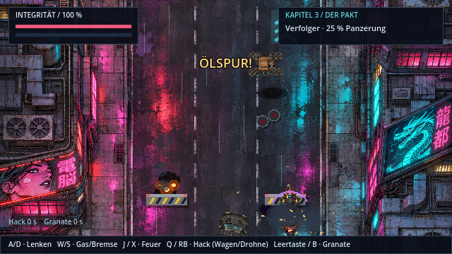
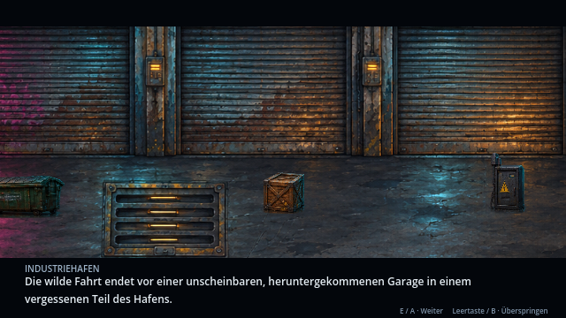

# Motorrad-Verfolgung und Garageneinfahrt (v0.20.0)

**Steuerung:** A / D lenken frei über die ganze Fahrbahn · **W / S Gas und Bremse** (nach vorn und zurück fahren) · J / X Ravens Schüsse nach hinten · Q / RB Hack · Leertaste / B Granate.

## Fahren und Taktik

- **Frei lenken:** keine festen Spuren mehr; träge Lenkung mit Funkenflug, wenn man am Bordstein entlangschrammt.
- **Nach vorn fahren** erhöht das Tempo (Straße, Tempolinien) und bringt Abstand zum Verfolger: Rammstöße erreichen dich dann nicht. Dafür bleibt weniger Reaktionszeit für Hindernisse, und Ravens Hack auf den Wagen braucht Nähe (unter 170 px).
- **Zurückfallen** bringt dich in Hack- und Granatenreichweite, aber in Rammgefahr.

## Straßenobjekte im Spielstil

| Objekt | Wirkung |
| --- | --- |
| Betonbarriere mit Warnstreifen und Blinklichtern | 24 Schaden |
| Brennendes Autowrack (Rauch, Flammen) | 28 Schaden, einmalig |
| Ölspur | Kein Schaden, das Hinterrad schlingert 1,1 s |
| Neon-Turbostreifen | 1,8 s Turbo (schneller, unverwundbar), +6 Integrität |
| Drohnenmine | 20 Schaden; trifft sie den Wagen, verliert er Panzerung |

## Drohnen

Kampfdrohnen fliegen über die Straße, folgen dem Motorrad und werfen drei Minen ab. **Q / RB unter einer Drohne kapert sie:** Raven lenkt sie in den Verfolger (−18 Panzerung). Ab 50 % Panzerung kommen zwei Drohnen gleichzeitig und der Wagen schießt doppelt.

## Ende: Einfahrt in die Garage

Ist der Verfolger zerstört, gibt die Straße den Weg frei. Kapitel 4 beginnt vor der Garage: Das mittlere Rolltor fährt hoch, das Motorrad rollt herein und parkt auf der Hebeplattform. Shadepi und Raven steigen ab, das Tor schließt sich. **Das Motorrad bleibt auf der Plattform stehen** und ist ein festes Hindernis; das Zugangsterminal liegt links daneben.

Grafik: `assets/world/hq/bike-parked.png` (Motorrad ohne Fahrer) wird mit `python3 tools/compose_parked_bike.py` aus dem vorhandenen HQ-Fahrzeugatlas erzeugt. Vorschau aller Abschnitte: `xvfb-run godot --rendering-driver opengl3 --script res://tools/chase_gallery.gd`.
